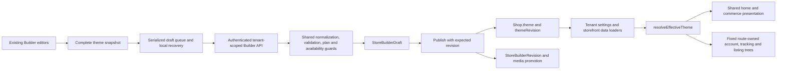

# Adaptive Full-Site Store Builder — Architecture Audit

**Date:** 20 October 2026, Asia/Dhaka. **Status:** investigation only; no implementation or release approval.

Source revision inspected: `54a04b6d34939dab3b9cc6f0139a753116edbd32`. The working tree was clean at the start of this investigation. Only the three requested planning documents are deliverables. No application code, theme definition, environment setting, database record, commerce API, dependency or deployment was changed.

Companions: [system design](C:/Users/user/WebstormProjects/Shop-for-all/ADAPTIVE_BUILDER_SYSTEM_DESIGN.md) and [implementation roadmap](C:/Users/user/WebstormProjects/Shop-for-all/ADAPTIVE_BUILDER_IMPLEMENTATION_ROADMAP.md).

## 1. Executive finding

The platform already has a useful **shared presentation and publication foundation**, but it is not a full-site block editor. Homepage sections are configurable records; most other pages remain fixed React component trees. Five preview choices do not represent five independently configurable page templates.

The smallest safe evolution is **versioned, constrained page templates with compatible blocks, typed design settings and protected commerce components**, implemented inside the existing theme package, renderer, Builder and publication service. Full freeform HTML/CSS/JavaScript editing is neither necessary nor appropriate for this platform.

Existing commerce controllers, hooks, sessions and APIs must remain authoritative. A configurable page arranges or styles approved views; it never defines prices, permissions, required checkout fields, OTP rules, order-access tokens or return eligibility.

## 2. Evidence and limits

Reviewed the relevant `AGENTS.md`, the theme contract/registry/resolver/capabilities, shared renderer and presentation components, Builder editors/preview/persistence hooks, storefront routes/controllers, backend Builder routes/services/models/media lifecycle, and these existing documents:

- [Functional inventory](C:/Users/user/WebstormProjects/Shop-for-all/STOREFRONT_RAW_STRUCTURE_AND_FUNCTIONAL_INVENTORY.md), especially route inventory, element ledger, functional contracts and known gaps.
- [Core anatomy audit](C:/Users/user/WebstormProjects/Shop-for-all/STOREFRONT_CORE_ANATOMY_AUDIT.md).
- [Atelier implementation plan](C:/Users/user/WebstormProjects/Shop-for-all/NEW_THEME_IMPLEMENTATION_PLAN.md), [component mapping](C:/Users/user/WebstormProjects/Shop-for-all/NEW_THEME_COMPONENT_MAPPING.md), and [regression matrix](C:/Users/user/WebstormProjects/Shop-for-all/NEW_THEME_REGRESSION_MATRIX.md).
- [Implementation history](C:/Users/user/WebstormProjects/Shop-for-all/track.md), including later rollout and Vite cache corrections.

**Evidence distinction:** source observations below were checked during this task. Test counts, database results and browser restrictions in `track.md` are historical evidence, not freshly reproduced acceptance. No application tests, builds, browser interactions, live commerce calls or database operations were run for this documentation-only investigation. No performance or accessibility score was measured. Reading the installed Next.js guides remains mandatory before any future Next.js code change, as required by `ecommerce-storefront/AGENTS.md`.

Older inventory/planning documents refer to nine themes because they predate Atelier. Current source has **ten definitions: nine active registry entries and a hidden Atelier entry exposed through trusted availability**. `track.md` records the user's subsequent authorization of local availability across existing Builder-enabled plans. That is not evidence of a remote production rollout, and it does not authorize rollout of this proposed adaptive format.

## 3. Current architecture and lifecycle

### Existing sources of truth

| Concern | Existing owner | Consequence for the proposed Builder |
|---|---|---|
| Theme schema/defaults/merge | `packages/storefront-theme/index.cjs`, ESM facade `index.mjs` | Extend this contract; do not create a second independently normalized configuration. |
| Effective plan/branding/policy resolution | `effective.cjs` plus backend `effectiveThemeService.js` | Same pure resolution for preview and live output; tenant/database I/O stays in server adapters. |
| Theme identities | `preset` provenance, homepage composition, optional `presentationVariant` | These have different jobs. A new page-template assignment must not be inferred from a preset ID or homepage composition. |
| Homepage layout | `composition.cjs`, `reference/StorefrontComposition.jsx` | Preserve standard/discovery/editorial/boutique slot rules until a merchant explicitly adopts a new page template. |
| Shared views | `packages/storefront-renderer/reference/` and `presentation/` | Reuse views and primitives. Rendering a new template must not duplicate transaction logic. |
| Stateful commerce | Storefront pages, contexts and hooks | Keep state, authority, API calls, idempotency and token binding here. |
| Publication | `storeBuilderService.js`, draft/revision models | Extend the existing whole-site revision; do not add independent page publications in the MVP. |

## 4. Existing capability versus the product vision

| Capability | Existing, source-verified | Missing/proposed |
|---|---|---|
| Homepage sections | Add, duplicate, move up/down, delete, lock, show/hide, type-specific editors; up to 30 saved dynamic sections | Page-compatible section lists on other routes; safe nested blocks. |
| Section catalog | 13 registered types; 10 editor-enabled types; 11 library presets, with some presets sharing a type | A page/block compatibility manifest and typed child slots. `Collection`, `CollectionShowcase`, `BrandShowcase` are registered but not enabled in the section-type editor. |
| Hero/catalog | Dedicated hero slides and catalog settings outside `homepageSections` | Explicit adapters for these special regions; do not pretend they are already arbitrary blocks. |
| Design | Shared color groups, fonts, cards, width/spacing presets and numeric shared section spacing | Per-page/node/part style records, explicit responsive inheritance and targeted reset. |
| Responsive | `mobile`, catalog columns, desktop/mobile section settings, hero media/focal points | One coherent per-property base/tablet/desktop contract; per-element constraints. |
| Selection | Homepage editor IDs, section overlays and sidebar selection | Stable selection IDs for every editable page region and approved element part. |
| Preview | Home, product, cart, checkout and one policy-detail preview | Category, collection, account states, tracking states, policy index, broader empty/error states and safe fixture selection. |
| Preview viewport | Separate document iframe; desktop 1180, tablet 768, mobile 390, small mobile 320 CSS pixels | Additional validation widths, safe state simulation and inspector parity across all routes. |
| Drafts/history | One tenant draft, local recovery, serialized writes, 30 undo snapshots, explicit publish and retained revisions | Page/block-aware summaries and validation paths; larger-document performance controls. |
| Reuse | Theme presets and reusable React components | Merchant-saved section copies, page templates and style presets. No linked merchant block library exists. |
| Modes | Existing editors and advanced color choices | Quick Edit / Design / Advanced as different views of the same authorized commands. |
| Validation | Theme version, variants, URLs, selected limits, plan boundaries and media checks | Required core slots, graph validity, typed styles, responsive constraints and whole-site reference checks. |

`Newsletter` is currently informational text/icon presentation, not a signup form. “Collection Grid” in the homepage library is a category layout, not collection assignment. A dedicated `/signup` tenant page is commented out; registration is an `/account` state. These must not be counted as capabilities already implemented.

## 5. Page-by-page customization and protection matrix

**MVP** below is the recommended new scope, not existing functionality. A “protected core” is the existing functional component/controller with a bounded style surface. It is not merchant-authored markup. Optional content remains removable; required and conditionally required elements remain system-controlled.

| Page / scope | Current reusable regions | Protected elements and behavior | Recommended MVP | Later expansion / constraint |
|---|---|---|---|---|
| **Global header** | Shared header, brand, navigation, desktop/mobile menus, search/account/cart/tracking utilities | Correct tenant identity; cart count; menu/search state; functional utility destinations; eligibility-controlled badges | Shared template and approved content/navigation/style controls; utility group retained | Compatible nested navigation/branding slots; retain usable mobile menu/search and keyboard behavior. |
| **Global footer** | Shared footer, merchant/support/social/policy links, credit and bottom navigation | Mandatory policy access and plan-controlled platform branding; correct destinations | Shared template, content/style controls and optional groups | Additional bounded columns/blocks. Uploaded-logo/newsletter/payment-icon features are not currently present. |
| **Home** `/` | Shared hero, composition, section renderer, catalog, cards | Product prices/stock/actions; catalog data/filter/page state; campaign eligibility; required shell utilities | Richest initial section/block editing: existing sections plus bounded decorative text/image/button groups; retain hero/catalog adapters | More nested groups only after constraints work. Existing composition slot placement is not unrestricted list order. |
| **Product** `/products/{id}` | `ProductDetailsView`, gallery, info, variants, actions, information tabs, reviews, related products | Actual product identity/price/availability; variant selection when required; quantity bounds; add/buy; review submission authorization | Style approved parts of the existing product core; arrange compatible content before/after it | Later expose gallery/info/tab slots through narrowly extracted views. Never let merchant text replace authoritative price or availability. |
| **Category** `/categories/{slug}` | Category heading/media, listing cards, filters, chips, sort, pagination | Current category identity; URL/query semantics; eligible product results; product actions; pagination/reset when needed | Style existing listing core; add content around it; shared template for all categories | Optional tenant-owned category/template assignment later. Category client is not already a pure shared listing view. |
| **Collection** `/collections/{slug}` | Collection heading/media/description, cards, sort, pagination | Current collection identity/membership, results and product actions | Same bounded listing-core strategy, keeping its actual supported control set | Do not invent category-style filters. Per-collection templates are later. |
| **Cart** `/cart` | Shared `CartView`, items, quantity/remove, coupon draft, totals, recommendations, empty state | Tenant-keyed cart; item/variant identity; zero-price semantics; quantity/removal; total derivation; checkout path | Style-only core and compatible surrounding optional content; explicit empty/filled preview | Later approve internal summary/item slots. Cart coupon is saved for checkout validation; it is not authoritative discount approval. |
| **Checkout** `/checkout` | Shared shell, details, order summary, trust/branding, marketing consent, OTP modal, mobile submit, empty/success states | Required fields, area selection, server totals, policy consent, separate optional marketing opt-in, OTP, disabled/busy/error states, idempotent submit and actual order result | Atomic checkout core; bounded palette/type/surface/width styles and surrounding slots approved for checkout | Field restructuring requires its own acceptance gate. No editable payment/shipping provider configuration, OTP tree, required flags or submit action. |
| **Login / registration / recovery** `/account` states | `AuthView`, `PasswordResetFlow`, existing account handler | Session, tenant/audience/role routing, credentials, OTP limits and expiry, reset token, password rules, feedback | Bounded styling of existing states; safe decorative companion area; synthetic read-only state previews first | Interactive fixtures need explicit safe I/O seams. No independent login/signup service or new `/signup` route. |
| **Customer account** `/account` authenticated states | Dashboard, order history/expanded rows, read-only profile, security tab; separate vendor view | Own-order access; session/logout; password API; role branch; conditional state | Page/core styling and optional static content; no real customer records in Builder previews | Internal tab/order-card slots later. `SecurityTab` owns API calls; it is not already a passive preview component. |
| **Tracking / after-sale** `/track` | Existing lookup/OTP, verified order regions, progress, items, cancel/return modals | Order ID + delivery phone verification; access token; no private results before verification; `canCancel`/return eligibility; reason/proof validation | Style existing protected regions; synthetic states and disabled actions; avoid extracting the large controller wholesale | Later, small view seams for chosen panels. Never make a preview send OTP, cancel an order or upload return proof. |
| **Policies index** `/policies` | Existing server page, contents navigation, all four policy bodies/links | Actual policy content/defaults; accessible contents and supported destinations | Shared template around the existing policy contents/body core; spacing/type/style controls | Small shared index view only when needed, preserving server data/metadata handling. |
| **Policy detail** `/policies/{type}` | Shared `PolicyView`, route-level valid-type/content loading | Supported policy types, full body/defaults, navigation and 404 behavior | Style the existing body/navigation core; optional surrounding content | Per-policy style variants later; text authority stays in existing `theme.policies`. |
| **Global overlays and route states** | Variant picker, search modal, analytics consent, toasts, loading/empty/error states | Consent semantics, focus/escape, safe product selection, disabled actions and accurate errors | Registry-defined style parts and synthetic state coverage; no free movement/deletion of system overlays | These are system state surfaces, not ordinary optional page sections. Unknown tenant/error routes remain neutral. |

Platform landing/login/legal pages, SEO handlers, API proxy routes and nonexistent tenant pages are outside the new tenant Builder scope.

## 6. IDs, schema and layout facts that constrain the design

1. **Format:** `THEME_SCHEMA_VERSION = 4`; `Shop.theme` is an explicitly declared nested Mongoose schema. Draft/revision `theme` values are Mixed, but this does not make the published schema permissive.
2. **Section identity:** persisted section `id` is used by `section:{id}` selection; older `section-{index}` selection is still accepted. New nested IDs must remain stable through reorder, selection, undo and save; array indexes cannot become their identity.
3. **Structural duplication:** the homepage has separate hero, flexible sections and all-products settings. Converting only `homepageSections` does not convert the entire home page.
4. **Merge:** objects merge recursively; arrays replace wholesale. Missing fields inherit; explicit false/zero/empty values have defined meaning. A new graph must not accidentally use partial-array merges or infer edit intent from normalized legacy snapshots.
5. **Bounds:** legacy sanitizer nesting limit 12, arrays 100 entries, objects 200 entries; homepage sections 30; selected product IDs 50; hero slides 5. Backend JSON request limit is 1 MB. A rich page tree can be truncated or archived by current logic if merely inserted as an unknown field.
6. **Unknown configuration:** unknown root fields can be archived under `extensions.unknown`; undeclared strict-schema paths under `extensions.schemaFields`. Archives are compatibility data, excluded from public effective output, not an executable extension mechanism.
7. **Capabilities:** shared rules already classify safe/structural/identity/responsive controls and enforce full/limited/none access. Required-block, child-slot and typed element-style rules do not yet exist.
8. **Theme layout:** homepage slot composition and Atelier `presentationVariant` are independent. Atelier deliberately controls some structures. Extensive new editing must be explicit per-page adoption, never a side effect of reading any of the ten presets.

## 7. Component reuse plan

| Existing area | Reuse decision | Necessary future seam |
|---|---|---|
| `storefront-theme` resolver/capabilities | Extend in place; CJS and ESM stay identical | Version-aware page graph validator, page/block manifest, typed style resolver and public projection. |
| Home/sections/composition | Keep current branch unchanged for unassigned pages | Adapters that reuse current section views and respect adopted template slots. |
| `ProductDetailsView` and product primitives | Strong reuse candidate | Registry-defined style parts; narrowly approved optional slots, with controller props unchanged. |
| `CartView`, `CheckoutSections`, `PolicyView` | Reuse existing presentation and callbacks | Protected core adapters and bounded part styles; no new commerce hooks. |
| Category/collection clients | Keep route/query/action owners | Small presentation seams only where inspector/preview cannot otherwise share a region. |
| Account and tracking | Preserve their existing controllers, state and APIs | Incremental view/part markers or injectable preview I/O boundaries; do not rewrite entire pages for preview convenience. |
| `PresentationRuntime` | Reuse Link/Image abstraction | Continue preview-safe links/media and live Next.js adapters; not a second theme provider. |
| Builder shell/sidebar/inspector | Reuse drawers, selection and lazy panels | Page selector, compatible block tree, contextual typed controls and state selector. |
| Autosave/history | Reuse serialized queue and whole-theme revision | ID-based edits, grouped interactions and targeted error paths; benchmark before replacing snapshots. |
| Assets/cache/SEO publication | Extend existing services | Graph-aware media references, all-page invalidation and preservation of adaptive data during SEO-only writes. |

## 8. Architecture risks and required responses

These are source-backed design constraints and prospective failure paths, **not claims of a newly exploited vulnerability**.

| Priority | Observation / source | Risk if ignored | Required response |
|---|---|---|---|
| Critical | Functional controls are currently owned by route controllers/hooks and backend APIs | A generic editable tree could remove consent, fabricate price, bypass OTP UX or expose order data | Protected cores and server-owned conditions/actions; no action expressions or security fields in merchant JSON. |
| High | Schema v4 allowlist + strict Shop model + compatibility archive | New templates disappear into archives or are dropped; older Admin saves erase new pages | Explicit next-version support and old-writer fencing before any adaptive publication. |
| High | `assertThemeAssetOwnership` scans known URLs; cleanup uses hardcoded current theme paths | Nested/global/library media can miss ownership/promotion/cleanup checks | One typed graph reference collector, tenant checks, published/draft/library references and retained-revision media policy before adding uploads. |
| High | Retired media grace is 7 days; revision retention is 20 records; cleanup does not inspect retained revisions | An older retained revision may refer to a deleted asset | Pin retained-revision assets or prevent silent restore; establish durable export/backup. Existing revisions are not automatically durable media backups. |
| High | Preview uses parent React portals into a script-disabled same-origin iframe | Portal event handlers can still call parent-imported functions; sandbox alone is not a no-side-effect guarantee | No-op/fixture action adapters and outbound-write rejection in tests; do not mount live account/tracking controllers with their API imports. |
| High | Publish supports real transactions and a compensating standalone path | Larger multi-page/library/media changes increase partial-publication exposure | Require transaction-capable MongoDB for new-format publication; keep existing v4 behavior unchanged. Verify rollback and media reference atomicity. |
| High | Multiple live entry points consume the effective theme; mixed Vite caches recently caused import failures | Preview/live drift and unsupported mixed deployments | Reader-first coordinated rollout; package export/dev-cache tests; explicit schema compatibility and full-entry import checks. |
| Medium | Per-element overrides multiply document size; undo saves complete snapshots | Browser memory, API latency and whole-site lost-update risk | Bounded graph/bytes, grouped edits, lazy state fixtures and retained CAS conflict handling; no premature collaboration engine. |
| Medium | Existing URL/text sanitization is not a structured style validator | Arbitrary CSS-like data could hide controls or load unwanted resources if spread into DOM styles | Typed property allowlists and compiler-owned CSS variables; no raw style strings, selectors, scripts, HTML or bindings. |
| Medium | Desktop/tablet/mobile paths currently vary by component | Changing breakpoint/merge rules can change all ten themes | New responsive rules only on opted-in templates; legacy CSS and resolution remain unchanged. |

## 9. Performance implications

**Observed architecture, not measured performance:** whole-theme drafts, JSON snapshots and up to 20 revision documents grow with every page. Gallery currently resolves/render-previews multiple themes, and preview frames clone Admin stylesheet nodes. Published settings, server fetch caches, backend cache entries and revision watchers already form multiple cache layers.

The design should therefore resolve only the active page plus its global templates, batch referenced product/category/media reads, and cache only public plans with tenant/revision/page/entitlement keys. Private account/order data and draft configurations must never enter shared public caches. Reuse current image optimization and bundled fonts. Avoid per-node fetches, runtime stylesheet injection per keystroke, duplicate global templates in each page, or shipping the entire merchant library to every storefront route.

Set measured budgets during the baseline phase; the proposed numeric document/graph limits in the design are initial engineering limits, not performance results. Responsive correctness, accessibility and mobile interaction still require actual browser testing.

## 10. Conclusion

Proceed with an opt-in, versioned extension of the existing system. Preserve the ten definitions and every unassigned legacy page. Start with baseline protection, then a pure page/block contract and protected-core adapters. Expand design control only where the shared component and backend validator can enforce it. Do not begin by replacing checkout, authentication, tracking, the theme provider or publication infrastructure.

## Source index

Repository-relative names in tables refer to these inspected files; links below are absolute workspace references.

- [Theme schema, registry and limits](C:/Users/user/WebstormProjects/Shop-for-all/packages/storefront-theme/index.cjs:6), [merge](C:/Users/user/WebstormProjects/Shop-for-all/packages/storefront-theme/index.cjs:755), [validation](C:/Users/user/WebstormProjects/Shop-for-all/packages/storefront-theme/index.cjs:975), [asset extraction](C:/Users/user/WebstormProjects/Shop-for-all/packages/storefront-theme/index.cjs:1090).
- [Effective resolution](C:/Users/user/WebstormProjects/Shop-for-all/packages/storefront-theme/effective.cjs), [capabilities](C:/Users/user/WebstormProjects/Shop-for-all/packages/storefront-theme/capabilities.cjs:54), [composition](C:/Users/user/WebstormProjects/Shop-for-all/packages/storefront-theme/composition.cjs), [ten-theme registry](C:/Users/user/WebstormProjects/Shop-for-all/packages/storefront-theme/prebuilt.cjs:492).
- [Builder page](C:/Users/user/WebstormProjects/Shop-for-all/ecommerce-admin/src/pages/dashboard/StoreBuilder/StoreBuilderPage.jsx), [section editor](C:/Users/user/WebstormProjects/Shop-for-all/ecommerce-admin/src/pages/dashboard/StoreBuilder/editors/DynamicSectionsEditor.jsx), [editor IDs and presets](C:/Users/user/WebstormProjects/Shop-for-all/ecommerce-admin/src/pages/dashboard/StoreBuilder/storeBuilderConstants.jsx).
- [Preview modes](C:/Users/user/WebstormProjects/Shop-for-all/ecommerce-admin/src/pages/dashboard/StoreBuilder/hooks/usePreviewMode.js), [preview selection](C:/Users/user/WebstormProjects/Shop-for-all/ecommerce-admin/src/pages/dashboard/StoreBuilder/StorefrontPreview.jsx), [iframe](C:/Users/user/WebstormProjects/Shop-for-all/ecommerce-admin/src/pages/dashboard/StoreBuilder/StorefrontPreviewFrame.jsx), [commerce preview](C:/Users/user/WebstormProjects/Shop-for-all/ecommerce-admin/src/pages/dashboard/StoreBuilder/PreviewCommercePages.jsx), [draft queue](C:/Users/user/WebstormProjects/Shop-for-all/ecommerce-admin/src/pages/dashboard/StoreBuilder/hooks/draftWriteQueue.js), [autosave](C:/Users/user/WebstormProjects/Shop-for-all/ecommerce-admin/src/pages/dashboard/StoreBuilder/hooks/useAutosaveRecovery.js).
- [Builder routes](C:/Users/user/WebstormProjects/Shop-for-all/ecommerce-backend/backend/routes/storeBuilderRoutes.js), [controller/cache handling](C:/Users/user/WebstormProjects/Shop-for-all/ecommerce-backend/backend/controllers/storeBuilderController.js), [normalization](C:/Users/user/WebstormProjects/Shop-for-all/ecommerce-backend/backend/services/storeBuilder/storeBuilderService.js:86), [draft](C:/Users/user/WebstormProjects/Shop-for-all/ecommerce-backend/backend/services/storeBuilder/storeBuilderService.js:261), [publication](C:/Users/user/WebstormProjects/Shop-for-all/ecommerce-backend/backend/services/storeBuilder/storeBuilderService.js:337), [restore](C:/Users/user/WebstormProjects/Shop-for-all/ecommerce-backend/backend/services/storeBuilder/storeBuilderService.js:573).
- [Shop schema](C:/Users/user/WebstormProjects/Shop-for-all/ecommerce-backend/backend/models/Shop.js), [draft model](C:/Users/user/WebstormProjects/Shop-for-all/ecommerce-backend/backend/models/StoreBuilderDraft.js), [revision model](C:/Users/user/WebstormProjects/Shop-for-all/ecommerce-backend/backend/models/StoreBuilderRevision.js), [compatibility archive](C:/Users/user/WebstormProjects/Shop-for-all/ecommerce-backend/backend/services/storeBuilder/themeCompatibilityService.js), [asset lifecycle](C:/Users/user/WebstormProjects/Shop-for-all/ecommerce-backend/backend/services/storeBuilder/storeBuilderAssetService.js), [availability](C:/Users/user/WebstormProjects/Shop-for-all/ecommerce-backend/backend/services/storeBuilder/themeAvailabilityService.js).
- [Shared home](C:/Users/user/WebstormProjects/Shop-for-all/packages/storefront-renderer/reference/StorefrontHome.jsx), [section renderer](C:/Users/user/WebstormProjects/Shop-for-all/packages/storefront-renderer/reference/StorefrontSectionRenderer.jsx), [design tokens](C:/Users/user/WebstormProjects/Shop-for-all/packages/storefront-renderer/designTokens.js), [viewports](C:/Users/user/WebstormProjects/Shop-for-all/packages/storefront-renderer/viewports.js), [presentation runtime](C:/Users/user/WebstormProjects/Shop-for-all/packages/storefront-renderer/presentation/Runtime.jsx).
- [Product controller](C:/Users/user/WebstormProjects/Shop-for-all/ecommerce-storefront/src/components/product/ProductDetails.jsx), [product view](C:/Users/user/WebstormProjects/Shop-for-all/packages/storefront-renderer/presentation/ProductDetailsView.jsx), [category client](C:/Users/user/WebstormProjects/Shop-for-all/ecommerce-storefront/src/app/[subdomain]/categories/[slug]/CategoryPageClient.jsx), [collection client](C:/Users/user/WebstormProjects/Shop-for-all/ecommerce-storefront/src/app/[subdomain]/collections/[slug]/CollectionPageClient.jsx).
- [Cart controller](C:/Users/user/WebstormProjects/Shop-for-all/ecommerce-storefront/src/app/[subdomain]/cart/page.jsx), [cart view](C:/Users/user/WebstormProjects/Shop-for-all/packages/storefront-renderer/presentation/CartView.jsx), [checkout controller](C:/Users/user/WebstormProjects/Shop-for-all/ecommerce-storefront/src/app/[subdomain]/checkout/page.jsx), [checkout views](C:/Users/user/WebstormProjects/Shop-for-all/packages/storefront-renderer/presentation/CheckoutSections.jsx).
- [Account controller](C:/Users/user/WebstormProjects/Shop-for-all/ecommerce-storefront/src/app/[subdomain]/account/page.jsx), [account components](C:/Users/user/WebstormProjects/Shop-for-all/ecommerce-storefront/src/components/account/CustomerTabs.jsx), [tracking controller](C:/Users/user/WebstormProjects/Shop-for-all/ecommerce-storefront/src/app/[subdomain]/track/page.jsx), [policy index](C:/Users/user/WebstormProjects/Shop-for-all/ecommerce-storefront/src/app/[subdomain]/policies/page.jsx), [policy detail](C:/Users/user/WebstormProjects/Shop-for-all/ecommerce-storefront/src/app/[subdomain]/policies/[type]/PolicyPageClient.jsx).
- [Tenant shell](C:/Users/user/WebstormProjects/Shop-for-all/ecommerce-storefront/src/app/[subdomain]/layout.jsx), [request-scoped settings](C:/Users/user/WebstormProjects/Shop-for-all/ecommerce-storefront/src/lib/storefrontPublishedSettings.js), [server loading](C:/Users/user/WebstormProjects/Shop-for-all/ecommerce-storefront/src/lib/storefrontServer.js), [revision watcher](C:/Users/user/WebstormProjects/Shop-for-all/ecommerce-storefront/src/components/storefront/StorefrontRevisionWatcher.jsx), [tenant boundary](C:/Users/user/WebstormProjects/Shop-for-all/ecommerce-backend/backend/middlewares/tenant.js).
