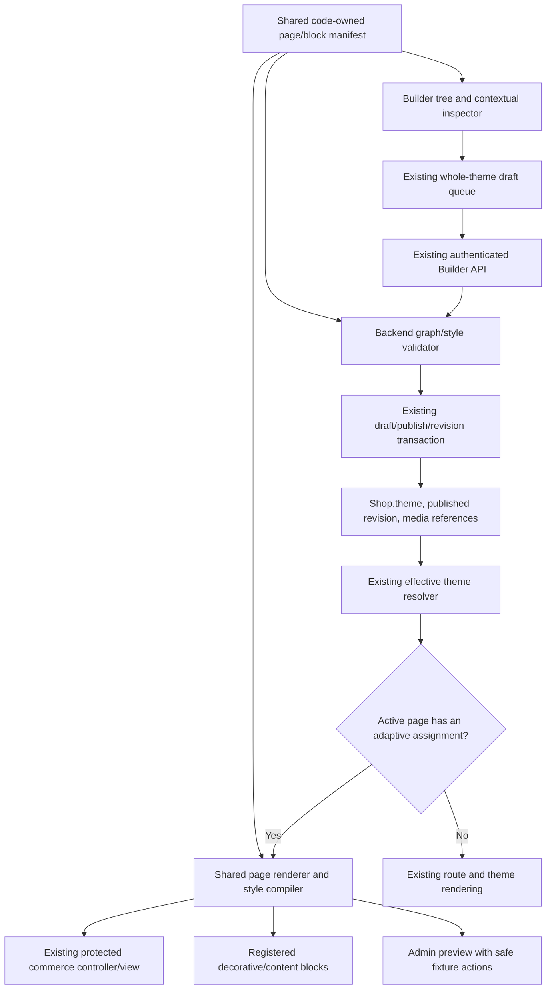

# Adaptive Full-Site Store Builder — Proposed System Design

**Date:** 20 October 2026. **Status:** proposal only. Every new contract, module, limit and workflow in this document is proposed unless explicitly marked existing.

Read with the [source audit](C:/Users/user/WebstormProjects/Shop-for-all/ADAPTIVE_BUILDER_ARCHITECTURE_AUDIT.md) and [implementation roadmap](C:/Users/user/WebstormProjects/Shop-for-all/ADAPTIVE_BUILDER_IMPLEMENTATION_ROADMAP.md). This document does not authorize implementation, publication or rollout.

## 1. Architecture decision

**Use constrained page templates containing registered sections and compatible nested blocks. Keep commerce as protected components with approved style parts.** Extend the existing theme contract, shared renderer, Builder inspector and publication pipeline; keep the current providers, commerce hooks and APIs.

“Adaptive” means that layouts respond to viewport, content length, available data and system-owned states within explicit constraints. It does not mean generated executable code, an AI layout service, or a merchant-programmable rules engine.

### Constrained templates versus freeform editing

| Concern | Constrained template/block system | Full freeform editing |
|---|---|---|
| Design range | Extensive colors, typography, spacing, layouts, compatible blocks and approved parts | Arbitrary geometry/DOM/CSS; maximum visual freedom |
| Commerce correctness | Required slots and server-owned actions can be verified | Easy to remove, cover, relabel misleadingly or duplicate functional controls |
| Responsive behavior | Three predictable tiers, intrinsic layout, bounded values | Many independent positioned elements; substantial repair tooling |
| Security boundary | Typed JSON, fixed renderers, no executable input | Requires a much larger HTML/CSS sanitization and isolation system |
| Preview/live parity | Same components, resolver and style compiler | Greater risk of separate editor/runtime engines |
| Theme preservation | Per-page opt-in with unchanged legacy route | Likely broad replacement and conversion of existing themes |
| Maintenance | One shared manifest and small component adapters | Large canvas engine, arbitrary layout persistence and complex migrations |
| Recommendation | **Adopt** | **Reject for this project** |

A generic stack/columns/section container is sufficient for the first nested-layout needs. No absolute-position canvas, plug-in marketplace, custom React components, arbitrary drag coordinates, CSS text editor or HTML import is proposed.

## 2. System boundaries and reuse



### Existing modules to extend, not replace

- `packages/storefront-theme/`: authoritative format, normalizer, effective resolution, capability rules and CJS/ESM exports.
- `packages/storefront-renderer/`: page/section views, shared design variables and Link/Image adapters.
- `ecommerce-admin/src/pages/dashboard/StoreBuilder/`: shell, sidebar, inspectors, preview frame, queue, recovery and history.
- `ecommerce-backend/backend/services/storeBuilder/`: validation/persistence, availability, assets, compatibility and SEO integration.
- Existing storefront page/controller/hook owners: retain commerce state, authentication, queries and API calls.

Possible new files **within those packages**, not new services: `pageTemplates.cjs`, `pageTemplateValidation.cjs`, `responsiveStyles.cjs`, `pageTemplateAdapters.cjs`; renderer `PageTemplateRenderer.jsx`, `BlockRenderer.jsx`, `ProtectedCoreAdapter.jsx` and a scoped stylesheet; Builder `PageTemplateTree.jsx`, `DesignInspector.jsx` and a selection helper. Names are proposals, not claims that these files exist. Separate files only where ownership is clear; avoid a generic plug-in framework.

## 3. Format and persistence decision

### 3.1 Keep one persisted site design

Continue using **`Shop.theme` as the published source**, `StoreBuilderDraft.theme` as the draft, and `StoreBuilderRevision.theme` as revision snapshots. A site publication updates the whole design under one `themeRevision`; the MVP does not publish pages independently or introduce a second site-design collection.

Reserve **theme schema version 5** for explicit adaptive adoption. This is a proposed next version; the current code only supports version 4. Introduce an optional `theme.siteBuilder` root in v5, with explicit schema/model/normalizer support. Do not hide active page configuration inside `extensions`, and do not leave it in a permissive unknown-field archive.

- Unconverted stores retain their current version and fields. Do not backfill every store to v5.
- Existing ten preset definitions, versions and registry statuses remain unchanged.
- `preset.id` remains application provenance; it is not a live template lookup.
- `presentationVariant` continues to select the current presentation family; `layout.homepageComposition` continues to describe the legacy homepage composition.
- Adaptive page assignment is explicit and independent of both fields.
- An assigned page uses its adaptive template. An unassigned page retains the current route/view exactly, even inside a v5 store.
- Existing flat theme colors/typography/layout/content remain authoritative defaults and legacy fallback data. Do not create a duplicate global token store.

### 3.2 Proposed theme extension

This is an **illustrative fragment**, not a complete theme or an API request body. Existing theme content, metadata, policies, media and legacy fields must be preserved in a real candidate.

```json
{
  "version": 5,
  "siteBuilder": {
    "defaultTemplates": {
      "product": "tpl_product_main"
    },
    "globals": {},
    "templates": {
      "tpl_product_main": {
        "pageKind": "product",
        "blueprintId": "product-standard-v1",
        "rootOrder": ["core_product", "sec_care"],
        "styles": {
          "base": { "background": { "token": "background" } }
        },
        "nodes": {
          "core_product": {
            "type": "product.core",
            "partStyles": {
              "title": {
                "base": { "textAlign": "start" },
                "desktop": { "fontSize": { "unit": "px", "value": 40 } }
              }
            }
          },
          "sec_care": {
            "type": "content.section",
            "slots": { "body": ["txt_care", "btn_policy"] },
            "styles": {
              "base": {
                "paddingBlockStart": { "unit": "px", "value": 24 },
                "paddingBlockEnd": { "unit": "px", "value": 24 }
              },
              "tablet": { "maxWidth": { "unit": "px", "value": 960 } }
            }
          },
          "txt_care": {
            "type": "content.text",
            "content": { "text": "Read our product care and store policies." }
          },
          "btn_policy": {
            "type": "content.link",
            "content": {
              "label": "Shipping policy",
              "destination": { "kind": "storePath", "path": "/policies/shipping" }
            }
          }
        }
      }
    },
    "savedSections": {},
    "stylePresets": {}
  }
}
```

### 3.3 Contract definitions

| Record | Proposed rule |
|---|---|
| `defaultTemplates` | Optional assignments for `home`, `product`, `category`, `collection`, `cart`, `checkout`, `account`, `track`, `policiesIndex`, `policy`. Every assignment must resolve to the matching `pageKind`. No URL regex or arbitrary route expression. |
| `globals` | Optional `header` and `footer` template IDs. Global templates are rendered once in the tenant shell, never copied into each page. |
| `templates` | Bounded map of template IDs to page kind, versioned code-owned blueprint, root order, nodes and page-level styles. Page kinds are the ten default-assignment families plus `header` and `footer`. One default per family in the MVP; no per-product/category overrides yet. |
| `node` | Stable ID is the map key. Allowed fields are `type`, type-specific `content`/`source`, `slots`, `styles`, `partStyles`, optional `stylePresetId`, and optional decorative visibility. Reject unknown properties. |
| `rootOrder` / `slots` | Ordered lists of node IDs. No parent pointer or `sortOrder` copy; list position is the single ordering source. Each node has exactly one owner, and all nodes must be reachable. |
| `partStyles` | Style overrides for code-owned semantic parts such as `title`, `primaryButton`, `input` or `surface`. These are not CSS selectors, DOM paths or arbitrary attribute names. Allowed parts vary per component. |
| `source` | Finite bindings such as current product/category/collection, approved manual product IDs, or policy type. No JavaScript, JSONPath, GraphQL, arbitrary endpoint or customer lookup expression. |
| `savedSections` | Bounded merchant-owned section templates in the same theme document. Insertion copies content and generates fresh IDs. MVP does not synchronize existing inserted copies. |
| `stylePresets` | Bounded named sets of typed styles. A node may reference one; presets cannot reference one another. Changing a preset shows all affected nodes before publication. |

IDs use a strict bounded alphanumeric/underscore/hyphen grammar, with reserved server core IDs. Reject `__proto__`, `prototype`, `constructor`, operator keys and dot-containing keys. Persist no DOM selector, function name, session/order data or editor selection state.

The flat node map avoids deeply nested JSON and gives stable inspector/undo targets. It is still a **tree**, not a general graph: reject cycles, shared children, dangling references, unreachable nodes and cross-template child references. Layout nesting is bounded independently from JSON serialization depth.

### 3.4 Initial limits — proposed, not current behavior

- Maximum 12 templates in the MVP: ten page families plus two globals.
- Maximum 50 nodes in a template; maximum 200 across templates and saved sections together.
- Maximum layout depth 3: section/container, one nested compatible group, leaf. Protected cores must occupy approved root/blueprint slots.
- Maximum 20 saved sections and 20 style presets, still within the global node/byte budget.
- Maximum 256 KiB UTF-8 for the complete v5 theme candidate, within the current 1 MB request limit. Existing v4 stores are not retroactively truncated or rejected by this new adoption limit.
- No base64 media, raw CSS, arbitrary fonts or recursive style-preset references.

Tune these limits against actual representative fixtures before committing to the MVP contract. Reject oversize input with a useful validation error; never silently truncate a graph. Do not simply raise all existing legacy sanitizer limits. The new subtree needs a dedicated bounded validator before normalization, with a separately bounded JSON depth appropriate to its shape.

## 4. Shared page/block manifest

A **code-owned manifest** extends the existing registry/capability approach. It is the common specification for the backend validator, Builder controls and shared renderer. Its renderer references map to trusted code; merchants cannot supply them.

Each definition describes:

1. Type and compatible page kinds/blueprints.
2. Compatible parent slots, allowed children and min/max counts.
3. Required singleton/core requirements and allowed optional sections.
4. Typed content/source fields, validation bounds and asset/reference collection.
5. Editable style properties and semantic parts per mode/viewport.
6. Allowed add/remove/duplicate/move/style/content commands.
7. Server-owned conditional states and preview fixture contracts.
8. Existing plan/capability restrictions and any separately approved adaptive entitlement.

Example specification, deliberately not executable application code:

```text
checkout.core
  pages: checkout
  placement: required root slot in checkout-default-v1
  count: exactly one
  children: none supplied by merchants
  content/source: none supplied by merchants
  commands: approved style/reset only
  immutable: form semantics, fields, conditions, handlers, endpoints, tokens
  parts: surface, heading, label, input, summary, primaryButton, error
  part properties: narrow allowlists; errors/focus/required controls cannot be hidden
```

`content.section`, `layout.stack`, `layout.columns`, text, image and link blocks can be added/duplicated/reordered in approved decorative slots. Core product/cart/checkout/account/tracking components cannot be nested inside arbitrary layout groups, duplicated or moved outside their blueprint constraints.

Do not treat merchant `locked: true`, `required: true`, `protected: false`, role predicates or capability flags as authority. The manifest determines protection. A user lock is only accidental-edit protection for optional content.

## 5. Functional cores and page contracts

Use the detailed page matrix in the audit as the component contract inventory. The following invariants must be enforced on writes and protected by runtime adapters:

| Core | Invariants |
|---|---|
| Header/footer | Tenant identity, functional utility links and policy access; existing branding/verification/plan restrictions. Optional merchant groups remain optional. |
| Product | Product/variant IDs, displayed price and stock from existing model; required options, quantity constraints, cart/buy callbacks and unavailable states. |
| Category/collection | Current resource identity, public eligible results, query/sort semantics, pagination and a usable way to clear active filters when required. |
| Cart | Current tenant cart, item identity, quantity/removal, authoritative price refresh contract, totals and checkout action; correct empty state. |
| Checkout | All currently required fields and area choices; policy acceptance; separate optional marketing consent; OTP when required; server-bound proof; existing order idempotency, validation, error/busy and success states. |
| Authentication/account | Existing role/session/tenant boundaries; credentials/OTP/reset checks; own orders; password change and logout. Read-only profile remains read-only. |
| Tracking/after-sale | No private order details before existing access verification; token/identity binding; backend cancellation/return eligibility and proof requirements. |
| Policies/overlays | Correct content/defaults/type routing; accessible required navigation; analytics consent, dialogs/focus and error feedback remain functional. |

“Required” is conditional on the actual runtime state. An empty cart does not need filled-cart rows; an unverified tracking page must not display private order rows; a product without variants does not need a selector. These conditions stay in code and backend responses. Merchant visibility rules cannot override them.

Per-element customization therefore means **approved styling of registered parts**, not deletion/replacement of every HTML element. Do not offer arbitrary wording for authoritative price/status labels, system security errors or consent/OTP semantics that could misrepresent the workflow.

In the MVP, cart, checkout, account and tracking are atomic functional cores. Rich internal block rearrangement is a later, separately tested feature. Add small presentation seams where necessary; keep hooks/controllers in their current owners and preserve API payloads.

## 6. Typed design settings and responsive inheritance

### 6.1 Allowed design surface

| Group | Proposed controls | Safety boundary |
|---|---|---|
| Color | Existing semantic token references or validated hex colors | No arbitrary CSS variable name, URL, gradient string or expression. Contrast validation on known foreground/background pairs. |
| Typography | Existing bundled/approved font enum, bounded size/weight/line-height/letter-spacing, alignment | No external font URL; readable minimums and essential-message constraints. |
| Box | Width/max-width, approved media height/aspect ratio, padding/margin, border/radius | Typed finite values; no negative margins, transforms, viewport-sized overlays or clipping of functional content. |
| Layout | Stack/approved columns, bounded gap, alignment and mobile stacking | DOM and keyboard order remain meaningful; no arbitrary absolute positioning or z-index. |
| Visibility | Decorative node visibility per tier | Required/conditionally required controls cannot be merchant-hidden. No opacity/pointer-events/display escape hatch. |

Reuse current 0–160 px spacing bounds initially. An image can have fixed height/aspect ratio; a checkout form or error region must grow with its content. Additional percent widths or larger decorative heading bounds should be deliberate typed options with tests, not unrestricted strings. Numeric limits are property/part-specific, not one global number range.

### 6.2 Breakpoints

For **new adaptive styles only**:

- `base`: mobile baseline, below 768 CSS px.
- `tablet`: overrides from 768 through 1023 px.
- `desktop`: overrides from 1024 px upward.

Existing themes retain all their current breakpoint/class behavior, including internal 430/1280/1536 rules where present. Do not rewrite legacy Tailwind classes to force them into the new model.

Resolve responsive overrides **within each style layer first**: base → tablet → desktop. Then compose layers by specificity. A node-specific base color must not lose to a less-specific page desktop color.

For a node, compiler-owned defaults are followed by its referenced style preset and its explicit styles; a registered part then receives its own explicit overrides. Page/parent text properties inherit only where CSS and the manifest declare them inheritable. **Padding, margin, width and borders are not copied down the tree.** Global theme tokens remain available through the existing theme provider.

### 6.3 Inheritance and reset

- Missing v5 properties inherit; false/zero are explicit where valid.
- Do not use `null` as a second ambiguous inheritance language. Reset removes that override at the selected tier/scope.
- “Reset mobile”, “Reset this property”, “Reset section styles” and “Reset page design” have different, previewed scopes.
- Resetting styles does not erase merchant text, media, products, links or protected identity.
- Blueprint defaults are versioned code definitions. Changing defaults for already published templates requires an explicit version/migration decision, not silent new-default application.

### 6.4 Rendering

Compile allowlisted values into known inline properties and scoped CSS custom properties consumed by static shared CSS. No dynamic Tailwind class interpolation, merchant CSS selector generation, per-customer stylesheet, CSS `url()`, `calc()` strings or arbitrary `style` spreading.

Provide compiler-owned intrinsic safeguards: constrained containers cannot exceed their parent, grid tracks can shrink, media scales within its box, and long text has component-appropriate wrapping. Stacking at narrow widths follows the blueprint's accessible DOM order. Do not use blanket overflow hiding to conceal a broken layout or clip essential controls. Validate these behaviors with real long-content fixtures, not just empty design blocks.

Resolve all tiers during SSR; CSS chooses the viewport. Do not read `window.innerWidth` in the pure resolver or choose a different component tree solely from editor width. Preview and live receive the same compiled plan; only data/actions and Link/Image adapters differ.

## 7. Builder interaction and preview

### 7.1 Selection and inspector

Use an ephemeral selection record such as `{ templateId, nodeId, partId, viewport }`. Stable node IDs survive reorder and reload; approved `partId` values come from the manifest. Repeated product/order items may have transient display instance IDs, but design settings attach to their registered shared part, not to customer/order data or a DOM index.

Click-to-select uses explicit markers and capture handlers/overlays. Selecting a Buy, OTP, return or login control in edit mode must select its part, not execute its live action. Provide keyboard selection, breadcrumbs, parent selection, visible focus and a readable tree. Expose disabled controls with a reason instead of silently allowing ineffective edits.

### 7.2 Modes

| Mode | Scope |
|---|---|
| **Quick Edit** | Text, approved media/source choices, links, optional visibility and ready-made layout/style presets. |
| **Design Mode** | Registered colors, typography, box/layout properties, part selection, responsive inheritance and reset. |
| **Advanced Mode** | Compatible nested groups, detailed typed dimensions and explicit overrides allowed by the same manifest. No raw HTML/CSS/JavaScript or arbitrary JSON mutation. |

Modes are UI density choices, not privilege levels. The backend evaluates every resulting configuration identically. Plan access and staff permissions remain independent.

### 7.3 Safe preview contract

Keep the existing `StorefrontPreviewFrame` viewport/portal approach. Preserve its script-disabled document and use only required shared styles/fonts. Because parent-side handlers can execute, **the iframe sandbox is not the commerce side-effect boundary**.

Expand previews by page family and explicit state fixtures: normal/empty/error; out-of-stock/variant states; anonymous/customer/vendor account; tracking lookup/unverified/verified/eligible/ineligible; checkout empty/form/OTP/busy/error/success. Fixture orders/customers are synthetic. Show fixture identity in Builder chrome, not customer-facing content.

- Preview uses the same registered presentation and style compiler as live.
- Existing public product/category content may be selected through tenant-scoped authorized reads.
- Do not load real customer sessions, order tokens, payment data or return proofs for design previews.
- All write actions are no-op or local simulated transitions. Tests must fail on unexpected outbound writes, uploads, OTP or notification calls.
- Do not mount API-owning account/tracking/security controllers as if they were passive shared views. Start with read-only shared regions; introduce narrow fixture/action ports before interactive states.
- Do not build a second independent set of account/checkout/tracking form markup. A state without a safe shared seam is reported unavailable until that seam is implemented.
- No public draft-preview URL in the MVP. A later share link needs tenant/template/revision-bound short-lived authorization, no-store/noindex responses and no credentials in URLs/logs.

Keep existing viewport presets. Add boundary/acceptance checks at 320, 360, 390, 430, 767/768, 1023/1024 and 1440 px, plus long text and 200% zoom. A scaled thumbnail is not proof of real responsive layout or touch behavior.

## 8. Backend validation and security pipeline

Extend existing Builder endpoints and service boundaries; **do not change commerce APIs**. Existing complete snapshot, `basedOnRevision`, `expectedDraftUpdatedAt`, `expectedRevision`, conflict handling and expected-shop consistency remain.

For draft/save/publish/restore and any SEO/theme-writing path:

1. Authenticate existing session; resolve tenant and staff permission through current middleware. Never authorize using submitted `shopId`, manifest flags, plan name or template owner.
2. Bound raw request bytes; check supported current/incoming format before side effects.
3. Reject unsafe object keys and validate the raw v5 graph/style schema before any legacy sanitization can truncate/archive it.
4. Validate unique IDs, ownership/reachability, compatible page/slot/type, graph depth/count/bytes, valid presets and required singleton cores in every applicable state. Validate unassigned templates, saved sections and style presets too; saved-section content cannot contain protected cores or dormant unsafe configuration.
5. Validate every content/style/source field by its declared type. No arbitrary props, event handlers, HTML, CSS, class names, expressions or merchant-defined endpoint/action URLs.
6. Apply server-derived plan/capability/rollout restrictions to the **final complete normalized candidate**. Restore and direct service callers receive the same check.
7. Batch-validate tenant-owned media/product/category/collection references. Never trust a valid-looking ID or matching name alone. A globally known asset belonging to another tenant remains forbidden.
8. Resolve only permitted public data bindings; authorization for private runtime data remains in existing APIs/controllers, outside the design graph.
9. Persist under existing draft CAS or publication transaction; record actor and validated page/node change summary without secrets or private fixture data.
10. Invalidate affected tenant settings/bootstrap/page/global cache entries after commit; return structured warnings if cache invalidation needs recovery. Do not claim failed publication merely because post-commit cache cleanup failed.

### URL and media policy

Use destination types: validated store-relative path, permitted HTTPS external navigation, or validated email/phone links where the component allows them. Reject protocol-relative/script/data URLs and encoded/control-character bypasses. Enforce the narrower destination policy of each component; a checkout submit action is never a merchant link. Public external links use safe browser attributes where applicable.

New uploaded media should use tenant-owned asset IDs resolved to approved public URLs. Preserve validated legacy image URLs during conversion without silently downloading/rehosting them. Do not turn media resolution into server-side fetching of arbitrary merchant URLs. No remote script/widget embeds or uploaded executable SVG/HTML support is introduced.

### CSS, data and privacy

Protection is both structural and visual: reject styles capable of hiding, covering or making essential controls unreadable/unusable. No merchant control of arbitrary position, z-index, overflow clipping, pointer events or form semantics. Server validation can establish structural/type bounds; it cannot prove computed layout or complete accessibility. Browser gates remain necessary.

Public serialization includes active public presentation, not drafts, compatibility archives, editor metadata, private preview fixtures, customer information or a merchant's entire saved-section library. Public cache keys must include tenant, revision, page/template and effective entitlement/branding context. Never cache order-access/session data in that cache.

## 9. Storage, assets and publication reliability

Declare the new root in `Shop.theme`; if the graph is stored as Mixed JSON to avoid duplicating the shared schema, enforce the shared pure validator before every persistence path and add a model-level shape/size validator. Mixed is a storage mechanism, not permission to persist unvalidated configuration. Tests must prove strict Mongoose round trips preserve the graph exactly.

Keep the existing unique tenant draft and `(shop_id, revision)` revision index. Do not create per-page jobs, per-node MongoDB documents or additional published stores in the MVP. Larger revisions require a measured retention/backup budget; current retention is only 20 whole-theme snapshots.

Before new graph media is writable, extend extraction, ownership, promotion, cleanup and restore to understand every graph/global/saved-section asset reference. Retained revision media must be pinned or independently recoverable; a seven-day retired-asset grace is not equivalent to revision retention. Prefer bounded `assetIds` on revision snapshots, alongside existing draft/current-theme references, and tenant-scoped presence checks before deletion. This does not need a distributed reference counter or another collection. Update reference snapshots transactionally on publication/pruning and defer physical deletion until no retained reference remains. Do not assume a successful revision restore can recreate a deleted Cloudinary object.

New-format publication should require MongoDB transactions across Shop, revision/audit and asset-reference state. The existing standalone compensating behavior can remain for legacy v4; do not expand it and call it atomic. If transactions are unavailable, v5 publication returns an explicit availability error and preserves the draft.

SEO-only publication must preserve the complete page graph, global assignments, content and asset references. Whole-site draft conflicts remain explicit: editing two different pages in different tabs is still concurrent editing of one draft, not an automatic merge. MVP has no real-time collaboration claim.

## 10. Validation UX

Return issues with stable `{ code, severity, templateId, nodeId, partId, viewport, property, message }` identifiers so IssuesDrawer can select the actual element after reorder.

**Publish-blocking:** unsafe/unsupported input; missing/duplicated required core; broken/cyclic reference; foreign tenant asset; forbidden capability; invalid style/unit; essential element hidden; payload bounds; unsupported version; invalid required runtime contract.

**Warnings or design review findings:** uncertain contrast over photography, long-content wrapping, narrow columns, optional empty content, image quality/crop, nonessential duplicate headings and spacing concerns. Known solid-color essential text/focus contrast failures can be blocked under an explicitly approved policy. Do not promise that static validation guarantees accessibility or legal compliance.

Use existing contrast utilities where applicable. Keep a last-valid preview while a numeric input is incomplete; do not persist invalid text as zero or silently delete blocks. “Fix” suggestions must preview an explicit merchant-approved edit.

## 11. Compatibility and migration

1. **Readers first:** add inert v5 codec/validation/public projection support to all deployed consumers and persistence paths before exposing v5 adoption. Keep gates disabled and v4 outputs identical.
2. **Protect old writers:** a current v5 store must reject an older v4/omitted-graph complete save unless it is an explicit supported conversion command. Never silently downgrade and erase adaptive templates. Include bootstrap capability/version metadata so Admin can show refresh/read-only guidance.
3. **Dry-run per page:** use a pure adapter to propose a template from the existing effective page and content. Preserve section IDs where compatible; generate new IDs for inserted copies. Do not infer a desired tree from a preset ID alone.
4. **Merchant confirms:** adoption creates a draft candidate. Explicit publish changes only assigned pages/globals; the rest retain their legacy branch.
5. **Preserve fallback/content:** keep current flat theme fields and an independently retained pre-adoption snapshot for recovery. Existing 20 revisions alone are insufficient for a durable migration backup.
6. **Keep preset application explicit:** on an adaptive site, offer appearance-only token application as the safe default. A command that replaces an adopted page must show its affected content and require review. It must not silently reintroduce `homepageSections` as a competing active source. No preset definition/version changes are needed.
7. **Rollback the feature, not the code blindly:** disabling new adoption must leave existing published v5 designs readable. Restore to a verified v4 backup only through a supported converter preserving merchant content/media. Old binaries cannot be assumed safe for v5 stores.
8. **Stale clients:** test older tabs, caches and mixed artifacts. The preserved legacy fallback may serve older clients until a safe refresh; do not force a reload that destroys an in-progress checkout. Do not claim immediate design convergence across all caches.

For a converted page, its assigned template owns that page's structure. Legacy fields remain inactive fallback/adaptor input there; dual editing of both representations is disabled. Shared token/content fields retain a single owner. In particular, policy text stays in `theme.policies`, and product facts stay in product data.

Keep current none/limited/full permissions until product approves an adaptive-specific matrix. Full currently permits structural editing; limited currently has narrower controls, not automatic permission for all future part styles. Do not grant new entitlements or decide downgrade/grandfathering silently. Reuse the availability service pattern for a **separate default-off adaptive adoption capability**; the already-authorized Atelier flag must not enable the new format.

## 12. Practical MVP and deferred features

### MVP

- One default template per existing page family and shared header/footer, with per-page opt-in.
- Rich homepage/global editing using existing views and bounded decorative nested groups.
- Existing product/listing cores with approved styling and surrounding content slots.
- Cart/checkout/account/tracking protected cores with a limited style surface, not arbitrary internal rearrangement.
- Policy index/detail composition and existing policy content ownership.
- Quick Edit and Design Mode; Advanced shows only supported typed options/compatible groups.
- Per-page/node/approved-part responsive overrides, property inheritance/reset, copy-based saved sections and bounded style presets.
- Full reuse of draft/autosave/undo/publish/revision workflows, graph-aware media safety and useful validation paths.
- Safe previews for all families; read-only synthetic protected states where interactive seams are not ready. No side-effecting live workflow inside Builder.

### Later, separately estimated

- Approved internal product/listing slots and progressively finer commerce part controls.
- Per-product/category/collection template assignment and an impact view for bulk assignment.
- Carefully approved checkout field/layout permutations without changing field semantics.
- Interactive account/tracking fixture states after safe action ports exist.
- Synchronized reusable sections with explicit update review, dependency accounting and rollback.
- Wider block libraries, additional responsive/container behavior and shareable authorized draft previews.

No freeform executable editing, new payment/shipping methods, new customer routes, real-time collaboration or new notification services is included.

## 13. Acceptance invariants

The new system is acceptable only when all ten existing definitions remain byte-for-byte unchanged; unassigned legacy pages retain configuration/render/workflow baselines; preview/live use the same resolution and presentation; every enabled command is backend-validated; all core actions retain their existing backend contracts; media and revisions survive restart/rollback; and actual responsive/browser/tenant/concurrency tests pass.

The [roadmap](C:/Users/user/WebstormProjects/Shop-for-all/ADAPTIVE_BUILDER_IMPLEMENTATION_ROADMAP.md) defines dependencies, tests, approval questions and the first safe task. There is no implementation in this document.
