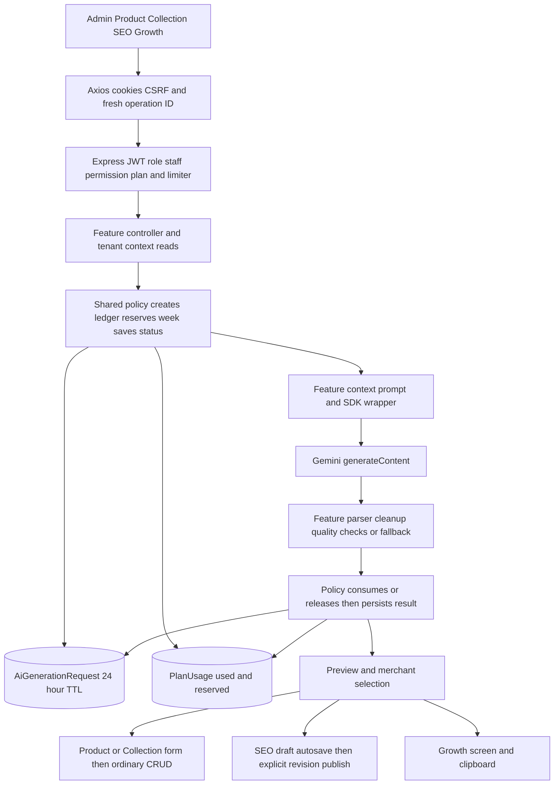
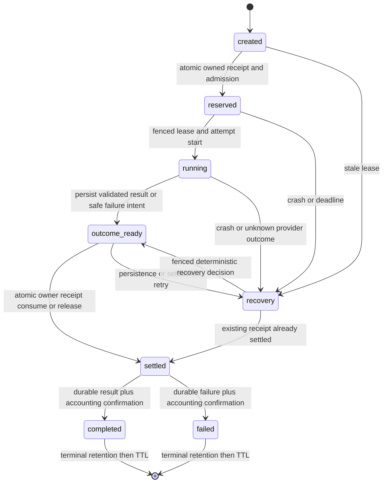
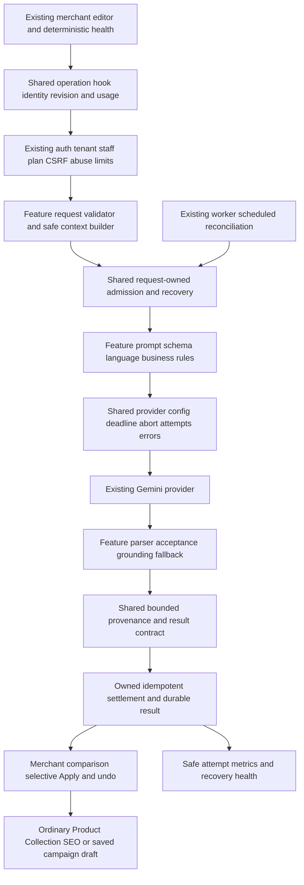

| Area | Current score /10 | Target /10 | Main blocker |
|---|---:|---:|---|
| Production readiness | 5 | 9 | Request accounting can diverge from durable results; deployment gates unverified |
| Reliability | 4 | 9 | Unowned reservations, no stale recovery, timeouts without transport abort |
| Security | 7 | 9 | Useful guards; free-text privacy and image resource/content boundaries incomplete |
| Tenant isolation | 8 | 9 | Scoped generation reads; asset ownership and adversarial HTTP tests unverified |
| Architecture | 6 | 9 | Shared policy exists, but four provider wrappers duplicate safeguards |
| Maintainability | 6 | 9 | Feature separation is useful; transport/contracts/configuration drift |
| Output quality | 5 | 9 | Parseable empty output passes; no multilingual acceptance benchmark |
| Client usefulness | 7 | 9 | Assistance is in real editors; Growth is copy-only and Collection emits unused fields |
| UX | 6 | 9 | Explicit Apply is good; stale-result, fallback, usage and permission feedback gaps |
| Observability | 3 | 9 | No per-attempt tokens/cost, recovery metrics or acceptance tracking |
| Cost control | 4 | 9 | App quota exists; retries, abandoned calls and provider spend remain opaque |
| Test confidence | 4 | 9 | Helper/static checks; no Mongo fault/concurrency or complete browser launch proof |

# AI Admin Platform — Second-Stage Review

Review date: 2026-10-10. Scope: the current working tree, including existing uncommitted storefront work. Scores are independent code assessments, not live provider quality measurements. Target 9 means the measurable launch gates below have passed; a score of 10 cannot be earned from source inspection alone.

Read in full before source verification: [main audit](AI_ADMIN_PANEL_AUDIT.md), [architecture/data flow](AI_ARCHITECTURE_AND_DATA_FLOW.md), [findings](AI_AUDIT_FINDINGS.md), [historical tracker](AI_AUDIT_TRACK.md), [feature inventory](AI_FEATURE_INVENTORY.md). Repeated claims were reconciled once. All evidence paths below are relative to the repository root. Application, dependency, schema, environment and customer/database state were not changed. New artifacts consist of this review and isolated verification scripts/logs under `output/`.

**Evidence meanings:** confirmed defect means a current source or mock-reproduced failure path, not an observed production incident. Potential risk means an exposure boundary exists without a demonstrated exploit. Hardening recommendation means a proposed improvement. **RUNTIME VERIFICATION REQUIRED** identifies deployment/provider/database/browser checks not executed here. **PRODUCT DECISION REQUIRED** identifies unresolved merchant or retention policy. Priorities P0–P3 describe implementation order; they are not vulnerability severity labels.

## 1. Executive Verdict

**Usable today:** the four Admin workflows are connected and support merchant review. Product and Collection apply into ordinary forms; SEO uses drafts and explicit publication; Growth displays planning copy. Useful helpers and guarded endpoints exist. Full live functionality remains **RUNTIME VERIFICATION REQUIRED**.

**Production-ready:** insufficient evidence for launch approval, with confirmed accounting and acceptance faults that should be repaired first. No Critical security exploit or direct cross-tenant generation read was demonstrated. Avoid interpreting a missing launch gate as evidence of a breach.

**Biggest architectural risk:** weekly counters have no request-owned reservation. Admission, settlement and result persistence are separate writes. Failure can strand quota, lose replay, or decrement a different pending request's capacity. This is a correctness defect across all five API entries, including legacy.

**Biggest merchant UX limitation:** the system cannot reliably explain whether a returned suggestion is still relevant to the edited form, whether content was provider-generated or synthesized, and how much generation capacity is actually available. Growth additionally requires copy/paste and has no durable campaign workspace.

**Highest-value next capability:** extend the existing Product readiness/SEO checks into a deterministic issue list with “Improve selected issues,” current-versus-suggested review and undo. The checklist and `scoreProductSeo` already exist; build on them. This has broader recurring value than another general AI screen. Brand Voice/language consistency follows, then reusable Growth drafts.

**Recommended direction:** retain the existing monolith, feature services, Mongo quota/ledger and human approval. Consolidate transport and safe context/provenance contracts. Keep one simple weekly generation pool. Add merchant capabilities only after P0 invariants and launch tests hold.

## 2. Audit Package Reconciliation

Current statuses below result from fresh source checks. No listed defect was found already repaired. F-011/F-016 are partial confirmations of missing controls, not confirmations of actual private-data disclosure.

| Finding / claim | Original audit status | Current status | Evidence | Action |
|---|---|---|---|---|
| F-001 orphan reservations | High, conditional defect | CONFIRMED AND STILL PRESENT | E01/E02/E03; mock reserve-success/status-save-failure leaves reservation and deletes row | R01 durable ownership and recovery |
| F-002 settlement/finalization divergence | High, conditional defect | CONFIRMED AND STILL PRESENT | E01/E02; mock usage-read failure after consume causes cleanup to decrement second pending slot | R01 idempotent settlement |
| F-003 timeout without cancellation | High, reliability gap | CONFIRMED AND STILL PRESENT | E04–E07 races; E08 supports local abort, explicitly excludes service-side cancellation/billing | R02 abort local transport, bound total work; qualify cancellation claim |
| F-004 incomplete JSON accepted | Medium, validation defect | CONFIRMED AND STILL PRESENT | E04/E05/E06/E07; Product description-only `{}` returns provider source and blank description in isolated probe | R03 per-feature acceptance before synthesis |
| F-005 SEO provenance lost | Medium, correctness defect | CONFIRMED AND STILL PRESENT | E12/E13/E14; Apply and sanitizer drop origin; resolver infers AI from matching text | R03 full accepted-field provenance |
| F-006 remote bytes buffered first | Medium, resource gap | CONFIRMED AND STILL PRESENT | E04 `fetchImageUrlPart` uses arrayBuffer before actual byte check | R05 stream cap |
| F-007 Growth range mismatch | Medium, correctness defect | CONFIRMED AND STILL PRESENT | E11 POST omits range; E18 controller defaults 30 days | R08 exact interval |
| F-008 unused Collection fields | Medium, incomplete integration | CONFIRMED AND STILL PRESENT | E10/E05/E17: keywords display only, rules unused, no rule schema | R08 stop requesting unused rules; retain compatible response temporarily |
| F-009 ID lacks input binding | Medium, design gap | CONFIRMED AND STILL PRESENT | E01/E03/E25: tenant/feature/ID uniqueness; fresh ID each click; no canonical input hash | R06 stable logical operation |
| F-010 pending/replay usage misleading | Medium, correctness defect | CONFIRMED AND STILL PRESENT | E02 remaining excludes reserved; E01 replay excludes usage; E09 only Product refreshes auth usage | R08 shared usage contract |
| F-011 privacy in free text | Medium, potential risk | PARTIALLY PRESENT | E18 aggregates raw query/city occurrences; E04 sends comments; E20 help says internal context | R04 minimize input; actual disclosure NEEDS RUNTIME VERIFICATION |
| F-012 stale tests/coverage gap | Medium, test debt | CONFIRMED AND STILL PRESENT | E27–E29; rerun 57/61 existing checks pass with same four source assertions failing | R09 behavioral and isolated fault tests |
| F-013 duplicated transport/settings | Medium, architecture debt | CONFIRMED AND STILL PRESENT | E04–E07 and E19; raw numbers outside Product timeout; four wrappers | R07 shared adapter, feature-owned prompts |
| F-014 no attempt/token/cost telemetry | Medium, recommendation | CONFIRMED AND STILL PRESENT | E03/E04–E07 retain result-level metadata, not attempt usage | R10 operational measurement |
| F-015 undocumented config/health | Low, config debt | CONFIRMED AND STILL PRESENT | E24 template omits AI variables; operator exposes configured only | R07 documentation; health NEEDS RUNTIME VERIFICATION |
| F-016 MIME/host do not prove validity/ownership | Medium, potential risk | PARTIALLY PRESENT | E04/E19/E23: MIME trust/host allowlist; no tenant asset check in generation | R05 distinct policies; private asset exploit NEEDS RUNTIME VERIFICATION |
| F-017 UI/SDK/legacy debt | Low, usability/debt | CONFIRMED AND STILL PRESENT | E09/E10/E21/E25: visible controls, unused Admin SDK, comment/route mismatch | R11 compatibility cleanup |

Additional current-source qualifications:

- SDK abort is **client-side**, not a guarantee that Gemini stops processing or charging. A mock also confirms the installed SDK does not propagate an already-aborted signal when constructing fetch options. The adapter must check `signal.aborted` before starting work (R02).
- Growth `confidence=high` follows `orders >= 3 OR views >= 50`; this is activity sufficiency, not measured ad effectiveness or model factual confidence. Label it accordingly (E07, R08).
- Collection AI converts a Bangla-only name into an encoded ASCII slug, and that generated slug survives CRUD normalization. Direct Bangla-only manual/title slug inputs still normalize to empty in ordinary CRUD. The issue is a consistent, usable multilingual slug policy, not loss of the generated encoded slug (E05/E17, R13).
- Product readiness/SEO assistance already exists (E20). A new completeness assistant should extend it, rather than duplicate it.
- Collection CRUD accepts syntactically valid product IDs into its document before checking tenant ownership. Association writes and public reads remain tenant-filtered. This is a referential integrity gap; no cross-tenant product-content disclosure was demonstrated (E17, R08).
- Product selling-point aliases are filled by the Product model before validation. Do not claim Growth necessarily loses saved `point/reason` rows (E22).
- Ordinary domain-event subscriber errors are swallowed by default. F-002 is reproduced through database-read failure, not an invented subscriber failure (E26).

## 3. Current Architecture



| Workflow | Current route and ownership | Persistence after review |
|---|---|---|
| Product | `POST /api/admin/products/ai/content-suggest`; `productController.generateProductContent` → `productContentAiService` (E09/E16/E04) | Apply changes form; normal Product save persists content |
| Collection | `POST /api/admin/collections/ai/suggest`; `collectionController.suggestCollectionAi` → `collectionAiService` (E10/E17/E05) | Apply name/description/SEO/slug; normal Collection save |
| Homepage SEO | `POST /api/store-builder/admin/seo/ai-suggest`; Store Builder controller → `storeSeoAiService` (E12/E16/E06) | Apply → draft autosave → revision-aware publish → shared resolver |
| Growth | `POST /api/admin/growth/generate-ad-copy`; `growthController.generateAdCopy` → `adInsightAIService` (E11/E18/E07) | UI/clipboard plus operational ledger; no campaign model |
| Legacy | `POST /api/admin/generate-description`; delegates to Product description-only (E21) | External caller must save; no discovered Admin caller |

Provider keys and inference stay in backend code. The request ledger and quota are Mongo-based. Redis cache support elsewhere does not back these limiters or AI settlement. Existing Mongo jobs have lock IDs and stale claims, but no AI generation handler (E30).

## 4. What Is Already Strong

- Tenant identity is derived from verified authentication; staff permissions and effective plan gates are enforced on the server. Posted shop IDs do not select generation context (E15/E16).
- Generated content is advisory. Product/Collection have explicit Apply and ordinary save; SEO has drafts, revision checks and explicit publish. Growth does not publish ads (E09–E12/E31).
- SEO uses public, active, non-deleted Published Product context. Growth metrics are calculated by application queries, rather than invented by AI (E16/E18).
- Feature contexts allowlist fields, limit rows/text and omit buying/cost prices. Prompt IDs/versions and provider JSON schemas exist (E04–E07).
- Product image URL fetching already requires HTTPS, a host allowlist, redirect rejection and a five-second abort. Keep these controls while completing resource and content validation (E04).
- React text rendering and shared storefront consumers avoid executing generated HTML in inspected flows (E09/E10/E12/E22).
- Product supports section generation, selective Apply and append/replace benefits. Product content normalization preserves legacy aliases (E09/E22).
- The existing Store Builder draft/revision system is the correct SEO persistence owner. Do not create a parallel publishing architecture (E31).

These strengths improve the source assessment; they do not replace two-tenant HTTP, provider contract or browser verification.

## 5. P0 Findings

### R01 — Request-owned accounting and recoverable finalization

- **Priority / current state:** P0. Confirmed High correctness defects F-001/F-002. `PlanUsage` stores aggregate counters; the request record has no reservation owner, period or settlement receipt.
- **Evidence:** E01 `beginAiGeneration`, `completeAiGeneration`, `failAiGeneration`; E02 reserve/consume/release; E03 models; six-probe log below. Reservation-save failure and concurrent cleanup were reproduced using the current policy with in-memory mocks.
- **Problem:** separate writes leave ambiguous ownership. A result can be charged then lost; generic cleanup can affect another request. TTL can erase unresolved evidence.
- **Client impact:** lost weekly capacity, unreliable retries and paid-looking failures without usable content.
- **Engineering impact:** support cannot safely infer which reservation to refund; counters cannot enforce at-most-once consume/release per operation.
- **Recommended solution:** keep the two existing models. Make the weekly quota document authoritative for **bounded outstanding ownership receipts**, keyed by the server-generated ledger ObjectId. Atomically admit/reserve and atomically transition that exact receipt to consumed/released with its counter change. Persist a validated result or failure decision in the ledger before settlement; then finalize the ledger and acknowledge/prune the receipt. Section 13 specifies crash recovery, fencing and pruning. This works with standalone Mongo single-document atomicity and replica sets; transactions may additionally group writes on supported deployments but must not be required for basic correctness. Do not maintain separate accounting algorithms for each topology.
- **Backend changes:** revise `services/ai/aiGenerationPolicyService.js`, `services/billing/planUsageService.js`; add a small reconciler in `services/ai/`; schedule through existing worker infrastructure, with equivalent bounded reconciliation on admission if worker health is unavailable. Controllers call one finalizer; catch cannot reverse settled outcomes. Events run after durable finalization.
- **Frontend changes:** represent processing/recovery explicitly; uncertain response retries reuse the operation (R06), with no immediate fresh generation loop.
- **Schema/data changes:** `AiGenerationRequest`: accountingVersion, immutable quotaPeriodStart, inputHash, lease/fence, deadline, outcome/settlement state; unresolved rows have no TTL expiry. `PlanUsage`: bounded reservation receipts containing owner, state, fence and deadline, including an acknowledgement stage. Unique tenant/week and tenant/feature/request keys remain.
- **Migration/backfill:** additive rollout with mixed-version prevention for AI writers. Pause new AI admissions, drain existing calls, inventory old active rows/counters and snapshot them. Old `reserved` cannot be reliably assigned after ledger deletion: explicitly reconcile ambiguous legacy reservations under a documented support adjustment policy; preserve `used`. Never invent provider completion. Resume after ownership version cutover; retain old completed payload replay during its retention window.
- **Compatibility:** keep route names, one-unit plan semantics, weekly reset and old billing aliases. Existing saved Product/Collection/SEO content is unaffected. Old completed rows without accountingVersion are replay-only; do not settle them again.
- **Security/privacy:** every mutation includes shop, original quota period, owner and expected state/fence. No raw prompt/customer data in receipts. Per-tenant admission caps also apply on unlimited plans.
- **Tests:** fail each write boundary; crash after reserve, result persistence, settlement and acknowledgement; two competing finalizers; A/B concurrent requests; repeated reconciliation; old-week completion; TTL only after terminal state; bounded receipt capacity; standalone and replica-set suites.
- **Complexity:** Large.
- **Dependencies:** design acceptance and disposable Mongo topology fixtures; R06 supplies canonical identity before final rollout. Recovery must ship with accounting, not later.
- **Definition of done:** no injected failure changes another request's reservation; consume/release each occur at most once; every stale owned receipt reaches a terminal decision or operator-visible quarantine; results replay without provider re-execution; receipt storage stays bounded. Production reconciliation lag and actual indexes are **RUNTIME VERIFICATION REQUIRED**.

### R02 — Local transport abort, total deadline and bounded concurrency

- **Priority / current state:** P0. F-003 remains; four local Promise races leave the SDK request running. Product's quality retry gets another full timeout.
- **Evidence:** E04–E07 `callGemini`; E08 installed SDK `generateContent(request, requestOptions)`, `buildFetchOptions`, `SingleRequestOptions`; isolated abort/pre-aborted-signal probes.
- **Problem:** timeout is a local wait boundary, not a provider cancellation contract. The SDK documentation explicitly says service processing and applicable charges can continue after AbortSignal cancellation.
- **Client impact:** long waits and retry confusion; repeated clicks after uncertain failures can spend provider resources again.
- **Engineering impact:** overlapping attempts, unknown charges and no enforceable logical-generation latency budget.
- **Recommended solution:** a shared adapter passes `{signal}` as the second generateContent argument. Check an already-aborted signal before invoking the SDK. Use one controller/deadline across context/image acquisition, all attempts and parsing, with timers/listeners removed in finally. Compute remaining budget before every attempt. Retain only Product's one quality-repair retry initially; do not automatically retry uncertain timeouts, auth/model failures or all 429/5xx responses. Fence late results by operation/attempt epoch; canceled or superseded results cannot finalize/apply. Persist an ambiguous-provider-outcome flag and bounded cooldown rather than claim that provider work stopped. Default per-tenant concurrency can start at two and be measured; use owned Mongo admission leases, with a platform cap appropriate to actual topology. SDK/network abort cannot promise remote exactly-once execution.
- **Backend changes:** new small provider adapter under `services/ai/`; thread deadline/signal through four services and image fetch; controllers provide disconnection intent deliberately. Preserve a result already durably accepted even if the client disconnects. Do not erase successful accounting merely because delivery failed.
- **Frontend changes:** cancel local requests on unmount/entity switch; display timeout versus ongoing/recoverable operation; preserve retry identity. Client cancellation alone is not an entitlement refund command.
- **Schema/data changes:** attempt epoch, logical deadline, cancellation reason, provider outcome known/unknown; reuse R01 leases/receipts rather than another semaphore system.
- **Migration/backfill:** additive metadata; old attempts have unknown cancellation/usage. No fabricated costs or retroactive abort claims.
- **Compatibility:** retain existing response fields and generous image budget initially. Publish a total budget distinct from per-attempt settings; tune from measured P95 rather than shorten all calls blindly.
- **Security/privacy:** signals contain no secrets; reject admission before fetching image bodies when concurrency is full. An unlimited subscription is not unlimited provider concurrency.
- **Tests:** slow mocked fetch observes abort; classify the actual SDK exported abort error class/controller reason rather than assuming error.name; already-aborted signal starts zero calls; body-read hang, retry near deadline, response after cancellation, navigation, crash, lease expiry and two-instance admission; timer/listener cleanup.
- **Complexity:** Medium.
- **Dependencies:** R01 ownership; R07 adapter/configuration contracts.
- **Definition of done:** no local attempt survives the logical deadline; no retry begins without remaining budget; late results cannot settle/apply; remote outcome and costs remain explicitly unknown when not reported. Provider-side processing/billing is **RUNTIME VERIFICATION REQUIRED**.

### R03 — Useful output acceptance and durable truthful provenance

- **Priority / current state:** P0. F-004/F-005: normalization can manufacture content before acceptance; SEO loses origin through Apply and theme sanitization.
- **Evidence:** E04 quality predicate; E05 `normalizeSuggestion`; E06 `normalizeAlternative`/three-option handling; E07 `cleanAdInsightResponse`; E12 Apply; E13 theme normalization; E14 `findAcceptedAiSource`; E31 draft/revisions/publish.
- **Problem:** parsing and safe text are not proof that requested useful content exists. Cleanup/synthesis is reported as provider output, and historical SEO is falsely inferred to be AI-authored.
- **Client impact:** blank or generic suggestions may use allowance; merchants cannot trust source badges after reload/publication.
- **Engineering impact:** contracts and quality measurement cannot distinguish provider, fallback, mixed or manual content.
- **Recommended solution:** validate raw shape/types, normalize legacy aliases, clean unsafe content, then apply feature acceptance before deterministic synthesis. Section 11 defines exact feature rules. Keep per-field origin only where synthesis or selective Apply makes it useful; use bounded versioned provenance. Separate `entitlementAction` from source strings. A fully deterministic fallback remains free; a failed requested operation cannot become chargeable merely because templates filled its holes. Charging for accepted mixed output requires an explicit policy (**PRODUCT DECISION REQUIRED**).
- **Backend changes:** acceptance functions in the four feature services; central provenance/response validation in `services/ai/`; result ledger records actual model/prompt/attempt/hash and origins. SEO save/publish normalizers preserve only allowlisted provenance. Shared resolver inspects accepted field hash/source, not just acceptedAt. Retain existing source label compatibility only as a display alias; expose precise origin separately.
- **Frontend changes:** Product retains fallback/meta with preview; SEO shows fallback/mixed badges; Apply stores accepted field metadata and hashes. Manual edits invalidate attribution for the changed field. “Edited since AI suggestion” is clearer than falsely labeling current copy provider-authored.
- **Schema/data changes:** additive bounded accepted provenance in `theme.seo.aiSuggestion`, normalized in `packages/storefront-theme/index.cjs`; operational source enum extends to mixed when needed. Product/Collection persisted provenance is optional until history R14; no raw prompts/images.
- **Migration/backfill:** old accepted SEO with no origin becomes `unknown_legacy`, not provider. No content rewrite. Store Builder revisions preserve historical values; never infer origin from matching text alone.
- **Compatibility:** preserve aliases `whyBuy`, `point/reason`, existing request/response and accepted option IDs. Invalid new output fails safely while saved old content remains readable.
- **Security/privacy:** no generated HTML; schema strips unknown fields. Evidence-backed authoritative specifications require merchant confirmation; generation never controls price/stock/status.
- **Tests:** `{}`, null, arrays, wrong types, partial sections, empty SEO options, deterministic-added Growth fields; concise Bangla and mixed text; apply→autosave→reload→publish→resolver provider/fallback/mixed/manual; edit one accepted field; legacy unknown.
- **Complexity:** Large.
- **Dependencies:** R01 settlement; R07 response/adapter boundary; shared theme compatibility tests.
- **Definition of done:** zero blank requested-field successes/charges in fixtures; every synthesized field has truthful origin; origin survives the complete SEO lifecycle and changes to manual after edits. Language usefulness requires R13 evaluation.

### R04 — Minimized, explicit safe AI context

- **Priority / current state:** P0 privacy boundary repair; potential disclosure, not a demonstrated leak. Raw repeated searches/cities and Product comments enter prompts.
- **Evidence:** E18 `getRelevantSearchTermsForProduct`/`getTopBuyerLocations`; E04 `buildContext`; E20 extra-note helper; E07 prompt.
- **Problem:** three occurrences are not three distinct people and do not remove contact/address text. A prompt instructing the model not to output PII cannot undo sending PII to it.
- **Client impact:** unclear external-provider disclosure and confusion about whether notes are internal or shopper-facing.
- **Engineering impact:** uncontrolled free-text privacy risk and difficult retention/support review.
- **Recommended solution:** remove raw analytics query strings from provider context initially. Derive product/category/tag topic counts from an allowlist, discarding residual text. Canonicalize cities to approved region IDs/labels; omit unknown address text. If distinct cohorts are later needed, count distinct sessions/customers internally without sending identifiers; do not equate sessions with guaranteed unique humans. Clearly mark Product comments as public shopper content; internal notes require a separate explicit domain feature, not this field. Apply allowlists before prompt serialization, with redaction as defense in depth. Unsaved merchant drafts may be used intentionally; explain this separately from public catalog data.
- **Backend changes:** Growth analytics context builders and Product context builder; central safe-context utilities/policy tests. Remove notes from AI input unless their public-content contract is explicit. Bound all multipart text fields before JSON parsing, not only after normalization.
- **Frontend changes:** correct Add/Edit note help; explain which current product/image/store fields are sent; distinguish draft planning from public-context suggestions.
- **Schema/data changes:** none required for initial omission/normalization; optional canonical region fields belong to commerce/address infrastructure if product policy later requires them.
- **Migration/backfill:** no customer-data rewrite. Previously transmitted data cannot be retroactively recalled; provider processing/retention terms need authorized operational verification.
- **Compatibility:** omit risky context while preserving existing outputs/endpoints. Merchants can still provide appropriate public product facts explicitly.
- **Security/privacy:** prohibit costs/supplier details, raw customers/orders/addresses, auth tokens and private documents. Merchant-visible product text can itself contain PII; avoid treating a field name as a perfect privacy guarantee.
- **Tests:** synthetic email, Bangladesh phone, Bangla digits, address, order ID, repeated single-session search and mixed script payloads absent from captured mock prompts; legitimate allowlisted topics preserved.
- **Complexity:** Medium.
- **Dependencies:** context policy approval (**PRODUCT DECISION REQUIRED**); R07 field budgeting.
- **Definition of done:** every external-provider field has a documented purpose/allowlist; no synthetic private analytics text reaches mocks; shopper notes and draft wording are truthful.

### R05 — Bounded and authorized product image handling

- **Priority / current state:** P0 resource boundary; F-006 confirmed allocation gap, F-016 potential security/privacy exposure.
- **Evidence:** E04 image functions; E19 memory Multer upload; E23 asset ownership model; Product `coverMediaId` in E22.
- **Problem:** arrayBuffer allocates before actual size rejection; MIME/signature/decoding/ownership are distinct, incomplete controls. A trusted hostname does not authorize a tenant's asset.
- **Client impact:** invalid images can reach the provider; legitimate old/external images need a clear compatibility policy.
- **Engineering impact:** concurrent image memory/base64 pressure and uncertain content boundaries.
- **Recommended solution:** read response.body incrementally and abort/cancel above 5 MiB of delivered/decoded bytes, regardless of Content-Length. Keep HTTPS/exact host policy and redirect rejection; disallow credentials/unsupported ports. Prefer exact configured Cloudinary delivery hosts over a blanket suffix. For configurable external hosts, verify DNS/address trust through a transport that prevents private-address resolution/rebinding, or do not permit such hosts. Validate MIME against magic bytes, decode safely and cap dimensions/pixels/decoder resources. Stream cap alone does not bound decompression CPU or giant-pixel decoding. Choose measured pixel limits and existing/audited decoder in implementation. For saved images, resolve an entity/asset under tenant ownership; local uploads represent merchant-supplied draft input. Arbitrary public URLs are a separate **PRODUCT DECISION REQUIRED**, never a substitute for permission to private assets.
- **Backend changes:** Product image utility and upload middleware; use existing tenant asset records where applicable. Store Builder assets are not assumed to cover every legacy Product URL. Acquire concurrency admission before upload/body allocation where middleware permits; cap multipart fields/parts as well as file count.
- **Frontend changes:** submit owned Product/asset identity for existing images; show text-only fallback and why the image was omitted without exposing internal hosts/errors.
- **Schema/data changes:** reuse existing asset/media identifiers; add ownership links only if current Product media cannot resolve them safely.
- **Migration/backfill:** preserve historical public URLs as text-only or explicitly permitted legacy inputs until ownership can be established. Do not assign ownership just because an URL is on Cloudinary.
- **Compatibility:** preserve no-image generation and supported JPEG/PNG/WebP; intentional external-image support must have a documented, tested policy.
- **Security/privacy:** no private verification/NID asset context; host allowlisting, content validity, tenant authorization and public URL permissions remain separate checks.
- **Tests:** oversized chunked/decompressed body, forged/absent length, MIME spoof, malformed image, huge dimensions, timeout, redirects, private DNS target, disallowed ports/credentials, A/B assets, valid edge size and text-only fallback.
- **Complexity:** Medium, potentially Large if legacy Product asset ownership needs migration.
- **Dependencies:** R01/R02 concurrency/deadline; confirmed asset inventory and public URL decision.
- **Definition of done:** bounded memory at configured concurrency, no oversized image body reaches provider, successful safe decode, tenant-denial fixtures pass, old stores continue text-only generation. Actual network egress/DNS controls are **RUNTIME VERIFICATION REQUIRED**.

## 6. P1 Architecture and Hardening

### R06 — Canonical operations and stale-result protection

- **Priority / current state:** P1; do not expose retry UI until identity is safe. IDs are unique by tenant/feature only; forms/entity selections remain editable while old responses return.
- **Evidence:** E01/E03 policy/model; E25 fresh ID helper; E09–E12 handlers have no input revision comparison or AI-request abort.
- **Problem:** same ID/different input can replay old content; lost-response retries create new provider work. A stale suggestion can overwrite newer fields after explicit Apply, and Growth can show an old product's ad result beside a new selection.
- **Client impact:** incorrect content application, duplicate generation and avoidable confusion.
- **Engineering impact:** no reliable retry contract or attribution to the context that produced output.
- **Recommended solution:** hash a canonical safe input envelope: feature/request sections, normalized fields, image digest/owned asset version, referenced entity/version, effective preference/prompt version and exact analytics interval. Preserve array order where semantically important; sort only set-like fields. Persist request input separately from server-resolved snapshot hashes so a lost-response retry does not falsely conflict solely because analytics naturally changed. Resolve a new operation's context once; retries reuse its frozen safe snapshot/result. Same ID/same request input replays; different input returns explicit 409. Keep one operation ID through uncertain delivery; Regenerate intentionally starts a new one. Frontend stores generatedFrom and form revision, disables or warns on stale Apply, supports comparison and field-level undo, and discards responses for a different entity.
- **Backend changes:** canonicalizer, ledger lookup before expensive context fetching where authorization permits, immutable snapshot metadata and optional tenant-protected status/replay route. Actor permission is rechecked on replay; history/status access is not granted by knowing an ID.
- **Frontend changes:** shared operation hook used by Product/Collection/SEO/Growth; stable retry IDs, captured revision, unmount/entity cancellation, latest-operation checks and reversible Apply.
- **Schema/data changes:** requestHash, resolvedContextHash, entity/version, image identity, effective preferences, range/from/to and contract version; bounded safe snapshot only when needed for retry recovery.
- **Migration/backfill:** old completed IDs replay under legacy semantics only within retention; no hash can be invented. New operations use versioned identity. Do not resume an old failed provider attempt automatically.
- **Compatibility:** existing clients still receive current envelope; legacy IDs remain accepted. Document bounded replay retention and expired operations; at-most-once application settlement is not a provider exactly-once guarantee.
- **Security/privacy:** hash an allowlisted context, not arbitrary private body; avoid putting hashes or entity IDs into high-cardinality metric labels. Preserve tenant/actor authorization on retries.
- **Tests:** same/different payload ID, image changes, reordered sets, language/sections/range change, context changes after lost response, entity switch, edited form, stale Apply, undo and cross-tenant replay denial.
- **Complexity:** Medium.
- **Dependencies:** R01 recovery; R03 provenance; R07 versioned envelopes.
- **Definition of done:** uncertain retry makes no extra accepted provider attempt, incompatible payload conflicts, no late response silently overwrites newer context or displays under a different entity.

### R07 — Shared transport/configuration and compatible errors

- **Priority / current state:** P1, with R02 transport fixes delivered as P0. Four wrappers and raw numeric settings; template omits AI variables; fallback contracts differ.
- **Evidence:** E04–E08/E19/E24; feature-specific controller mappings E16–E18/E21.
- **Problem:** each feature independently implements timeouts, provider setup, error extraction and metadata. Malformed config can yield immediate/unexpected timers. Configured is not healthy.
- **Client impact:** inconsistent errors and fallback expectations; backend setup advice leaks into merchant messages.
- **Engineering impact:** every new feature copies operational safeguards; changes risk drift.
- **Recommended solution:** a narrow provider adapter handles initialization, approved model choice, request options, deadlines, attempt metadata and safe error classification; feature modules retain context/prompt/schema/acceptance/grounding/fallback. Validate finite integer configuration once at startup. Document `GEMINI_API_KEY`, `GEMINI_MODEL`, `GEMINI_TIMEOUT_MS`, `GEMINI_PRODUCT_AI_MAX_OUTPUT_TOKENS`, `TRUSTED_PRODUCT_IMAGE_HOSTS`, `AI_AGGREGATE_PRIVACY_THRESHOLD`, and any new logical/concurrency bounds. Missing key explicitly disables provider AI; an intentionally offered deterministic tool stays distinct. Keep feature fallback policy in section 11. Add versioned `meta`, `usage`, `error` while retaining old `message/errorCode/providerCode` and 200 logical-failure compatibility until clients migrate.
- **Backend changes:** `services/ai` config/adapter/error/response modules; four wrappers delegate; environment example documents placeholders/defaults/bounds in a future approved implementation. Operator configured/last-success/last-failure/unknown states remain separate.
- **Frontend changes:** shared safe error extraction; merchant messages say contact store support, rather than edit backend keys. Keep Product/Collection `success=false` checks; Growth/SEO also check logical outcome explicitly.
- **Schema/data changes:** contract version/attempt metadata via R10; no new database/provider system.
- **Migration/backfill:** additive envelope first; legacy clients/route contract tests before changing HTTP status semantics. Do not silently switch models for existing deployments.
- **Compatibility:** existing routes, prompt IDs, field aliases and per-feature fallbacks remain recognizable. Defaults must preserve current operational budgets until measured tuning.
- **Security/privacy:** backend-only secret; no full provider error/prompt/key in merchant response. Validate trusted host configuration, not arbitrary input-selected endpoints.
- **Tests:** missing/empty/NaN/Infinity/negative/huge settings, provider 400/401/403/404-model/429/5xx/abort, malformed JSON, configured-but-failing status; old/new response consumers and no browser SDK/key imports.
- **Complexity:** Medium.
- **Dependencies:** R02 transport contract; R03 acceptance; no package installation required for current SDK local abort support.
- **Definition of done:** all four feature services share the same transport/config/safe-error implementation; fresh setup knows required keys; configured never implies healthy; backward-compatible contract fixtures pass. Live model access is **RUNTIME VERIFICATION REQUIRED**.

### R08 — Range, usage and Collection workflow consistency

- **Priority / current state:** P1; F-007/F-008/F-010 plus Collection referential integrity. Growth POST ignores selected range; usage excludes pending and replay has no usage; rules are unused.
- **Evidence:** E11/E18 range; E02/E01 usage/replay; E09–E12 consumers; E10/E05/E17 Collection; E07 activity confidence.
- **Problem:** displayed and generated analytics differ; shared capacity looks stale; generated fields lead nowhere; Collection accepts non-owned ID references; confidence wording overstates what activity counts establish.
- **Client impact:** contradictory advice, quota surprises and ineffective collection suggestions.
- **Engineering impact:** contract drift and dangling/inconsistent catalog relations.
- **Recommended solution:** pass a validated 7/30/90 range and resolved from/to into both detail and generation, freeze the operation interval and show it with evidence. Rename displayed confidence to “Evidence available”/“Activity sufficiency”; demographics are hypotheses, not measured buyer demographics. Return used/pending/available/limit/unlimited/resetsAt and fresh usage on replay. Keep `remaining` as a compatibility alias with documented semantics; UI uses available. One shared usage updater handles all four screens. Stop requesting `suggestedRules` in the default Collection prompt; preserve old response key as advisory/empty during compatibility review. Keywords may remain only with an explicit Copy action and advisory label. Validate all Collection CRUD product IDs under tenant/not-deleted before persistence; reject foreign/unavailable IDs without exposing their details.
- **Backend changes:** Growth controller context/metadata; shared usage service/policy; Collection context/payload validation; truthful draft/public eligibility wording and existing response compatibility.
- **Frontend changes:** Growth interval/evidence labels, shared usage updates, Collection purposeful actions and AI entitlement/staff feedback. Omitted range retains 30-day legacy default.
- **Schema/data changes:** no rule engine; additive interval provenance and usage envelope. Keep metric `aiProductCreations` and plan limit key internally for existing contracts.
- **Migration/backfill:** no subscription balance conversion. Dry-run Collection reference audit; remove/repair foreign/dangling IDs only through a reviewed migration, without importing another tenant's products.
- **Compatibility:** legacy range/default and billing aliases retained; API fields deprecated based on consumers, not abruptly deleted. Draft planning eligibility is **PRODUCT DECISION REQUIRED**; allow drafts with honest wording if merchants need it.
- **Security/privacy:** tenant-owned IDs only; no distinct-person confidence inference; current usage replay rechecks authorization.
- **Tests:** detail/generation exact interval for all ranges and rollover; pending capacity on finite/unlimited plans; current replay usage; each screen refreshes quota; denied staff; foreign/dangling IDs; every retained Collection field has a visible action.
- **Complexity:** Medium.
- **Dependencies:** R01/R03/R06 contracts.
- **Definition of done:** generation and displayed metrics use identical recorded intervals; all screens show truthful capacity; Collection cannot store foreign product references; no unused rule-generation promise.

### R09 — Behavior-based verification and explicit launch gates

- **Priority / current state:** P1 work, mandatory release gate for P0. Current selected suite still passes 57/61; failures are stale source patterns, not demonstrated browser defects.
- **Evidence:** E27–E29 and new verification logs; critical policy tests previously inspected schema/helper definitions rather than executing Mongo faults.
- **Problem:** static assertions can pass while quota/authorization/provider behavior fails, or fail after a correct renderer delegation.
- **Client impact:** unresolved regression risk across Apply/save/publish and failures.
- **Engineering impact:** unreliable release signal and untested critical invariants.
- **Recommended solution:** replace stale shim regex checks with shared consumer behavior, retaining intended alias/alt/responsive-image/slug guarantees. Add the unit/provider/HTTP/Mongo/multi-tenant/browser matrix in section 15. Use a no-network provider mock by default and dedicated disposable databases for integration, including standalone and replica-set configurations. Never run fault/migration fixtures against deployment/customer Mongo.
- **Backend changes:** tests around real policy/services/controllers and deterministic context/acceptance functions; provider adapter injection for reliable faults. No test-only behavior branches in production accounting.
- **Frontend changes:** controlled browser fixtures for form revision, selective Apply, undo and SEO publication. Test user-facing content, not just source strings.
- **Schema/data changes:** fixture-owned databases/indexes only; test TTL terminal conditions and deployed-index readiness separately.
- **Migration/backfill:** test migration dry run, legacy rows, cutover and rollback before operational changes. Existing selected tests remain until behavior replacements cover their guarantees.
- **Compatibility:** legacy response/data aliases part of regression fixtures.
- **Security/privacy:** synthetic tenants and PII; block outbound network and assert zero real credentials; sanitization fixtures include prompt/image injection and output XSS attempts.
- **Tests:** section 15 enumerates exact cases/gates; SDK abort probes already executed here do not count as database or live-provider proof.
- **Complexity:** Large for complete matrix, delivered incrementally with each fix.
- **Dependencies:** stable R01–R08 expected contracts; disposable fixture tooling already exists for Mongo, topology-specific additions need review.
- **Definition of done:** stale assertions replaced; critical invariants fail under deliberately broken fixtures; all launch gates pass in isolated environments and operational checks are recorded. No “source test passed” claim substitutes for E2E.

### R10 — Attempt telemetry, recovery health and bounded retention

- **Priority / current state:** P1. Request-level model/prompt/latency exists, but attempts/tokens/provider cost/recovery metrics do not; ledger expires after 24 hours.
- **Evidence:** E03/E04–E07 result metadata; E24 configured operator flags; E30 workers; E18 query/index structure.
- **Problem:** one application unit is not one provider call or known monetary cost. Retrying Product or discarding responses is invisible to billing analysis.
- **Client impact:** support cannot explain availability/failure; usage messaging needs accurate capacity, not internal token details.
- **Engineering impact:** no meaningful provider spend, P95, fallback or stale-reservation operating signal.
- **Recommended solution:** record each attempt's ID/epoch, model/modality, start/end/outcome/status, reported input/output/total tokens and latency, including discarded valid responses. Missing token usage is null/unknown, never zero. Use idempotent attempt IDs for retained daily tenant/feature/model aggregates. Compute estimated cost only against an effective-dated verified pricing schedule; record currency/pricingVersion and distinguish unknown timeout spend. Capture application units separately. Start operator health with existing operations services/logging, not a new monitoring service. Retention proposals appear in section 14; policy is **PRODUCT DECISION REQUIRED**.
- **Backend changes:** adapter extraction of SDK usageMetadata, safe structured events, idempotent aggregation and recovery health endpoint restricted to platform operators. Telemetry delivery failures never reverse settled accounting.
- **Frontend changes:** merchant usage/recent outcomes stay simple; platform-only configured/health/active/stale/P50/P95/fallback/token-cost view. No ordinary merchant key/transport diagnostics.
- **Schema/data changes:** bounded attempts on operational request or separate small attempt records if retention requires; aggregates deduplicate attempt contribution. Pricing is versioned configuration/records, not invented constants. Reuse existing Mongo.
- **Migration/backfill:** historical attempt counts/tokens/cost remain unknown. Do not multiply historical app units by an assumed model price. Introduce metrics before choosing additional indexes/caches from measurements.
- **Compatibility:** preserve app allowance; no merchant price changes from instrumentation.
- **Security/privacy:** no prompt/search/address/customer text in telemetry; IDs only in restricted logs/traces, low-cardinality dimensions in metrics. Scrub provider error messages.
- **Tests:** two attempts/one logical unit, fallback after paid output, unknown timeout cost, duplicate telemetry aggregation, invalid pricing interval, retention deletion and tenant/operator access.
- **Complexity:** Medium.
- **Dependencies:** R01/R02/R07; retention/pricing decisions.
- **Definition of done:** operator can explain logical units versus attempts and known/unknown provider usage; reconciliation failures alert; telemetry failure cannot corrupt quota; retained records have enforceable TTL/access policies.

### R11 — Entitlement feedback and careful legacy/dependency cleanup

- **Priority / current state:** P1, lower urgency. Product/Collection controls lack the specific AI access feedback; Admin declares unused SDK; legacy documentation differs from registered route.
- **Evidence:** E09/E10/E21/E25; guarded routes E16/E19.
- **Problem:** avoidable denied requests and misleading integration documentation.
- **Client impact:** merchants/staff cannot tell permission denial from plan upgrade or provider outage.
- **Engineering impact:** unnecessary dependency surface and compatibility risk if legacy is removed casually.
- **Recommended solution:** show effective AI permission/feature/allowance state in existing editors. Staff permission requests and merchant upgrade guidance are distinct. Recheck frontend SDK references/build usage before removal in implementation. Document actual `/api/admin/generate-description`; retain delegation and description-only acceptance tests. Add safe route usage telemetry, review known integrators and use a communicated retirement window; a calendar Sunset header is not proof of no consumers.
- **Backend changes:** effective access/error metadata; legacy route documentation/usage telemetry; no deletion without compatibility evidence.
- **Frontend changes:** contextual locked/disabled state and appropriate next action; remove unused dependency only after verified build/tests.
- **Schema/data changes:** none.
- **Migration/backfill:** none; observe legacy calls over an agreed business interval (**PRODUCT DECISION REQUIRED**).
- **Compatibility:** preserve old endpoint/headers/payload until retirement approved; replay should include deprecation headers consistently. Existing subscriptions retain identifiers/limits.
- **Security/privacy:** frontend visibility is usability only; backend remains authoritative. Dependency declaration is not evidence of a browser API key leak.
- **Tests:** permitted/denied VendorStaff, plan disabled, exhausted/pending allowance, provider unavailable, Admin bundle no SDK usage and legacy external contract.
- **Complexity:** Small.
- **Dependencies:** R07/R08 response and access semantics; runtime consumer inventory.
- **Definition of done:** no unexplained denied AI control, documentation matches routes, dependency removal verified, legacy retirement tied to evidence. External callers are **RUNTIME VERIFICATION REQUIRED**.

## 7. Product AI Review

**Current job:** draft SEO, description, benefits, specifications, public notes and ALT from the current unsaved Add/Edit form and optional first image. It already supports section generation, preview and explicit Apply; normal Product save remains the authority (E09/E20/E22).

**Robustness:** selling-point quality has one repair retry; other requested sections can succeed empty. Wrong-type title hits `.trim()` without a request schema. Partial/invalid requestedSections can silently expand to all. Multipart contexts need early size/type limits. Specification/visual evidence is advisory; image appearance cannot verify metal purity, warranty or dimensions. Deterministic fallback also contains category-derived styling assumptions and English templates, so fallback is not automatically factually/language-correct (E04).

**UX:** good placement and selective Apply. Metadata is discarded from suggestion state; fallback is primarily a toast. There is no persistent source badge, before/after comparison, operation retry, stale input warning or field undo. Explicit Apply prevents automatic form mutation on arrival, but can still replace new edits with an old suggestion.

**Future state:** repair R01–R07 first, then R12. Extend the existing readiness/SEO score into actionable issues and generate only selected missing content. Product title/category/tag suggestions can be optional provisional outputs checked against the tenant's taxonomy; never invent commerce facts. `shortDescription` is not an established Product write field in the inspected schema, so defer schema expansion until a storefront use is approved. Do not add another Product “AI score” detached from current health checks.

## 8. Collection AI Review

**Current job:** help name and describe manually selected product groupings. Context uses up to 30 tenant products' title/category/tags, though the controller selects description/SEO and discards them. No hidden product selection or membership execution occurs (E10/E17/E05).

**Robustness:** server minimum context is weaker than UI; incomplete JSON becomes partial copy. Current UI does not send optional API language/targetCustomer. AI-generated encoded ASCII slugs survive CRUD; direct Bangla-only manual/title slug input can normalize to empty. Readable, stable multilingual URLs need a shared policy. Persisting raw product ID references without tenant validation is an integrity concern, even though association updates/public reads are scoped.

**UX:** apply and save are useful. Keywords have no intentional persistence/action; suggestedRules have none at all. Generate only outputs with a purpose. R08 retains useful keywords only with Copy/advisory semantics and deprecates unused rules compatibly.

**Future state:** improve curated collection content, language and explicit field actions. **Do not build a dynamic rule engine now.** If merchants later need frequently updated collections, start deterministic filters and membership preview first. AI may translate intent to a bounded rule AST; application queries evaluate members with tenant/public eligibility and manual include/exclude. Rule schema, index/query limits, rebuild behavior and explanation UI make this a Large P3 subsystem, not a parser tweak.

## 9. Homepage SEO AI Review

**Current job:** three title/description alternatives from official identity, saved storefront content and public catalog; Apply updates SEO draft, autosave persists it and explicit publish writes revisions/live Shop theme (E12/E16/E31).

**Robustness:** preserve official name, bounds and shared SEO resolution. Three empty provider objects can become templates while source remains provider. Current `generatedFromHash` is a freshness hash of a summary, not complete operation identity: it omits some prompt inputs/preferences/current SEO. Do not reuse it as a full idempotency hash without defining coverage (E06).

**UX:** selection by title/description/both is helpful; fallback/mixed origin and stale input are not clearly visible. SEO draft-save uses AbortController already, but that does not protect AI generation requests; keep these responsibilities distinct (E12).

**Future state:** R03 provenance through generate→apply→autosave→reload→publish→resolver, and R06 complete operation/input identity. Manual edits change only affected attribution. Preserve revision conflict controls. Legacy accepted copy stays unchanged and receives unknown origin. No automated SEO publication or ranking guarantees.

## 10. Growth Center AI Review

**Current job:** explain application metrics and draft ad copy/audience hypotheses; display/copy rather than publish. Product lookup is tenant/not-deleted but permits inactive/draft content while strings claim published data. Intentional prelaunch planning should remain possible with truthful wording (**PRODUCT DECISION REQUIRED**) (E11/E18/E07).

**Robustness:** pass range and freeze exact period; application metrics remain authoritative. Cohort counts do not establish anonymous text or distinct people. Age range is string-truncated rather than validated, and category defaults are hypotheses. `high` confidence is activity sufficiency, not an empirically tested successful campaign. No audience targeting outcome benchmark was run.

**UX:** fallback badge is present, but missing configuration silently returns deterministic success. Offer a clearly named basic planning option rather than pretend AI was healthy. Copy is useful; loss on navigation and no editable/saved campaign are the major product gaps. R15 addresses that after fundamentals.

**Future state:** evidence window, source, limitations and “audience hypothesis” language; editable reusable drafts; current Product facts always win. No Meta integration or spend/autopublish authority. Costly analytics queries should be measured with EXPLAIN/query telemetry before adding cache/indexes/Redis. Existing shop/date/event indexes are useful but do not prove query latency in deployment (E18).

## 11. Shared AI Platform Review

### Proposed acceptance contracts (R03)

Validate **before** inserting fallback values. Root must be a plain object; strings cannot accept coerced objects/arrays; arrays have bounded item counts; numeric/enums are explicit. Normalize known legacy aliases only. Unknown fields are discarded. Cleaned requested content must remain useful and grounded; plain JSON parsing and provider schema conformance are insufficient.

| Feature | Required useful content and shape | Types, bounds, grounding | Honest fallback boundary |
|---|---|---|---|
| Product | For requested SEO: nonempty title+description; description: nonempty product-specific text; sellingPoints: at least two distinct supported point/reason rows when evidence allows; imageAlt: relevant concise text; specs/notes: supported rows or explicit unavailable reason | Strings/arrays only; SEO 70/170; existing description/row caps retained; confidence enum low/medium/high; labels/evidence bounded; no invented dimensions/material/warranty; optional unsupported sections explicitly unavailable | A requested section must have content or a disclosed insufficient-context state. Empty object/all-unavailable fails without charge. One bounded repair attempt, then visibly deterministic fallback only if useful grounded content exists |
| Collection | Nonempty name, description, SEO title/description and usable slug; selected context or meaningful merchant title required | Name 100, description 1000, SEO 70/170; slug accepted by ordinary save; keywords bounded optional advisory; no executable free-text rules | Parse/quality rejection can return clearly labeled basic copy; transport/config failures remain explicit. Do not silently fabricate member count from the capped 30-product sample |
| Homepage SEO | Exactly three valid, meaningfully different options; each has nonempty title/description and preserves official identity | Bounded option IDs, title 70/description 170, string explanation/tone/topics, allowed recommendation priorities; concise Bangla is valid despite English length “target” warnings | Empty/partial options are not provider success. Whole fallback labeled deterministic, or option-level origin for an explicitly accepted mixed contract |
| Growth | Nonempty product-specific primaryText/headline/description, allowed CTA and a coherent bounded planning rationale | CTA allowlist; age omitted/unknown or validated interval rather than arbitrary text; interest/location lists bounded; locations intersect canonical aggregate evidence; computed evidence/activity sufficiency has deterministic origin | Filling missing primary copy cannot leave provider-only source. On provider outage show failure plus optional basic planning; deterministic additions are marked separately |
| Legacy description | Nonempty safe product-specific description | Delegate to same description acceptance; validate trimmed string title | Empty provider result cannot count as success; preserve compatibility envelope |

Natural short Bangla/mixed copy should not be rejected for an English word-count target. Useful-content checks combine nonempty cleaned fields, product/context relevance, supported facts and duplicate/generic detection; language fixtures define behavior. A large heuristic “quality score” is not a factuality guarantee. Merchant-supplied facts are claims to review, not proof of certification.

### Fallback and errors (R07)

| Feature | Keep / change | Application allowance | Merchant message |
|---|---|---|---|
| Product | Keep one quality-repair retry; grounded basic fallback for unusable output; configuration/transport failure explicit | Consume once only for accepted provider work; deterministic fallback free | “AI unavailable” or “Basic suggestion”; retain retry operation |
| Collection | Basic fallback for unreadable/unusable output, not silently for all provider faults | Same shared pool; no charge for invalid/blank copy | Explain basic source and fields available to Apply |
| SEO | Basic alternatives for unusable output; explicit configuration/transport failures | Free deterministic fallback, truthful accepted origin | Badge before Apply; preserve in draft/live data |
| Growth | Replace silent missing-config AI success with unavailable state and an explicit basic planning action; runtime outage may offer labeled fallback | Basic planning bypasses provider quota admission but still requires permissions, feature policy and rate limits; no provider attempts | “Basic planning from store data,” no claim that AI is healthy |

A provider call before fallback may still have cost even if app units are refunded. Mixed-output billing is a product decision; do not let `source` string alone make financial decisions. New responses can add `contractVersion`, `meta` (operation, origin, interval), `usage` and `error` while keeping old fields/status handling during migration. Error classes: input/context, entitlement/pending, operation conflict/processing, not configured, model/auth, rate limit, unavailable, timeout/canceled/unknown outcome, unusable output, persistence/recovery. Never expose raw provider payloads.

### Prompt/context boundaries

Prompts remain feature-owned with stable IDs/versions. Product and Collection currently use `JSON.stringify(...).slice(...)`; SEO/Growth serialize field-bounded objects. Replace arbitrary serialized slicing with a priority-based structured context budget: identity/task/preferences/selected authoritative facts first; bounded optional rows next; truncate field values/omit rows before serialization. Preserve valid JSON and record which context categories were omitted, without storing raw prompts. Stable system instructions may use the installed SDK's systemInstruction capability after contract tests; delimiters and system roles still do not eliminate stored/image prompt injection.

Core provenance should include request/feature/contract version, provider/model, prompt ID/version, source and field origins where relevant, fallback reason, requested sections, request/resolved-context hashes, entity/version, exact analytics interval, usedImage, attempts and timestamps. Applied provenance adds accepted option/fields, acceptedAt and per-field content hash. It is metadata, not a second source of commerce truth.

## 12. Security and Multi-Tenancy

| Boundary | Current evidence / classification | Required action and proof |
|---|---|---|
| JWT/account/session/membership | Verified source checks; E15. No demonstrated auth bypass | Two-tenant HTTP tests, revoked sessions and mismatched membership/legacy user shop fixtures. Membership verification and the legacy user shop used for req.tenantId must remain consistent |
| VendorAdmin/VendorStaff | Server roles and permission gates, E15/E16/E19; frontend visibility incomplete | Direct API denials despite visible/hidden UI; staff permission recheck on replay/history |
| Plans/suspension | Effective plan gates check operational state; E15/E16. SEO uses storeBuilder/homepageSeo gates, Growth growthCenter/aiAdGenerator | Exercise suspended/inactive plans and zero/pending/unlimited allowance; preserve existing feature contracts |
| Tenant context/entity IDs | Generation queries and aggregate filters include tenant, E16–E18 | A cannot obtain B Product/Collection/analytics/ledger/quota. Product AI accepts merchant form data, not a posted Product lookup; do not claim it reads B's record |
| Collection saved references | Confirmed missing ownership validation before persistence; reads/association writes scoped, E17 | R08 referential validation; no proven cross-tenant content leak from this gap |
| Replay/usage | Scoped keys, E01/E02; payload identity missing | Same-ID A/B denial; current staff capability recheck; actor-history policy; R06/R08 |
| CSRF/request caps | Cookie Axios CSRF and app unsafe-route protection/json 1 MiB, E25/E32 | Runtime invalid/missing token tests; multipart field/part caps separately; JSON cap does not protect multipart bodies |
| Rate limiting | Product/Collection/SEO default IP MemoryStore; Growth tenant+actor; no explicit shared limiter store, E19 | Tenant+actor+feature keys after auth, tenant/global concurrency separately. Test proxy settings and actual instance count |
| Prompt/stored/image injection | Delimited untrusted merchant content, no autonomous tool authority | Adversarial mock/evaluation fixtures; acceptance/grounding and human review, not claims of complete prompt-injection prevention |
| Output XSS/HTML | Inspected React text/shared consumers escape output, E09–E14/E22 | Render hostile output in browser/save path; keep text contract. No confirmed generated XSS found |
| Remote image SSRF | HTTPS host trust, redirects rejected, timeout; E04 | Exact hosts, credentials/port rules, DNS/private address policy and egress verification; arbitrary-host SSRF not demonstrated |
| Image memory/content | Confirmed buffer-before-cap; MIME trust; E04/E19 | R05 stream/signature/decode/pixel/concurrency tests |
| Assets | Trusted host is not tenant ownership; E23 | Tenant asset resolution; private verification images excluded. Cross-tenant private access remains potential, not proven |
| Analytics/notes privacy | Confirmed raw free-text path, potential PII input; E18/E20 | R04 minimization and synthetic capture tests; cohort counts are not anonymity proof |
| Secrets/logs/provider input | Backend keys; safe selected metadata logs; E04–E07/E24 | Keep secrets out of frontend/ordinary telemetry, scrub SDK errors and verify deployed injection. No secrets printed here |

**Deployment-dependent rate limiting:** `app.set('trust proxy', 1)` is in source; it does not prove the proxy chain is correct. **RUNTIME VERIFICATION REQUIRED** for instance count, proxy topology and existing Redis availability. For one backend, an in-memory abuse limiter plus Mongo-owned quota/concurrency can be adequate initially. For multiple API instances, choose a shared supported limiter store if cluster-wide request-rate enforcement is required; reusing an operationally verified Redis may be appropriate. Do not add Redis as a quota database or assume cache Redis already protects AI. Rate, entitlement and in-flight concurrency solve different problems.

## 13. Reliability / Failure Recovery

### Proposed single accounting protocol (R01)



Logical states can be encoded compactly; they are not a requirement for six separate collections or API layers. `outcome_ready` includes accepted provider result, deterministic fallback or failure/release decision. `settled` means accounting is known; a post-settlement result write failure must never call aggregate release.

**Authoritative ownership:** each existing weekly PlanUsage row gains a bounded receipt set `{ownerRecordId, state, fence, leaseUntil, deadline}`. A server ledger ObjectId is the receipt key, not a user-controlled string. A reservation filter includes tenant/week, no existing owner, admission limit `used+reserved < limit` for finite plans and shared concurrency/storage caps. Receipt insertion and `reserved += 1` occur in one atomic update. Unlimited plans bypass the finite allowance only, not concurrency/storage admission.

**Consume/release:** filter the owner's receipt in `reserved`, with current fencing token, in the original immutable week. In one atomic update set receipt `consumed` and change `reserved -= 1, used += 1`, or set `released` and `reserved -= 1`. Zero match is not assumed success: inspect receipt/ledger state. Already matching settled state is a safe no-op; contradictory intent quarantines/alerts. Receipt fencing is authoritative: recovery atomically acquires/bump-fences that owner receipt before mirroring its token to the ledger. Ledger outcome writes are conditional on running state, matching fence and deadline; already durable outcome_ready is recovered rather than overwritten by timeout cleanup. Old runners cannot settle with an obsolete receipt fence or opposite terminal decision. No code decrements merely because aggregate reserved is positive.

**Durability/acknowledgement:** save validated bounded result/failure intent to the request ledger before mutating counters. After owned settlement, finalize ledger completed/failed. Retain the settled receipt until terminal ledger acknowledgement is durable; then prune. Duplicate stale finalizers cannot consume/release because the atomic receipt filter no longer matches. A stale caller cannot reinsert a pruned reservation: only the fenced `created` ledger transition authorizes first admission. Completed records never enter admission again. TTL applies only after terminal acknowledged accounting. At expiry replay guarantee ends; document the retention window.

**Bounds:** retain only active and unacknowledged settled receipts in the week document. A proposed hard capacity such as 128 outstanding receipts plus a low tenant running limit prevents unbounded BSON growth on unlimited plans; it is a storage safety bound, not a new billable allowance. If finalization is persistently unavailable, stop admission and expose recovery rather than grow the document indefinitely. Test the actual document size/cap under fixtures. Do not retain every completed operation in an ever-growing weekly map.

| Crash / fault | Recovery behavior |
|---|---|
| Ledger created, no receipt | Expired created lease with no attempt can be failed/released as no reservation; do not launch a provider call blindly on recovery |
| Receipt inserted, ledger reserved write fails | Receipt retains owner and period; reconciler fences the expired request and releases only that owner, or restores known reserved state according to recorded attempt status |
| Provider started, process dies | Attempt outcome unknown; fence old lease, do not auto-call provider again; release failed app operation under existing policy, record unknown provider cost and enforce bounded cooldown |
| Validated result saved, settlement fails | Replay recovery uses durable outcome; idempotently settle exact receipt, without a new provider call |
| Counter settlement succeeds, ledger finalization fails | Receipt says consumed/released; recover final result from outcome_ready and acknowledge; no opposite cleanup |
| Ledger terminal, prune fails | Safe retry pruning; receipt continues to count toward storage capacity but not running quota; reconcile later |
| Concurrent worker/finalizer | Conditional leases/fences and atomic receipt transition allow one settlement; repeated recovery is harmless |
| Week boundary/plan change | Settle original stored week; current UI usage reads current week/current entitlement. Never release a new week's reservation |
| TTL or worker outage | Unresolved rows do not expire. Admission detects unhealthy recovery/capacity and fails safely; operator alarm. Index definitions require actual deployment verification |

**Transactions:** replica-set/sharded transactions can make the cross-document stage atomic and simplify some recovery windows, but cannot encompass an external Gemini request. Store Builder already detects transaction-capable topology (E31); source does not prove deployment type. A transaction-only proposal without a standalone policy is incomplete. Request-owned conditional writes plus durable receipts solve accounting on either topology. If implementation elects to simplify by requiring replica-set transactions instead, standalone AI must be explicitly disabled with a clear operational migration decision; never silently fall back to today's unsafe aggregate writes.

**Legacy cutover:** old aggregate reservations have no trustworthy owner. Inventory/drain/quiesce all AI writers, preserve completed used, and explicitly repair ambiguous reserved values with operator-approved adjustments. Cross-version writers cannot run together. A dead row or vanished TTL ledger is not evidence of provider success. Reconciler scans tenant/week/owner and stale deadlines in bounded batches; it can reuse the existing worker scheduler and locks. No separate AI queue is needed for synchronous generations.

**Delivery:** DB settlement is at most once; remote provider execution is not guaranteed exactly once. If the response is lost after successful completion, same-operation replay returns result and fresh usage. If timeout leaves remote work unknown, regeneration is an explicit new merchant action, recorded as possible duplicate spend. Telemetry/event delivery is post-finalization and cannot reverse quota.

## 14. Cost and Usage Model

**Keep one shared weekly AI generation allowance.** Product, Collection, SEO, Growth and legacy use `aiProductCreations`/`aiProductCreationsPerWeek` internally (E02/E03). Merchant labels should say “AI generations,” with aliases retained for saved plans/auth clients. Seed limits are not necessarily deployed limits; effective stored plan/overrides win. Do not introduce tokens-as-credits or feature prices before measured usage demonstrates need.

| Concept | Meaning / proposed treatment |
|---|---|
| used | Completed accepted chargeable logical generations in the UTC week |
| pending | Owned admitted reservations still occupying admission capacity |
| available | `max(limit - used - pending, 0)` for finite plans; null for unlimited |
| limit/unlimited/reset | Effective plan limit, explicit unlimited flag, Sunday 00:00 UTC reset; UI localizes reset time |
| provider attempts | Actual outbound calls, including repair retries and responses later discarded |
| provider tokens/cost | Provider-reported tokens and verified effective-dated estimated pricing; unknown on abandoned calls without usage |
| fallback | Deterministic result can be free in the app while prior provider work incurred spend |
| mixed output | Field origins remain truthful; chargeable accepted primary output is a separate policy, not a source-enum shortcut |

Cost estimation is `sum(reported modality-specific usage × applicable verified model rates)`, only when that model's real charging units are known. Persist pricingVersion/effective date/currency. Do not invent dollar values, assume all images cost like text, or infer zero cost from no consumed app units. Merchant usage exposes units/capacity and recovery, not internal provider invoice details.

### Retention proposals — PRODUCT DECISION REQUIRED

| Record | Current | Recommended starting policy / purpose |
|---|---|---|
| AiGenerationRequest/result | 24h from creation, including active requests | No unresolved TTL; 24h after terminal acknowledged accounting initially for operational replay; show expiry. Longer recovery history requires deliberate bounded policy |
| Outstanding quota receipts | None | Active/unacknowledged only, bounded and pruned after durable terminal acknowledgement; never TTL-release silently |
| Provider attempts | No persisted attempt usage | Safe diagnostic detail ~7 days, aggregate before deletion; no raw prompts/images/customer text |
| Daily/monthly usage aggregates | Weekly application usage exists | Application and provider aggregates retained ~13 months for trends/support if justified; idempotent aggregation, tenant deletion/retention policy |
| Merchant content history | Operational result only | Explicit feature-owned history, e.g. 30 days initially with merchant visibility/delete; accepted ordinary content remains in its domain record |
| Accepted SEO provenance | Partial in theme/revisions | Bounded metadata while the accepted field remains; clear attribution on edit; revisions follow existing retention |
| Structured feedback | None | Bounded reasons/operation link, e.g. 90 days then aggregate; no free customer text required |
| Campaign drafts | None | Deliberately saved merchant work; explicit delete/archive policy rather than silently expire like request ledger |

These periods are proposals, not legal retention claims. Keep tenant deletion, staff access and existing Store Builder revision retention aligned. Never reuse a transient request TTL as permanent merchant history.

### Performance priorities

Fix duplicate work, deadlines, acceptance and admission before optimization. A 5 MiB image grows by roughly one-third when base64-encoded and can coexist with binary/JSON copies; measure peak memory at configured concurrency. Growth executes multiple tenant analytics aggregations before policy admission and repeats context queries on duplicate requests. Authorization/input/operation lookup and cheap admission should precede expensive work while preserving quota-free replay/basic planning. Existing indexes are source evidence only; capture real query latency/EXPLAIN and plan before adding indexes, rollups or caching. Reuse existing analytics/jobs if measurements justify them; no Redis/queue/microservice by default.

## 15. Testing Strategy

### Tests actually executed for this review

Inspected the selected tests before running; they use helpers/schema/source inspection, do not load application startup/dotenv, connect Mongo, run workers or call a paid provider. New probes run current source with mock dependencies/fetch only.

```powershell
# From ecommerce-backend/backend
node --test --test-reporter=spec tests/product-content-ai.test.js tests/ad-insight-ai.test.js tests/seo-ai-production-hardening.test.js tests/seo-rendering.test.js
node --test --test-reporter=spec --test-name-pattern='AI|growth center|csrf|security middleware|upload pipeline|shop feature flags' tests/security-hardening.test.js
# From repository root
node --test output/ai-second-stage-probes.cjs
```

| Run | Result | Meaning |
|---|---|---|
| Existing four-file group | 48/52 pass; 4 fail | Same stale source assertions for shared selling-point aliases, media ALT, hero picture expression and RelatedProduct slug expression |
| Selected security checks | 9/9 pass | Static route/middleware/UI contract assertions, not HTTP exploit/E2E tests |
| Isolated current-source probes | 6/6 pass | Reproduced two quota defects and empty Product success; SDK local abort and pre-aborted limitation; Collection partial normalization |
| Overall | 63/67 selected checks pass | Not a launch score. Passing probes demonstrate defects/SDK behavior rather than remediation |

Logs: [existing checks](../output/ai-second-stage-tests.log), [security checks](../output/ai-second-stage-security.log), [probes](../output/ai-second-stage-probes.log), [probe source](../output/ai-second-stage-probes.cjs). The scratch probe initially assumed an SDK error name; it was corrected to assert the actual exported error class, then rerun. No application/test-suite source was changed.

### Required coverage and launch gates (R09)

| Current gap | Exact required tests | Launch gate |
|---|---|---|
| Context/normalization | Per-feature allowlists, malformed multipart JSON/types/oversized fields, structured budgeting, unsafe claim removal, public/draft wording, multilingual length/grapheme fixtures | No private field/corrupt context in captured mocks; valid concise multilingual text accepted |
| Provider contract | Valid/empty/malformed/wrong-type/partial result; 400/401/403/404 model/429/500; blocked response; timeout/abort/pre-aborted; body hang/late result; total retry deadline | Safe classified envelope; no empty success; no late acceptance; zero outbound network in default suite |
| Accounting | Concurrent finite/unlimited admission, exact owner consume/release, injected failures at every stage, duplicate finalization/reconciliation, week rollover, plan change, stale lease/fence and missing ledger, capped receipts | All invariants hold in disposable standalone and replica-set Mongo; zero other-request counter changes |
| Indexes/TTL | Real unique tenant/feature/ID and tenant/week indexes; terminal TTL; unresolved row retention; migration mixed-version protection | Fixture indexes tested; deployed indexes/topology separately verified before rollout |
| HTTP guards | Cookie CSRF and bearer handling, VendorAdmin/Staff permissions, inactive/revoked membership, suspended shop/billing, feature disabled, zero/pending quota, payload conflict/replay | Unauthorized requests start zero attempts and touch zero foreign quota/records |
| Multi-tenant | A/B Product/Collection/analytics context, same-ID replay, usage/history, ownership assets; mismatched legacy user/membership tenant fixtures | Zero B content/usage returned to A; no B write; no raw private asset fetched |
| Product browser | Generate subset/all→review→form changes→stale warning→selective Apply/undo→ordinary save→storefront content | Correct requested fields saved; commerce facts preserved; no silent stale overwrite |
| Collection browser | Generate→field apply→edit→save, Bangla slug, tenant-owned members, keywords action | Usable copy persists, slug valid, membership deliberate and scoped |
| SEO browser | Provider/fallback/mixed generation→Apply title/description→autosave→reload→publish→resolver; concurrent revision conflict and manual edit | Content/origin survive; changed field becomes manual; no auto-publish |
| Growth browser | 7/30/90 detail+generation interval, draft/public wording, entity/range switch, basic planning, copy and future save | Old result cannot attach to new product/window; source/limitations honest |
| Resource/privacy | Oversized streamed/compressed image, spoofed MIME/malformed decode/pixel bomb, redirect/private DNS/foreign asset; synthetic PII free text | Byte/decode/concurrency limits enforced; private synthetic content absent from provider payload |
| Operations/cost | Two attempts one app unit; discarded attempt; unknown usage; duplicate aggregation; recovery alarm; telemetry failure | Cost/attempt facts truthful; telemetry cannot change finalized accounting |

**RUNTIME VERIFICATION REQUIRED:** real deployed env inheritance/model access, provider usage/billing behavior, index existence/topology, recovery worker health, proxies/instance count, query/memory latency, and complete browser flows. No live provider request or DB integration was performed. Future authorized provider evaluation must use synthetic data, bounded spend and recorded model/prompt/version; it is not implicitly authorized by this read-only review.

## 16. Client UX Review

1. **Enter editor:** show assistance where the merchant already works. Product/Collection locked actions explain plan versus staff permission. Existing deterministic health remains available without provider configuration.
2. **Prepare input:** show what is missing and which factual details require the merchant. Explain text/image/draft context use; notes must not invite private supplier/customer input.
3. **Generate:** show chosen sections, source context and allowance impact. A processing state needs a recoverable operation ID; do not invite uncontrolled fresh retries.
4. **Review:** show current versus suggested text, field/source badges, image uncertainty and omitted fields. Translate model confidence into evidence limitations, not promises.
5. **Edit while waiting:** returned content carries captured entity/form revision. Stale results remain reviewable but cannot silently apply over newer state. Growth detail/ad requests must use latest-selection checks too.
6. **Apply:** keep selective Apply; add field undo. Manual edits remain easy. AI never changes price, inventory, policy, subscription or publication status.
7. **Save/publish:** ordinary Product/Collection save and SEO revision publish remain source of truth. Applied suggestions are not saved until those domain workflows succeed. Show save failure separately from successful generation.
8. **Return later:** bounded history or campaign draft prevents useful work being lost. Operational ledger expiry must not be marketed as permanent history.
9. **Usage/error:** one small shared used/pending/available/reset display; explicit unknown/recovery outcome, fallback availability and relevant upgrade/support action.

Measure task completion time, section Apply rate, undo/edits after Apply and structured rejection reasons using synthetic/pilot cohorts with consent. Any stated time savings below are hypotheses to validate, not observed merchant metrics. Keep AI UI subordinate to the actual ecommerce task.

## 17. New Feature Opportunity Matrix

Value/frequency/time savings are product hypotheses grounded in current workflows, not measured demand. P2 ordering: Product issues → preferences/language → reusable Growth drafts → lightweight history/feedback. R10 operator health belongs in P1. Shared usage/status belongs in current screens first.

| Feature | Merchant value | Frequency | Complexity | Cost | Risk | Dependencies | Recommendation |
|---|---|---|---|---|---|---|---|
| Product completeness/quality assistant | High; may remove repeated checks and save minutes per listing | Every add/edit | Medium | Deterministic checks near-zero provider cost; selected generation only | Misleading score/duplicate UI | Existing readiness/score, R01–R09 | P2 first: extend existing checks; R12 |
| Expanded Product AI | High for selected titles/benefits/SEO; medium for category/tags | Per product | Medium; new short-description field adds domain work | Bounded subset attempts | Invented facts/taxonomy; image uncertainty | R03/R06/R12 | Add only actionable provisional suggestions; defer unsupported new fields |
| Store Brand Voice | High consistency, less repeated tone/language editing | All generations, profile edited occasionally | Medium | Small context overhead | Private profiling/overridden factual constraints | R04/R07 and saved preferences | P2 R13, merchant-controlled business content |
| Generation history | Medium-high reuse/recovery | Repeated edits/team work | Medium | Storage; no new generation to reapply | Retention/staff access/stale reapply | R03/R06/R10 | P2 bounded history R14; distinct from request ledger |
| AI Control/usage area | Medium; consolidates usage/preferences | Occasional; contextual usage frequent | Small if thin | Minimal | Dashboard clutter and diagnostics leakage | R08/R13/R14 | Small settings/usage area only, no giant AI Center |
| Collection dynamic rules | Medium for large changing catalogs; low current manual workflow evidence | Unknown until demand | Large | Deterministic query/index/refresh cost; optional AI parse | Hidden membership, expensive filters | Rule AST/query/preview/ownership foundations | Defer P3; improve current advisory content first |
| Growth campaign drafts | High for merchants using current ad planning; removes lost work/copy churn | Campaign cycle | Medium | Mongo storage, bounded field regeneration | Old metrics/price reused as current | R03/R06/R08/R10 | P2 R15, editing/save/copy; no ad publishing |
| Bangla/Banglish/mixed/auto support | High for Bangladesh-oriented workflows | All localized work | Medium | Evaluation effort; no inherent extra provider calls | Broken marks/slug/length, facts mistranslated | R03/R09/R13 | Language fixtures P1 gate; preference consistency P2 |
| Structured feedback | Medium quality signal; useful only if reviewed | After generation, optional | Small incremental to history | Low | Collecting unnecessary text/vanity metrics | R10/R14, review owner | P2 opt-in reasons, no raw private free text |
| Background/bulk AI | High for proven large-catalog batch need | Episodic; unverified demand | Large | Many attempts plus jobs/recovery | Uncontrolled spend/partial apply | All P0/P1, R12/R14, measured demand | Conditional P3 R16; do not implement now |
| Operator AI health | Indirect high benefit: faster repair/support | Daily operator use | Medium | Telemetry storage/query | False health/cost precision | R01/R02/R07/R10 | P1 R10; platform-only view |
| Public-content consistency / missing facts checklist | High: detect title/spec/variant conflicts before publishing | Per listing | Small/Medium | Deterministic first | Overblocking legitimate variants | Existing editor, R12 | Fold into Product health; AI rewrites supported facts only |
| Product shopper-question draft from existing specs | Medium; public notes already exist | Selected products | Medium | One bounded content operation | Invented warranty/delivery answers | R03/R04/R12, confirmed use | Pilot as selected public content, not a chatbot or autonomous support agent |

Distinctive value comes from tenant catalog, current unsaved fields, authorized images, exact evidence windows and merchant preferences. Generic rewriting alone is weak differentiation. Validate estimated time saved through baseline→assisted task completion, useful Apply rate and factual rejection rate. Reject an addition if its simplest useful version lacks a clear Apply/save workflow.

### R12 — Extend existing Product health into selected improvements

- **Priority / current state:** P2. Add/Edit already contain readiness checklists and `scoreProductSeo`; Product AI already supports six section actions (E20/E09).
- **Evidence:** `ecommerce-admin/src/utils/seoHealth.js:88` (`scoreProductSeo`), AddProduct readinessItems/health, EditProduct health; E04/E22 supported fields.
- **Problem:** deterministic issues and generation actions are separate; fallback-resolved SEO can look ready while explicit fields need improvement. A new standalone score would duplicate existing tooling.
- **Client impact:** spend less time finding missing copy and generating unnecessary fields.
- **Engineering impact:** smaller focused inputs/cost, measurable field acceptance and fewer unsupported schema additions.
- **Recommended solution:** one issue list from existing checks, with missing ALT/description/SEO/benefits/specs/tags and useful variant/content consistency warnings. Detect deterministically. Distinguish required save fields, optional merchandising suggestions and inferred fallback SEO. Map selected issues to existing section requests; show current/suggested, edit, Apply and undo. Category/title/tag proposals are provisional and merchant-confirmed. Do not score missing optional brand/images/specs as an absolute defect for every product type. Extra public shopper-question copy must derive from supplied facts; unsupported questions become missing-information prompts.
- **Backend changes:** acceptance/context contracts reuse Product service; optional title/tag/taxonomy outputs only if selected and actionable; verify against tenant catalog/taxonomy where applicable. No commerce-value generation.
- **Frontend changes:** extend readiness/SEO utilities and Add/Edit assistant integration; keep one health panel; issue→selected-generation wiring.
- **Schema/data changes:** none for existing fields; defer short-description/new-field schema until actual storefront presentation use is approved.
- **Migration/backfill:** none; do not rewrite old products or require complete optional metadata.
- **Compatibility:** existing section names/aliases remain; saved forms work without AI; score is advisory.
- **Security/privacy:** no hidden facts; uncertain image observations labeled; price/stock/status/policies excluded from Apply targets.
- **Tests:** existing health versus explicit/fallback SEO, valid sparse products, selected subset payload, wrong suggested facts/category, mixed language, form edit/stale/undo, unchanged commerce fields after Apply/save.
- **Complexity:** Medium.
- **Dependencies:** R01–R09, R13 fixtures for language; merchant pilot (**PRODUCT DECISION REQUIRED** for expanded outputs).
- **Definition of done:** one issue/health panel; each retained suggestion has a field/action; pilot measures task time and factual rejection; existing deterministic checks work when AI is unavailable.

### R13 — Reusable Brand Voice and complete language contracts

- **Priority / current state:** P2 profile feature; P1 language acceptance tests. Product uses auto/en/bn/mixed, Collection auto/API preference, SEO en/bn locale, Growth en/bn/banglish. Growth fallback partly localizes copy; category guidance remains English (E04–E07/E13).
- **Evidence:** feature context/preference builders E04–E07; SEO language sanitization E13; Collection slug E17; Growth Unicode letter/number normalization excludes combining marks.
- **Problem:** preferences/language differ across screens; prompts alone do not preserve Bangla text, useful length, claims or persistence. Combining marks/ASCII slug processing can alter words.
- **Client impact:** less repeated tone editing and better Bangla/Banglish consistency while brand/product terms stay intact.
- **Engineering impact:** one versioned preference contract and reproducible multilingual quality evaluation.
- **Recommended solution:** bounded merchant profile: preferred output language, tone, business type/audience description, spelling, CTA/emoji style, preserve/prefer/avoid phrases and prohibited claims. Precedence: server safety/factual rules → explicit operation preference → feature-specific saved preference → store profile → existing defaults. Snapshot effective preferences/version into identity. Auto detects source language without changing facts; mixed/Banglish are explicit output modes. Normalizers preserve Unicode marks/graphemes; CRUD uses compatible Unicode slug/transliteration policy with stable URLs. Do not silently redirect every legacy slug.
- **Backend changes:** shared preference resolver, context budgeting, feature fallback localization and language validators; shared slug policy where needed.
- **Frontend changes:** small store business-content settings and per-operation override; language previews, preserved terminology and unknown-fact labels.
- **Schema/data changes:** additive bounded Shop AI/business-content preferences with schema version; saved source facts unchanged.
- **Migration/backfill:** absent profiles use current defaults; no automatic translation of saved content or slug rewrite. Legacy ASCII URLs remain stable.
- **Compatibility:** accept existing en/bn/mixed/banglish/locale aliases; normalize to a clear canonical mode; preserve SEO locale independently from prose style.
- **Security/privacy:** no customer profiles, supplier secrets or sensitive audience targeting in Brand Voice; preferences cannot override safety or become executable instructions.
- **Tests:** Bangla-only, English, Banglish, mixed, combining marks/digits, brand acronyms, concise text, fallback, unsupported-claim variants, slug save/reload, profile/feature/operation precedence and hash change.
- **Complexity:** Medium.
- **Dependencies:** R03/R04/R06/R07/R09; approved slug/language/profile policy (**PRODUCT DECISION REQUIRED**).
- **Definition of done:** all four features use the effective preference snapshot; multilingual fixtures retain facts/marks and pass acceptance/save; old content/URLs unchanged; native-speaker quality review recorded.

### R14 — Bounded content history, feedback and a small usage/settings area

- **Priority / current state:** P2. Ledger is operational and transient; generated content/rejection/application are not a merchant history (E03/E09–E12).
- **Evidence:** ordinary save/apply flows and 24h request TTL; auth usage context E25.
- **Problem:** prior useful output disappears, teams lack field-level review history and operators lack structured usefulness signal.
- **Client impact:** recover/reuse approved text and understand recent outcomes without repeatedly paying/generating.
- **Engineering impact:** measurable quality/application rates with controlled storage and permission boundaries.
- **Recommended solution:** contextual history per entity plus a thin recent-generation/settings view. Store bounded sanitized content/provenance and explicit application/rejection events; link accepted content to entity/field/version. Optional Useful/Not useful reasons: incorrect facts, generic, tone, language, length, missing details. Prefer reason enums; no free-text customer data. Reapply is an explicit comparison against current content, never restores price/stock or auto-saves. Usage/preferences remain available contextually; central area is navigation and recent status, not a new AI command surface.
- **Backend changes:** tenant/feature/entity-authorized history query/write/delete and application events; operational request remains separate from merchant content history.
- **Frontend changes:** contextual history drawer, field comparison/reapply/undo, optional reasons, small usage/preferences link.
- **Schema/data changes:** bounded content-history records and feedback enums; before/after only affected public text fields, actor/entity/version, source/prompt. Explicit retention/indexes.
- **Migration/backfill:** opt-in history begins prospectively; old expired operations cannot be reconstructed; accepted SEO provenance may be shown as unknown legacy.
- **Compatibility:** normal saved content unchanged; deletion of history does not delete product content; staff access follows current feature/entity permissions.
- **Security/privacy:** no raw prompts/images/private context; tenant-scoped staff history policy (**PRODUCT DECISION REQUIRED**); deletion/retention notices.
- **Tests:** tenant/staff access, sanitized limits, retention/delete, stale entity reapply, accepted event after actual save, duplicate feedback event, no commerce rollback.
- **Complexity:** Medium; feedback/central link are Small increments.
- **Dependencies:** R03/R06/R08/R10; retention policy and team-access decision.
- **Definition of done:** usable output is recoverable within disclosed retention, reapply remains explicit/version-aware, structured feedback has an owner/review cadence, no permanent raw prompt archive.

### R15 — Editable Growth campaign drafts

- **Priority / current state:** P2. Growth planning is UI/clipboard only, with transient ledger output (E11/E18).
- **Evidence:** `GrowthCenter.generateAdCopy/copyAdText`; no campaign persistence in current generation controller; E07 evidence/meta fields.
- **Problem:** reusable copy disappears, merchant edits happen elsewhere and evidence window can become stale.
- **Client impact:** save, edit, duplicate and reuse campaign plans without repeated copy/paste/generation.
- **Engineering impact:** a measurable real workflow and bounded authoritative-versus-generated distinction.
- **Recommended solution:** save an explicit merchant campaign draft containing tenant/product, language/type, analytics range/from/to, primaryText/headline/description/CTA, advisory audience/interests/locations, evidence sufficiency/limitations, source/version and generatedAt. Separate snapshot evidence from current Product facts; warn when product/evidence is stale. Add Edit/Save/Duplicate/Copy/export and selected-field regenerate. Versions are draft content changes, not advertising performance claims. Require ordinary merchant save; no Meta/Facebook/Instagram publishing or spend control.
- **Backend changes:** scoped draft CRUD, field generation reuse of existing Growth service, quota/identity unchanged; validate entity ownership and current permissions on each action.
- **Frontend changes:** current Growth detail becomes editable draft view with comparison, source/window labels, save/duplicate and stale warnings.
- **Schema/data changes:** small tenant-scoped CampaignDraft model with bounded content/evidence/provenance/version; no customer list/ad account credentials.
- **Migration/backfill:** prospective only; current transient result may be saved explicitly during retention. Do not convert all ledger outputs into permanent campaigns.
- **Compatibility:** existing generate/copy behavior remains; saving a draft does not consume another AI unit.
- **Security/privacy:** evidence stays aggregate/allowlisted; demographics are hypotheses; manual approval required for all external use.
- **Tests:** CRUD tenant/staff isolation, old evidence/product changed, duplicate without new provider call, regenerate one field/operation, source/usage, explicit save and copy/export escaping.
- **Complexity:** Medium.
- **Dependencies:** R01–R10, especially interval identity/privacy; campaign retention/ownership policy (**PRODUCT DECISION REQUIRED**).
- **Definition of done:** merchant can return to an edited plan and distinguish historical evidence from current facts; save/copy requires no new inference; nothing automatically publishes ads.

### R16 — Conditional bulk generation using existing jobs

- **Priority / current state:** P3, not recommended for immediate implementation. Existing Mongo queue has idempotency/lock IDs/stale claims; no AI handler (E30).
- **Evidence:** `services/jobQueueService.js`, `workers/index.js`; Product selected generation and shared policy.
- **Problem:** a future “200 products” action cannot safely use uncontrolled browser requests; demand and provider budget are not yet measured.
- **Client impact:** potential large-catalog time savings, but poor bulk results multiply review work.
- **Engineering impact:** job/item lifecycle, cancellations, partial failures and spend introduce substantial operating complexity.
- **Recommended solution:** only after measured demand, use existing jobs with per-item owned operations and bounded worker concurrency. Preview item count/context/available allowance before launch. Reserve per admitted item, not all 200 up front; pause at quota/reset/plan change. Each item has a stable identity/version, deadline, safe retry classification, result and review state. Job supports progress, pause/resume, cancellation and partial outcomes. Cancellation stops new items and locally aborts attempts where supported; do not promise provider refund. Completed content requires item/field merchant review and ordinary domain save.
- **Backend changes:** bounded AI queue handler and JobItem state using existing locking conventions; plan/version checks at claim, item policy calls, status/cancel APIs and recovery. Avoid a new broker until measured throughput requires one.
- **Frontend changes:** explicit selected-product batch preview/progress/result review; controlled apply with version conflicts; no hidden auto-publish.
- **Schema/data changes:** bounded tenant job/item metadata, result/provenance links and retention, possibly reuse Job model with separate items to avoid huge documents.
- **Migration/backfill:** prospective jobs only; no automatic bulk rewriting existing catalogs.
- **Compatibility:** synchronous editors continue; same entitlement pool/acceptance applies. No default new credits economy.
- **Security/privacy:** tenant/actor scopes, per-item safe context, no private prompt accumulation; plan suspension stops work; current price/stock never generated/applied.
- **Tests:** item/job duplicate claims, cancel during call, crash/restart, quota exhausted/reset, plan revoked, partial retry, provider unknown outcome, tenant isolation, stale Product version and manual batch apply.
- **Complexity:** Large.
- **Dependencies:** all P0/P1 invariants, measured attempts/cost, usable R12 review/history and demonstrated large-catalog demand (**PRODUCT DECISION REQUIRED**).
- **Definition of done:** controlled pilot finishes/resumes/cancels with bounded concurrency/spend, no duplicate settlement, explicit per-item review and documented operational ownership. Until then defer.

## 18. What NOT To Build Yet

| Idea | Decision / repository reason |
|---|---|
| Generic chatbot, autonomous store manager/agents/multi-agent system | Not recommended yet: current need is predictable content inside established forms; no agent tool workflow or authority requirement |
| RAG, vectors, embeddings, separate AI database | Not recommended yet: bounded Product/catalog contexts already fit current tasks; no retrieval failure demonstrated |
| Multiple providers or AI microservices | Not recommended yet: duplicated safeguards are solved by one adapter inside the existing backend; no justified failover contract/operational capacity |
| Automatic ad publishing, product publishing, discounts or pricing | Not recommended: application commerce truth and merchant authority must remain explicit; no current integrations/review budget |
| AI-controlled stock, refunds, customer profiling | Not recommended: deterministic transactional authority and sensitive customer boundaries; no justified merchant need in this audit |
| Dynamic collections and bulk generation immediately | Defer: each requires new rule/job/review semantics; unused suggestedRules is not demand evidence; single-request correctness comes first |
| Large AI Control Center or universal quality score | Defer: use existing health/editor/usage surfaces; avoid a dashboard that duplicates tasks |
| Permanent full prompt/image/customer archives | Reject: operational diagnostics need bounded metadata, not unrestricted sensitive retention |

No new Shopify-style autonomous commerce capability is implied by calling Gemini. Proposed shopper-question copy remains a selected public-content suggestion, not an autonomous customer support/chat system.

## 19. Target Architecture



**Shared:** identity/leases/owned quota/replay, config/provider adapter, total deadline/abort and safe errors, attempt metadata, response/provenance shape, context-budget utilities, low-cardinality telemetry and shared frontend operation/usage handling.

**Feature-specific:** domain input/context, prompt/version, response schema/acceptance, factual grounding, language-specific expectations, deterministic fallback, Apply mappings and ordinary persistence. Do not combine them into a giant all-feature AI service. Do not introduce a second editor/theme/publish system or duplicate plan source of truth.

**Data authority:** Product/Shop/Collection/orders/inventory/ratings/subscriptions stay authoritative. AI result/history/campaign fields are proposed text/plans with origin and explicit merchant acceptance. Metrics/evidence are immutable snapshots of application-calculated data, not model measurements.

## 20. P0–P3 Roadmap

| Priority | Work item | Client benefit | Engineering benefit | Complexity | Dependency |
|---|---|---|---|---|---|
| P0 | R01 accounting/owned recovery | No phantom lost quota | Correct concurrent/fault settlement | Large | Invariants, identity contract, isolated Mongo |
| P0 | R02 deadline/local abort/concurrency | Predictable waits/retries | Bounded local work, honest unknown outcomes | Medium | R01, adapter contract |
| P0 | R03 acceptance/provenance | Useful output and truthful origin | No blank charged successes; durable SEO origin | Large | R01/R07 |
| P0 | R04 safe context/privacy | Clear external-data boundary | No raw private analytics text | Medium | Context policy |
| P0 | R05 images/resource/ownership | Safe image assistance/fallback | Bounded memory/content/authorization | Medium–Large | R01/R02, asset policy |
| P1 | R06 operation identity/stale UI | Safe retries and newer edits preserved | Duplicate work/input conflicts controlled | Medium | R01/R03/R07 |
| P1 | R07 adapter/config/errors | Consistent errors/setup | One transport safeguard implementation | Medium | R02 contract |
| P1 | R08 range/usage/Collection integrity | Consistent evidence/capacity/useful fields | Stable shared contracts/scoped relations | Medium | R01/R03/R06 |
| P1 | R09 behavioral launch verification | Reliable Apply/save/publish | Invariants and compatibility demonstrated | Large, incremental | Each fix; final gates after R01–R10 |
| P1 | R10 telemetry/retention/operator health | Better support/availability | Measured attempts/cost/recovery | Medium | R01/R02/R07 |
| P1 | R11 entitlement/legacy/dependency | Clear access guidance | Reduced drift with compatibility | Small | R07/R08, consumer observation |
| P2 | R12 extend Product health/selected improvements | Highest recurring content value | Focused prompts/measurable Apply | Medium | All P0/P1 |
| P2 | R13 Brand Voice/language preferences | Consistent localized copy | Shared tested preferences | Medium | R03/R04/R06/R09 |
| P2 | R15 Growth campaign drafts | Reusable editable plans | Real workflow and provenance | Medium | R08/R10, retention policy |
| P2 | R14 history/feedback/thin central settings | Recovery/team review | Quality/acceptance signals | Medium | R03/R06/R10 |
| P3 | R16 conditional bulk jobs | Large catalog efficiency | Bounded resumable workflow | Large | Correct single requests, measured demand/cost |
| P3 | Dynamic Collection rules, only if needed | Maintained groupings | Deterministic rule evaluation | Large | Proven demand, rule/query/preview specification |

## 21. Recommended Implementation Sequence

1. Freeze read-only baseline and agree accounting/identity/acceptance/retention contracts; create disposable standalone/replica fixtures and failing behavioral tests for R01–R03. Verify deployment topology/indexes/worker ownership before choosing operational rollout.
2. Implement R01 ownership receipts, durable outcomes, settlement/fencing, reconciliation and terminal-only TTL together. Run fault/concurrency/cutover dry-run tests. Do not deploy mixed old/new AI writers.
3. Implement R02 local abort/total deadline/concurrency through the narrow R07 adapter/config core. Test pre-aborted signal and uncertain remote outcome; remove four Promise-race-only implementations.
4. Implement R03 per-feature acceptance, truthful mixed/fallback origin and separate entitlement action; carry SEO provenance through normalization/draft/revisions/publish/resolver. Run complete lifecycle fixtures.
5. Implement R04 context minimization and public-note wording, then R05 streaming/content/asset boundaries under the same admission/deadline. Confirm external URL/asset policy before enforcing legacy behavior.
6. Complete R06 canonical request/resolved snapshot identity and frontend stable retry/entity/form revision checks, stale warning and undo. Old completed payloads remain replay-compatible within retention.
7. Complete R07 safe compatible envelopes and per-feature fallback UX; migrate clients before changing existing HTTP logical-error status behavior.
8. Implement R08 range/from/to consistency, shared pending/available usage, Collection tenant references and output purpose, activity-sufficiency labels. Preserve plan aliases/legacy default range.
9. Implement R10 attempt measurement/recovery alarms and retention. No price estimate until actual model rates/charging units are verified; capture unknown outcome correctly.
10. Finish R09 behavior replacements and all HTTP/Mongo/browser/resource/privacy launch gates; perform explicitly authorized synthetic runtime provider/deployment checks. This is the production release checkpoint.
11. Apply R11 permission/setup messaging/dependency/documentation cleanup; observe external legacy clients before retirement. Small UI wording fixes may ship earlier if independently tested.
12. Deliver R12 selected Product improvements using existing readiness/score. Pilot recurring task time/Apply/factual rejection, then expand only successful provisional outputs.
13. Deliver R13 merchant Brand Voice/profile and language consistency; multilingual acceptance fixtures already required at launch, profile is the new feature here.
14. Deliver R15 saved Growth drafts and R14 bounded history/feedback incrementally. Use measured usage to choose which workflow gets history first.
15. Consider R16 bulk jobs/dynamic collections only after recurring demand and budget/review evidence. Otherwise keep them deferred.

Tests ship with each step; step 10 is the final release gate, not the first time tests are written. Future implementation should stop at reviewable migrations/compatibility plans before modifying deployment state.

## 22. Quick Wins

- R11: fix route documentation and remove “edit GEMINI_API_KEY” guidance from merchant-facing errors; add accurate staff-versus-plan feedback.
- R08: pass Growth range and show exact interval; retain omitted-range legacy default. Relabel activity confidence without claiming predicted campaign performance.
- R04: correct the public notes wording and omit raw analytics query strings while richer safe topics are designed.
- R03: visibly label SEO/basic Product fallback; persistence provenance still requires the complete lifecycle change, so a badge alone does not close F-005.
- R08: stop requesting invisible Collection rules and give retained keywords a Copy/advisory purpose.
- R07: document backend-only configuration placeholders and bounds; this is future work, no environment file changed here.

Small scope does not mean higher urgency than R01. Each quick win references a full recommendation/test/compatibility contract above; none substitutes for accounting repair.

## 23. Large Investments

R01 accounting/reconciliation/cutover and R03 complete acceptance/SEO origin involve meaningful state/schema contracts. R09 full fault/HTTP/browser gates require isolated infrastructure. R13 shared preferences/Unicode slug compatibility and R14 merchant history introduce policy and retention decisions. R15 campaign drafts are a new business workflow. R16 bulk jobs and dynamic collection evaluation are the largest optional investments, with no launch justification today. New packages/decoder/runtime infrastructure should be selected only during an approved implementation after checking existing capability.

## 24. Final Product Recommendation

### Fix first

Owned quota/recovery and outcome finalization; local abort/total deadlines/concurrency with honest remote uncertainty; useful-output acceptance/provenance; privacy/image boundaries before production trust.

### Improve next

Stable retry/form revision/undo, exact Growth interval, shared used/pending/available, meaningful Collection outputs/tenant references and language-aware Apply/save. Finish behavior/operational launch verification.

### Build next

Extend Product health into selected improvements, reusable Brand Voice/language preferences and editable saved Growth plans. Add bounded history/feedback where measured usage shows repeated reuse.

### Defer

Bulk jobs, dynamic collections, large AI dashboard and external ad integrations until demand, costs and review capacity justify them. No autonomous commerce authority.

### Remove/deprecate

Unused Collection rule generation and Admin Google SDK after compatibility/build checks; retire legacy endpoint only after consumer telemetry/integrator communication. Do not delete existing saved content or infer historical origins.

### Keep

Existing tenant/RBAC/plan guards, backend provider keys, one weekly allowance, feature modules, selective Apply/ordinary save, SEO drafts/revisions/publish, deterministic metrics and shared storefront resolution.

### Suggested future Codex phases (proposal only)

| Phase | Goal / repository areas | Prerequisites | Migration risk | Tests / exit criteria |
|---|---|---|---|---|
| 1 Accounting foundation | Policy/PlanUsage/request models/reconciler; R01 plus identity contract | Disposable topology fixtures, deployment evidence | Large: legacy active rows, writer cutover, TTL | Fault/concurrency/standalone/replica; no cross-owner settlement and stale recovery |
| 2 Provider, validation and origin | services/ai adapter, four feature services, shared SEO normalization/hooks; R02/R03/R07 | Phase 1 invariants | Additive response/origin; unknown legacy | Mock failures/abort/budget, no empty charge, complete SEO origin lifecycle |
| 3 Privacy, identity and release gates | Images/context/operations/UI range/usage, telemetry and tests; R04–R10 | Phases 1–2, asset/privacy/retention decisions | Legacy URLs and Collection references; preserve plan aliases | PII/resource/A–B/API/browser/cutover gates and operator recovery evidence |
| 4 Existing merchant workflow | Product selected issues, language/profile, entitlement/legacy cleanup; R11–R13 | Launch gates; merchant pilot design | Profile additive; no content/URL rewrite | Health→selected generation→review/undo/save; multilingual compatibility; measured value |
| 5 Durable merchant value | Growth drafts/history/structured feedback; R14/R15 | Stable origin/identity/retention and evidence of reuse | New bounded domain records and permission decisions | Draft/history isolation, stale review, explicit save/reapply; no autopublish |

Bulk/dynamic Collections require a separate demand-based specification after these phases; they are not an automatic Phase 6 commitment.

### Current source evidence index

Paths are repository-relative; line numbers identify reviewed anchors in the current working tree, not claims of deployed behavior. Each E reference resolves here. Source indexes/schema definitions do not prove production indexes.

| Ref | Current source / anchors |
|---|---|
| E01 | `ecommerce-backend/backend/services/ai/aiGenerationPolicyService.js:47` begin; `:90` complete; `:131` fail; `:147` replay |
| E02 | `ecommerce-backend/backend/services/billing/planUsageService.js:32` usage; `:46` reserve; `:80` complete; `:88` release; `ecommerce-backend/backend/services/billing/subscriptionUsageService.js:6` shared usage; `ecommerce-backend/backend/services/billing/subscriptionWarningService.js:16` warning thresholds |
| E03 | `ecommerce-backend/backend/models/AiGenerationRequest.js:3` state/result/provenance, `:45` indexes; `ecommerce-backend/backend/models/PlanUsage.js:3` aggregate counters and unique week |
| E04 | `ecommerce-backend/backend/services/products/productContentAiService.js:141` sections/context; `:259` cleanup; `:400` fallback; `:525` prompt; `:580` image input; `:610` URL trust/fetch; `:685` timeout/provider call; `:759` quality/generation |
| E05 | `ecommerce-backend/backend/services/collections/collectionAiService.js:16` schema; `:72` normalize; `:93` fallback; `:142` prompt; `:166` call; `:225` generation |
| E06 | `ecommerce-backend/backend/services/storeSeoAiService.js:66` normalize; `:145` safe context; `:176` prompt; `:191` call; `:224` generation/hash/fallback |
| E07 | `ecommerce-backend/backend/services/adInsightAIService.js:302` Unicode normalization; `:432` context; `:517` localized fallback; `:584` cleanup; `:665` prompt; `:706` call; `:742` generation; `:834` evidence confidence |
| E08 | `ecommerce-backend/backend/node_modules/@google/generative-ai/dist/index.js:441` signal forwarding, `:1373` per-call options; `ecommerce-backend/backend/node_modules/@google/generative-ai/dist/generative-ai.d.ts:1296` SingleRequestOptions and client-only abort warning; installed package version 0.24.1 |
| E09 | `ecommerce-admin/src/components/products/ProductAiAssistant.jsx:330` state/usage; `:371` FormData; `:393` generate; `:432` Apply; `:475` buttons |
| E10 | `ecommerce-admin/src/pages/dashboard/CatalogTools.jsx:264` save; `:440` generate; `:478` Apply; `:605` display/keywords |
| E11 | `ecommerce-admin/src/pages/dashboard/GrowthCenter.jsx:227` detail range; `:242` generation; `:269` copy; `:464` source/fallback display |
| E12 | `ecommerce-admin/src/pages/dashboard/Seo/hooks/useHomepageSeo.js:147` draft save/abort; `:177` autosave; `:194` publish; `:277` generation; `:296` acceptance; `ecommerce-admin/src/pages/dashboard/Seo/SeoAiPanel.jsx:1` alternatives UI |
| E13 | `packages/storefront-theme/index.cjs:367` language; `:373` accepted suggestion sanitizer |
| E14 | `packages/storefront-theme/homepage-seo.cjs:201` findAcceptedAiSource; `:209` resolveTextField |
| E15 | `ecommerce-backend/backend/middlewares/auth.js:20` attachUserFromToken; `ecommerce-backend/backend/middlewares/permission.js:4` requirePermission; `ecommerce-backend/backend/middlewares/featureGate.js:27` requireShopFeature |
| E16 | `ecommerce-backend/backend/controllers/productController.js:248` Product orchestration; `ecommerce-backend/backend/controllers/storeBuilderController.js:269` SEO context/orchestration; `ecommerce-backend/backend/routes/adminRoutes.js:832` Product/legacy routes; `ecommerce-backend/backend/routes/storeBuilderRoutes.js:121` SEO route; `ecommerce-backend/backend/services/products/publicProductQueryService.js:1` public eligibility |
| E17 | `ecommerce-backend/backend/controllers/collectionController.js:33` ASCII slug; `:53` IDs; `:99` payload; `:175` admin read; `:186` AI; `:387` create; `:430` update; `:143` tenant/public product match; `ecommerce-backend/backend/models/Collection.js:4` manual member/content schema |
| E18 | `ecommerce-backend/backend/controllers/growthController.js:24` cohort/range; `:49` city aggregate; `:91` searches; `:141` deterministic classify; `:666` generation; `ecommerce-backend/backend/models/AnalyticsEvent.js:117` indexes; `ecommerce-backend/backend/models/Order.js:484` indexes |
| E19 | `ecommerce-backend/backend/routes/adminRoutes.js:300` image middleware/limiter; `ecommerce-backend/backend/routes/collectionRoutes.js:19` limiter/gates; `ecommerce-backend/backend/routes/storeBuilderRoutes.js:48` limiter; `ecommerce-backend/backend/routes/growthRoutes.js:19` tenant/actor limiter |
| E20 | `ecommerce-admin/src/pages/dashboard/products/AddProduct.jsx:97` readiness, `:459` save, `:517` assistant, `:1063` notes help; `ecommerce-admin/src/pages/dashboard/products/EditProduct.jsx:535` readiness, `:637` save, `:730` assistant; `ecommerce-admin/src/utils/seoHealth.js:88` scoreProductSeo |
| E21 | `ecommerce-backend/backend/controllers/productController.js:180` legacy documented route/delegation/deprecation headers; actual registered route E16 |
| E22 | `ecommerce-backend/backend/models/Product.js:10` row aliases, `:93` content, `:278` normalization; `packages/storefront-renderer/presentation/ProductExtras.jsx:5` normalizeFeatures/rendered text; `packages/storefront-renderer/presentation/ProductInfo.jsx:85` escaped description |
| E23 | `ecommerce-backend/backend/models/StoreBuilderAsset.js:3` tenant/URL/publicId/size/dimensions; Product coverMediaId E22; ownership not checked by E04 generation |
| E24 | `ecommerce-backend/backend/.env.example:1` current template; `ecommerce-backend/backend/controllers/superAdminOperationsController.js:674` configured flags; `ecommerce-backend/backend/config/subscriptionPlans.js:48` seeded AI limits/features; `ecommerce-backend/backend/services/billing/planAccessService.js:80` effective stored entitlement |
| E25 | `ecommerce-admin/src/utils/aiRequestId.js:1` fresh IDs; `ecommerce-admin/src/context/AuthContext.jsx:1` auth hydration; `ecommerce-admin/src/api/api.js:9` Axios/cookie/CSRF; `ecommerce-admin/package.json:13` declared SDK; backend SDK dependency `ecommerce-backend/backend/package.json:39` |
| E26 | `ecommerce-backend/backend/services/events/domainEventBus.js:29` default listener error capture; ordinary subscriber failures do not establish F-002 |
| E27 | `ecommerce-backend/backend/tests/product-content-ai.test.js:279` stale alias assertion; `ecommerce-backend/backend/tests/seo-ai-production-hardening.test.js:23` schema/source checks; `ecommerce-backend/backend/tests/ad-insight-ai.test.js:1` helper fixtures |
| E28 | `ecommerce-backend/backend/tests/seo-rendering.test.js:51` media source assertion; `:651` hero expression; `:884` related slug expression |
| E29 | `ecommerce-backend/backend/tests/security-hardening.test.js:117` middleware contracts; `:285` Collection source contract; selected checks described in section 15 |
| E30 | `ecommerce-backend/backend/services/jobQueueService.js:58` claim/lock/stale handling; `ecommerce-backend/backend/workers/index.js:1` imports/handlers (no AI generation handler) |
| E31 | `ecommerce-backend/backend/services/storeBuilder/storeBuilderSeoService.js:138` draft normalization/persistence, `:231` publish; `ecommerce-backend/backend/services/storeBuilder/storeBuilderService.js:328` transaction topology, `:529` transaction-or-standalone publish; `ecommerce-backend/backend/models/StoreBuilderDraft.js:1`; `ecommerce-backend/backend/models/StoreBuilderRevision.js:1` |
| E32 | `ecommerce-backend/backend/app.js:42` trust proxy, `:101` JSON limit, `:135` limiter, `:147` CSRF, `:150` route mounts |

Local configuration evidence was read with secret values suppressed: backend `.env` exists with a nonempty key setting and model identifier `gemini-3.5-flash-lite`; the other reviewed AI optional settings were absent. Source defaults use `gemini-2.5-flash`. Neither identifier's availability nor key validity was verified. A running/deployed process may use different injected settings. No environment file was edited.

Verification integrity: a content fingerprint over the 692 existing non-ignored application/package/document files was captured before probes/report writing and compared after, excluding only this newly created review. The original five reports are preserved. The comparison matched exactly: 692 files, SHA-256 `fee8cf6048e44700ea032f872230cdb4724b8eca72bda57090de2b9505e70cd1`. This verifies preservation of those existing file contents, not absence of changes in a running external deployment.

# If This Were My Product

- **Three fixes first:** request-owned quota/recovery; bounded provider attempts with honest cancellation limits; useful-output validation and durable truthful origin. Privacy/image launch boundaries ship alongside them.
- **Three additions next:** selected Product improvements from existing health checks; shared Brand Voice/language preferences; editable saved Growth campaign drafts.
- **Three deliberately deferred:** autonomous commerce/AI chatbot; RAG/vectors/multiple-provider infrastructure; bulk jobs/dynamic collections until demand and single-request correctness justify them.
