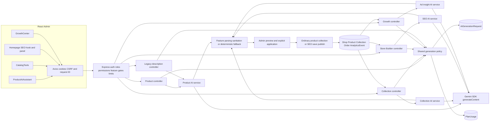
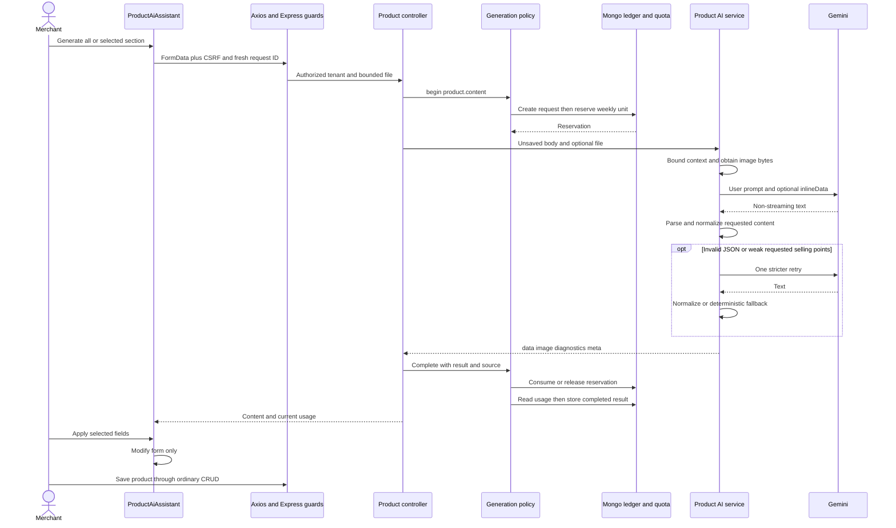
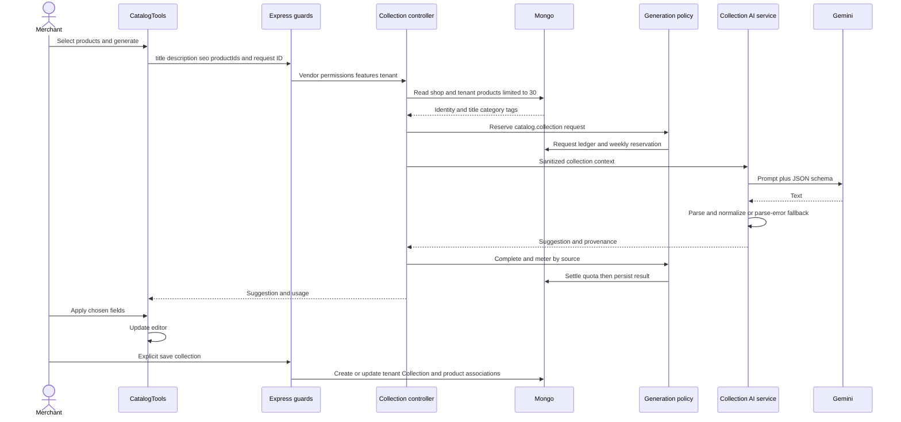
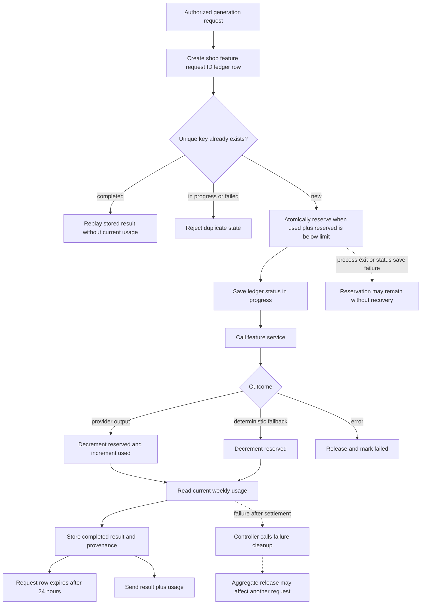

# Current AI architecture and data flow — 2026-10-10

Observed source architecture only. Live provider, browser, database indexes and deployment are unverified. Examples in the main report use illustrative values rather than captured traffic.

## Architecture

Guard routing and services: [APP] [PR] [CR] [SR] [GR] [PC] [CC] [SC] [GC] [LEG]. Shared policy writes are Mongo-based, without a Redis AI ledger/credit path. Each feature independently calls the SDK. [POL] [USAGE] [PCALL] [CP] [SP] [GP]

## Product generation sequence

Exact chain: AddProduct/EditProduct mount → generate/buildRequestData → /api/admin/products/ai/content-suggest → guards/Multer → generateProductContent → beginAiGeneration → generateProductContentSuggestion → callGemini → parse/clean/quality retry → completeAiGeneration → preview → applySections → normal save. [ADD] [EDIT] [PUI] [PR] [UPLOAD] [PC] [PCTX] [PGEN] [POL]

A File becomes base64 inlineData; a trusted URL is fetched server-side first. URL failure becomes text-only. Provider timeout rejects the local Promise.race without cancelling the model operation. Late output is not applied by this path. [PIMAGE] [PCALL]

## Collection generation sequence

No generated product IDs/rule execution occurs. Name maps to title, keywords are display-only, and suggestedRules have no editor application/persistence. Generation result is recorded automatically; collection content is saved separately. [CC] [CP] [CUI] [CVIEW] [CM] [CPERSIST]

## SEO and Growth execution paths

| Stage | Homepage SEO | Growth ad planning |
|---|---|---|
| UI/request | SeoAiPanel → hook sends currentTheme.seo/language/spelling, fresh ID | GrowthCenter sends productId/language/general campaign, fresh ID; selected range omitted |
| Guards | Vendor roles, storeBuilder permission, storeBuilder/homepageSeo features, 12 per 15min | Vendor roles, growthCenter permission/feature, aiAdGenerator, tenant+actor limiter |
| Context | Tenant shop plus public products 20 and active collections 10 | Tenant product plus activity, relevant aggregate searches/cities and shop |
| Prompt/call | seo.homepage v2.0.0, schema, 1800 tokens, 15s | growth.ad_planning v2.0.0, schema, 900 tokens, 7s |
| Parse/failure | Normalize 3 options, parse/count fallback; transport error fails | Normalize category/CTA/location/claims; all provider failures fallback |
| UI application | Selected title/description → draft autosave → explicit publish | Display/copy planning text; no campaign save/publish |
| Persistence | Ledger/usage; accepted SEO in draft/live theme/revisions | Ledger/usage; UI and clipboard |

Evidence: [SUI] [SPANEL] [SR] [SRL] [SC] [SS] [SP] [SGEN] [SPERSIST] [SPUBLISH] [GUI] [GR] [GC] [GDATA] [GCTX] [GP] [GOUT] [GGEN].

SEO accepted provenance is incomplete: source/fallback/meta are dropped by hook and theme normalizer; matching accepted fields are labeled ai in resolver. Growth normalizes model output with rule-derived additions and application-calculated evidence. [SUI] [SNORM] [SSOURCE] [GOUT]

## Usage, quota and application billing flow

Observed ordering is deliberately shown: no transaction spans reservation/request state or settlement/result. TTL deletes the ledger row without releasing PlanUsage.reserved. Reservation ownership is only shop+week, not a unique request reservation. Mongo unique indexes provide intended request/weekly keys; actual deployed indexes are unverified. [POL] [USAGE] [LEDGER] [UM]

This is application entitlement metering, not monetary provider billing. One completed provider result counts one unit; two product attempts can count one. Provider work preceding fallback/failure/timeout may still cost the provider account while no app unit is used. The code does not record tokens/prices or create AI credit balances. [PGEN] [POL] [LEDGER]

## Tenant and trust boundaries

The backend verifies JWT/user/membership/session/shop and uses req.tenantId. AI JSON shop IDs are not authoritative. Context product IDs are always looked up under tenant; Growth aggregates include shop filters; SEO uses public eligibility. Staff permissions/feature gates run before provider calls. Cross-tenant authenticated runtime testing remains open. [AUTH] [PERM] [GATE] [CC] [GC] [GDATA] [SC] [PUBLIC]

Merchant form text and image content cross into an external provider. Instructions delimit merchant JSON, but no prompt wording guarantees privacy or factual output. Product comments and analytics free text need an explicit public-data policy; hostname trust does not prove image ownership. Results are escaped and explicitly applied. [PCTX] [PPROMPT] [PIMAGE] [GP] [GDATA] [SPANEL] [INFO]

## Failure and retry contract differences

| Situation | Product | Collection | SEO | Growth |
|---|---|---|---|---|
| Missing key | 503 configured=false | 503 configured=false | 503 safe SEO code | Deterministic success fallback |
| Provider failure | 200 success=false with mapped providerCode | 200 success=false | 502 | Deterministic success fallback |
| Bad JSON | One stricter call, then fallback/error | Deterministic fallback | Deterministic 3 options | Deterministic fallback |
| Parsed incomplete object | Requested non-benefit fields not validated | Empty fields can be accepted | Three empty options become templates under provider source | Missing fields synthesized under provider source |
| Duplicate completed | Shared result replay without usage | Same | Same | Same |

Evidence: [PC] [CC] [SC] [PGEN] [CP] [SGEN] [GGEN] [POL]. No provider/model fallback, streaming, generation queue or client retry cancellation was found. Domain-event subscriber errors are swallowed by default, so F-002 specifically concerns DB operations after settlement; an ordinary subscriber failure is not claimed to trigger it. [EVENT]

## Source evidence index

References resolve to inspected current source. The range is displayed here; each link opens its first line. Verified on 2026-10-10.

[ADD]: <C:/Users/user/WebstormProjects/Shop-for-all/ecommerce-admin/src/pages/dashboard/products/AddProduct.jsx:459> "ecommerce-admin/src/pages/dashboard/products/AddProduct.jsx:459-522 — submit payload and assistant mount"
[APP]: <C:/Users/user/WebstormProjects/Shop-for-all/ecommerce-backend/backend/app.js:99> "ecommerce-backend/backend/app.js:99-174 — middleware and route registration"
[AUTH]: <C:/Users/user/WebstormProjects/Shop-for-all/ecommerce-backend/backend/middlewares/auth.js:20> "ecommerce-backend/backend/middlewares/auth.js:20-140 — attachUserFromToken"
[CC]: <C:/Users/user/WebstormProjects/Shop-for-all/ecommerce-backend/backend/controllers/collectionController.js:186> "ecommerce-backend/backend/controllers/collectionController.js:186-278 — suggestCollectionAi"
[CM]: <C:/Users/user/WebstormProjects/Shop-for-all/ecommerce-backend/backend/models/Collection.js:4> "ecommerce-backend/backend/models/Collection.js:4-54 — collectionSchema"
[CP]: <C:/Users/user/WebstormProjects/Shop-for-all/ecommerce-backend/backend/services/collections/collectionAiService.js:142> "ecommerce-backend/backend/services/collections/collectionAiService.js:142-269 — prompt / provider / generation"
[CPERSIST]: <C:/Users/user/WebstormProjects/Shop-for-all/ecommerce-backend/backend/controllers/collectionController.js:387> "ecommerce-backend/backend/controllers/collectionController.js:387-482 — createCollection / updateCollection"
[CR]: <C:/Users/user/WebstormProjects/Shop-for-all/ecommerce-backend/backend/routes/collectionRoutes.js:19> "ecommerce-backend/backend/routes/collectionRoutes.js:19-46 — collection guards and route"
[CUI]: <C:/Users/user/WebstormProjects/Shop-for-all/ecommerce-admin/src/pages/dashboard/CatalogTools.jsx:440> "ecommerce-admin/src/pages/dashboard/CatalogTools.jsx:440-494 — generateCollectionAi / applyCollectionAi"
[CVIEW]: <C:/Users/user/WebstormProjects/Shop-for-all/ecommerce-admin/src/pages/dashboard/CatalogTools.jsx:605> "ecommerce-admin/src/pages/dashboard/CatalogTools.jsx:605-645 — suggestion display"
[EDIT]: <C:/Users/user/WebstormProjects/Shop-for-all/ecommerce-admin/src/pages/dashboard/products/EditProduct.jsx:637> "ecommerce-admin/src/pages/dashboard/products/EditProduct.jsx:637-735 — save / assistant mount"
[EVENT]: <C:/Users/user/WebstormProjects/Shop-for-all/ecommerce-backend/backend/services/events/domainEventBus.js:29> "ecommerce-backend/backend/services/events/domainEventBus.js:29-51 — publish"
[GATE]: <C:/Users/user/WebstormProjects/Shop-for-all/ecommerce-backend/backend/middlewares/featureGate.js:27> "ecommerce-backend/backend/middlewares/featureGate.js:27-72 — requireShopFeature"
[GC]: <C:/Users/user/WebstormProjects/Shop-for-all/ecommerce-backend/backend/controllers/growthController.js:666> "ecommerce-backend/backend/controllers/growthController.js:666-743 — generateAdCopy"
[GCTX]: <C:/Users/user/WebstormProjects/Shop-for-all/ecommerce-backend/backend/services/adInsightAIService.js:432> "ecommerce-backend/backend/services/adInsightAIService.js:432-478 — sanitizeProductContext / metrics / shop"
[GDATA]: <C:/Users/user/WebstormProjects/Shop-for-all/ecommerce-backend/backend/controllers/growthController.js:24> "ecommerce-backend/backend/controllers/growthController.js:24-138 — getRangeStart / cities / search terms"
[GGEN]: <C:/Users/user/WebstormProjects/Shop-for-all/ecommerce-backend/backend/services/adInsightAIService.js:742> "ecommerce-backend/backend/services/adInsightAIService.js:742-812 — generateAdInsight"
[GOUT]: <C:/Users/user/WebstormProjects/Shop-for-all/ecommerce-backend/backend/services/adInsightAIService.js:584> "ecommerce-backend/backend/services/adInsightAIService.js:584-637 — cleanAdInsightResponse"
[GP]: <C:/Users/user/WebstormProjects/Shop-for-all/ecommerce-backend/backend/services/adInsightAIService.js:665> "ecommerce-backend/backend/services/adInsightAIService.js:665-740 — buildGeminiPrompt / callGemini"
[GR]: <C:/Users/user/WebstormProjects/Shop-for-all/ecommerce-backend/backend/routes/growthRoutes.js:19> "ecommerce-backend/backend/routes/growthRoutes.js:19-41 — growth guards / route"
[GUI]: <C:/Users/user/WebstormProjects/Shop-for-all/ecommerce-admin/src/pages/dashboard/GrowthCenter.jsx:227> "ecommerce-admin/src/pages/dashboard/GrowthCenter.jsx:227-274 — detail / generation / copy"
[INFO]: <C:/Users/user/WebstormProjects/Shop-for-all/packages/storefront-renderer/presentation/ProductInfo.jsx:85> "packages/storefront-renderer/presentation/ProductInfo.jsx:85-100 — description text rendering"
[LEDGER]: <C:/Users/user/WebstormProjects/Shop-for-all/ecommerce-backend/backend/models/AiGenerationRequest.js:3> "ecommerce-backend/backend/models/AiGenerationRequest.js:3-49 — request schema and indexes"
[LEG]: <C:/Users/user/WebstormProjects/Shop-for-all/ecommerce-backend/backend/controllers/productController.js:180> "ecommerce-backend/backend/controllers/productController.js:180-238 — generateDescription"
[PC]: <C:/Users/user/WebstormProjects/Shop-for-all/ecommerce-backend/backend/controllers/productController.js:248> "ecommerce-backend/backend/controllers/productController.js:248-361 — generateProductContent"
[PCALL]: <C:/Users/user/WebstormProjects/Shop-for-all/ecommerce-backend/backend/services/products/productContentAiService.js:685> "ecommerce-backend/backend/services/products/productContentAiService.js:685-756 — getGeminiTimeoutMs / callGemini"
[PCTX]: <C:/Users/user/WebstormProjects/Shop-for-all/ecommerce-backend/backend/services/products/productContentAiService.js:141> "ecommerce-backend/backend/services/products/productContentAiService.js:141-209 — normalizeRequestedSections / buildContext"
[PERM]: <C:/Users/user/WebstormProjects/Shop-for-all/ecommerce-backend/backend/middlewares/permission.js:4> "ecommerce-backend/backend/middlewares/permission.js:4-54 — requirePermission"
[PGEN]: <C:/Users/user/WebstormProjects/Shop-for-all/ecommerce-backend/backend/services/products/productContentAiService.js:759> "ecommerce-backend/backend/services/products/productContentAiService.js:759-883 — quality predicate / generation / meta"
[PIMAGE]: <C:/Users/user/WebstormProjects/Shop-for-all/ecommerce-backend/backend/services/products/productContentAiService.js:580> "ecommerce-backend/backend/services/products/productContentAiService.js:580-683 — fileToGeminiPart / fetchImageUrlPart / buildImagePart"
[POL]: <C:/Users/user/WebstormProjects/Shop-for-all/ecommerce-backend/backend/services/ai/aiGenerationPolicyService.js:13> "ecommerce-backend/backend/services/ai/aiGenerationPolicyService.js:13-151 — begin / complete / fail / replay"
[PPROMPT]: <C:/Users/user/WebstormProjects/Shop-for-all/ecommerce-backend/backend/services/products/productContentAiService.js:525> "ecommerce-backend/backend/services/products/productContentAiService.js:525-578 — buildPrompt"
[PR]: <C:/Users/user/WebstormProjects/Shop-for-all/ecommerce-backend/backend/routes/adminRoutes.js:832> "ecommerce-backend/backend/routes/adminRoutes.js:832-854 — product AI routes"
[PUBLIC]: <C:/Users/user/WebstormProjects/Shop-for-all/ecommerce-backend/backend/services/products/publicProductQueryService.js:1> "ecommerce-backend/backend/services/products/publicProductQueryService.js:1-11 — buildPublicProductQuery"
[PUI]: <C:/Users/user/WebstormProjects/Shop-for-all/ecommerce-admin/src/components/products/ProductAiAssistant.jsx:330> "ecommerce-admin/src/components/products/ProductAiAssistant.jsx:330-465 — generate / applySections"
[SC]: <C:/Users/user/WebstormProjects/Shop-for-all/ecommerce-backend/backend/controllers/storeBuilderController.js:269> "ecommerce-backend/backend/controllers/storeBuilderController.js:269-376 — suggestStoreSeo"
[SGEN]: <C:/Users/user/WebstormProjects/Shop-for-all/ecommerce-backend/backend/services/storeSeoAiService.js:224> "ecommerce-backend/backend/services/storeSeoAiService.js:224-290 — generateStoreSeoSuggestion"
[SNORM]: <C:/Users/user/WebstormProjects/Shop-for-all/packages/storefront-theme/index.cjs:373> "packages/storefront-theme/index.cjs:373-390 — SEO suggestion normalization"
[SP]: <C:/Users/user/WebstormProjects/Shop-for-all/ecommerce-backend/backend/services/storeSeoAiService.js:176> "ecommerce-backend/backend/services/storeSeoAiService.js:176-222 — buildPrompt / callGemini"
[SPANEL]: <C:/Users/user/WebstormProjects/Shop-for-all/ecommerce-admin/src/pages/dashboard/Seo/SeoAiPanel.jsx:1> "ecommerce-admin/src/pages/dashboard/Seo/SeoAiPanel.jsx:1-43 — SeoAiPanel"
[SPERSIST]: <C:/Users/user/WebstormProjects/Shop-for-all/ecommerce-backend/backend/services/storeBuilder/storeBuilderSeoService.js:138> "ecommerce-backend/backend/services/storeBuilder/storeBuilderSeoService.js:138-190 — saveStoreBuilderSeoDraft"
[SPUBLISH]: <C:/Users/user/WebstormProjects/Shop-for-all/ecommerce-backend/backend/services/storeBuilder/storeBuilderSeoService.js:231> "ecommerce-backend/backend/services/storeBuilder/storeBuilderSeoService.js:231-257 — publishStoreBuilderSeo"
[SR]: <C:/Users/user/WebstormProjects/Shop-for-all/ecommerce-backend/backend/routes/storeBuilderRoutes.js:121> "ecommerce-backend/backend/routes/storeBuilderRoutes.js:121-130 — SEO AI route"
[SRL]: <C:/Users/user/WebstormProjects/Shop-for-all/ecommerce-backend/backend/routes/storeBuilderRoutes.js:48> "ecommerce-backend/backend/routes/storeBuilderRoutes.js:48-57 — storeBuilderAiLimiter"
[SS]: <C:/Users/user/WebstormProjects/Shop-for-all/ecommerce-backend/backend/services/storeSeoAiService.js:66> "ecommerce-backend/backend/services/storeSeoAiService.js:66-174 — normalizeAlternative / buildSafeContext"
[SSOURCE]: <C:/Users/user/WebstormProjects/Shop-for-all/packages/storefront-theme/homepage-seo.cjs:201> "packages/storefront-theme/homepage-seo.cjs:201-216 — findAcceptedAiSource / resolveTextField"
[SUI]: <C:/Users/user/WebstormProjects/Shop-for-all/ecommerce-admin/src/pages/dashboard/Seo/hooks/useHomepageSeo.js:277> "ecommerce-admin/src/pages/dashboard/Seo/hooks/useHomepageSeo.js:277-313 — requestAiSuggestions / applyAiSuggestion"
[UM]: <C:/Users/user/WebstormProjects/Shop-for-all/ecommerce-backend/backend/models/PlanUsage.js:3> "ecommerce-backend/backend/models/PlanUsage.js:3-27 — usage schema and unique index"
[UPLOAD]: <C:/Users/user/WebstormProjects/Shop-for-all/ecommerce-backend/backend/routes/adminRoutes.js:300> "ecommerce-backend/backend/routes/adminRoutes.js:300-337 — productAiImageUpload / productAiLimiter"
[USAGE]: <C:/Users/user/WebstormProjects/Shop-for-all/ecommerce-backend/backend/services/billing/planUsageService.js:1> "ecommerce-backend/backend/services/billing/planUsageService.js:1-94 — weekly quota reservation / settlement"

- **ADD**: [ecommerce-admin/src/pages/dashboard/products/AddProduct.jsx:459-522 — submit payload and assistant mount][ADD]
- **APP**: [ecommerce-backend/backend/app.js:99-174 — middleware and route registration][APP]
- **AUTH**: [ecommerce-backend/backend/middlewares/auth.js:20-140 — attachUserFromToken][AUTH]
- **CC**: [ecommerce-backend/backend/controllers/collectionController.js:186-278 — suggestCollectionAi][CC]
- **CM**: [ecommerce-backend/backend/models/Collection.js:4-54 — collectionSchema][CM]
- **CP**: [ecommerce-backend/backend/services/collections/collectionAiService.js:142-269 — prompt / provider / generation][CP]
- **CPERSIST**: [ecommerce-backend/backend/controllers/collectionController.js:387-482 — createCollection / updateCollection][CPERSIST]
- **CR**: [ecommerce-backend/backend/routes/collectionRoutes.js:19-46 — collection guards and route][CR]
- **CUI**: [ecommerce-admin/src/pages/dashboard/CatalogTools.jsx:440-494 — generateCollectionAi / applyCollectionAi][CUI]
- **CVIEW**: [ecommerce-admin/src/pages/dashboard/CatalogTools.jsx:605-645 — suggestion display][CVIEW]
- **EDIT**: [ecommerce-admin/src/pages/dashboard/products/EditProduct.jsx:637-735 — save / assistant mount][EDIT]
- **EVENT**: [ecommerce-backend/backend/services/events/domainEventBus.js:29-51 — publish][EVENT]
- **GATE**: [ecommerce-backend/backend/middlewares/featureGate.js:27-72 — requireShopFeature][GATE]
- **GC**: [ecommerce-backend/backend/controllers/growthController.js:666-743 — generateAdCopy][GC]
- **GCTX**: [ecommerce-backend/backend/services/adInsightAIService.js:432-478 — sanitizeProductContext / metrics / shop][GCTX]
- **GDATA**: [ecommerce-backend/backend/controllers/growthController.js:24-138 — getRangeStart / cities / search terms][GDATA]
- **GGEN**: [ecommerce-backend/backend/services/adInsightAIService.js:742-812 — generateAdInsight][GGEN]
- **GOUT**: [ecommerce-backend/backend/services/adInsightAIService.js:584-637 — cleanAdInsightResponse][GOUT]
- **GP**: [ecommerce-backend/backend/services/adInsightAIService.js:665-740 — buildGeminiPrompt / callGemini][GP]
- **GR**: [ecommerce-backend/backend/routes/growthRoutes.js:19-41 — growth guards / route][GR]
- **GUI**: [ecommerce-admin/src/pages/dashboard/GrowthCenter.jsx:227-274 — detail / generation / copy][GUI]
- **INFO**: [packages/storefront-renderer/presentation/ProductInfo.jsx:85-100 — description text rendering][INFO]
- **LEDGER**: [ecommerce-backend/backend/models/AiGenerationRequest.js:3-49 — request schema and indexes][LEDGER]
- **LEG**: [ecommerce-backend/backend/controllers/productController.js:180-238 — generateDescription][LEG]
- **PC**: [ecommerce-backend/backend/controllers/productController.js:248-361 — generateProductContent][PC]
- **PCALL**: [ecommerce-backend/backend/services/products/productContentAiService.js:685-756 — getGeminiTimeoutMs / callGemini][PCALL]
- **PCTX**: [ecommerce-backend/backend/services/products/productContentAiService.js:141-209 — normalizeRequestedSections / buildContext][PCTX]
- **PERM**: [ecommerce-backend/backend/middlewares/permission.js:4-54 — requirePermission][PERM]
- **PGEN**: [ecommerce-backend/backend/services/products/productContentAiService.js:759-883 — quality predicate / generation / meta][PGEN]
- **PIMAGE**: [ecommerce-backend/backend/services/products/productContentAiService.js:580-683 — fileToGeminiPart / fetchImageUrlPart / buildImagePart][PIMAGE]
- **POL**: [ecommerce-backend/backend/services/ai/aiGenerationPolicyService.js:13-151 — begin / complete / fail / replay][POL]
- **PPROMPT**: [ecommerce-backend/backend/services/products/productContentAiService.js:525-578 — buildPrompt][PPROMPT]
- **PR**: [ecommerce-backend/backend/routes/adminRoutes.js:832-854 — product AI routes][PR]
- **PUBLIC**: [ecommerce-backend/backend/services/products/publicProductQueryService.js:1-11 — buildPublicProductQuery][PUBLIC]
- **PUI**: [ecommerce-admin/src/components/products/ProductAiAssistant.jsx:330-465 — generate / applySections][PUI]
- **SC**: [ecommerce-backend/backend/controllers/storeBuilderController.js:269-376 — suggestStoreSeo][SC]
- **SGEN**: [ecommerce-backend/backend/services/storeSeoAiService.js:224-290 — generateStoreSeoSuggestion][SGEN]
- **SNORM**: [packages/storefront-theme/index.cjs:373-390 — SEO suggestion normalization][SNORM]
- **SP**: [ecommerce-backend/backend/services/storeSeoAiService.js:176-222 — buildPrompt / callGemini][SP]
- **SPANEL**: [ecommerce-admin/src/pages/dashboard/Seo/SeoAiPanel.jsx:1-43 — SeoAiPanel][SPANEL]
- **SPERSIST**: [ecommerce-backend/backend/services/storeBuilder/storeBuilderSeoService.js:138-190 — saveStoreBuilderSeoDraft][SPERSIST]
- **SPUBLISH**: [ecommerce-backend/backend/services/storeBuilder/storeBuilderSeoService.js:231-257 — publishStoreBuilderSeo][SPUBLISH]
- **SR**: [ecommerce-backend/backend/routes/storeBuilderRoutes.js:121-130 — SEO AI route][SR]
- **SRL**: [ecommerce-backend/backend/routes/storeBuilderRoutes.js:48-57 — storeBuilderAiLimiter][SRL]
- **SS**: [ecommerce-backend/backend/services/storeSeoAiService.js:66-174 — normalizeAlternative / buildSafeContext][SS]
- **SSOURCE**: [packages/storefront-theme/homepage-seo.cjs:201-216 — findAcceptedAiSource / resolveTextField][SSOURCE]
- **SUI**: [ecommerce-admin/src/pages/dashboard/Seo/hooks/useHomepageSeo.js:277-313 — requestAiSuggestions / applyAiSuggestion][SUI]
- **UM**: [ecommerce-backend/backend/models/PlanUsage.js:3-27 — usage schema and unique index][UM]
- **UPLOAD**: [ecommerce-backend/backend/routes/adminRoutes.js:300-337 — productAiImageUpload / productAiLimiter][UPLOAD]
- **USAGE**: [ecommerce-backend/backend/services/billing/planUsageService.js:1-94 — weekly quota reservation / settlement][USAGE]
