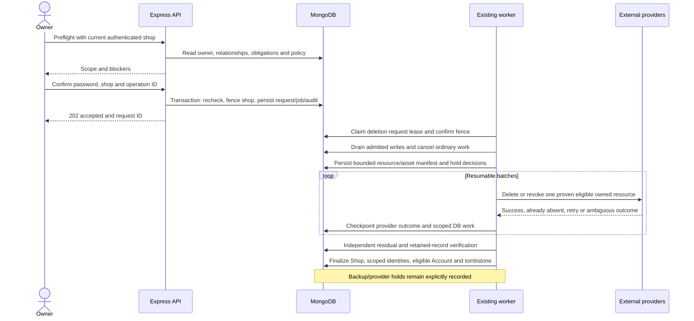

# Recommended architecture and failure recovery

Everything in the proposed design is a blueprint, not implemented behavior. Reuse the current monolith, MongoDB transactions and Mongo-backed worker. External operations cannot participate in a MongoDB transaction.

## Options

| Option | Benefits | Failure modes | Assessment |
|---|---|---|---|
| A: synchronous API cascade | Few initial modules | Request timeout, unbounded transaction/manifest, external partial failure, lost response, no resumable evidence, races with existing writers | Unsuitable for production shops. A synchronous preflight/acceptance transaction is still appropriate. |
| B: background deletion only | Existing claims/retries/idempotency can be reused | Shop remains writable until cleanup; child data can be recreated and providers called after removal | Necessary but incomplete. |
| C: staged shutdown, durable cleanup, retries and verification | Separates admission, obligations, DB batches, provider recovery and final evidence | Requires lifecycle guards and approved retained access; staged deployment is mandatory | **Recommended, using the existing services and worker.** |

Sources for reusable behavior: [Job queue](/Users/user/Downloads/Shop-for-all/ecommerce-backend/backend/services/jobQueueService.js:15), [critical transaction/outbox](/Users/user/Downloads/Shop-for-all/ecommerce-backend/backend/services/platformAuditOutboxService.js:119), [distributed lease](/Users/user/Downloads/Shop-for-all/ecommerce-backend/backend/services/workers/distributedLeaseService.js:1).

## Proposed durable records

Use at most two focused new model families initially; exact names are proposed:

- `DeletionRequest`: requestId, targetType, targetShopId, requestingAccountId, explicit account scope, normalized operation key/hash, policy version, reviewed relationship version, acceptance/cutoff time, phase, execution lease/fence, bounded receipt-grant hash/expiry, batch checkpoints/counts, obligation/hold summaries, retry/error codes and verification outcome. It must remain usable after Shop/User removal. Unique active target and account-scoped operation identity prevent duplicates. No password, NID or full customer/provider payloads.
- `DeletionItem`: bounded per-resource/per-asset manifest and outcomes, keyed uniquely by request/resource/stable identity; includes selector version, action/hold decision, minimal provider identifiers/resource/delivery type, attempts and terminal outcome. Use pages or individual rows; do not embed every product/order/media ID into one 16 MiB Mongo document or an unbounded Job payload.

On completion, strip unnecessary request/item content under the approved policy and retain a minimal authoritative anti-resurrection tombstone: immutable tenant/account identities where authorized, lifecycle generation/cutoff, policy version and completion/retention outcome. This can be the minimized request record, not another microservice. Its recovery source must survive restoring the tenant database to an older backup; a same-backup copy alone is insufficient. The secure independent copy, access controls, identifiers and retention duration are an operational/legal decision.

Retained commercial/evidence rows need explicit classification and expiry/review information. Choose how to represent holds consistently during implementation; do not assume `isDeleted` or NID-only retention fields implement a retention registry.

## State and completion contract

Proposed states: `requested` → `eligibility_review` → `blocked_obligations` **or** `quiescing` → `manifesting` → `cleaning` → `verifying` → `completed_with_retention` / `completed_live_erasure`. Recoverable errors use `retry_wait`; exhausted/ambiguous operations use `needs_operator`. Do not treat an attempt limit as success. A deletion state in Shop is monotonic and separate from billing/verification suspension. Missing legacy state means active only during a controlled compatible rollout, never for a tombstoned ID.

Decision required: whether an obligation-blocked request closes sales immediately. If it does, retained fulfillment/refund/history access must be available before rollout. The minimal first version can block acceptance of destructive cleanup until obligations are settled and make closure an explicit reviewed phase. Do not globally suspend an Account with other memberships.

## Write fence and in-flight work: essential correctness requirement

Middleware checks are admission hints, not a transaction barrier. A transaction that only reads Shop and writes Product/Order can commit from an older snapshot after shutdown unless it conflicts with a shared fence. Merely cancelling queued/running Jobs changes database state; it does not stop JavaScript or an already submitted provider request.

Proposed minimum:

1. Record a deletion generation and cutoff atomically with acceptance. Add an explicit lifecycle predicate to every producer, consumer, lazy-create path, webhook handler, public alternate path and periodic scan.
2. Each shop mutation must participate in a database-enforced fence. For transaction-backed mutations, perform a conditional write/touch to the Shop lifecycle gate in the **same transaction** as domain writes, with a conflict against the closing transition; reread on retry. Never rely solely on a snapshot read. A per-shop sequence gate can be simple but serializes writes; load-test contention. If a separate operation-lease mechanism is chosen, its admission and cutoff must themselves be atomic and fenced.
3. Nontransactional writers need explicit conversion to a short transactional gate plus write, or an equivalent proven fenced-operation protocol. Updating every model through a generic delete plugin is not a substitute: ownership and retention differ.
4. External operations need an admitted operation/Job identity and bounded lifetime. Check persisted cancellation/lifecycle immediately before the side effect, record its result and let deletion wait for already admitted operations to drain or become reconciled. There is no atomic DB/provider cutoff; classify ambiguous submissions and do not purge their tracking evidence prematurely.
5. Block stale retries and completion handlers from creating new content after the fence; allow only the deletion executor and specifically approved retained-obligation operations. An inactive-plan exception is never a deletion exception.
6. Periodic scans, scripts and operators must use the same contract. Stop old application/worker versions before accepting destructive requests. Gate fails closed if lifecycle/deletion control data cannot be resolved.

This is the largest compatibility change. Prove it against real MongoDB interleavings for checkout, receiving, uploads, AI settlement, billing approval and publishing before enabling cleanup. New deletion functionality must not claim the current application already enforces this barrier.

## Cleanup order

1. Resolve owner/account scope and retention/obligations. Revalidate during acceptance.
2. Fence admissions; close approved public commerce; revoke affected sessions/OTP/reset/marketing proofs; cancel queued jobs, scheduled work and plan changes. Quiesce running requests, providers, webhooks, audit outbox and periodic/recovery loops.
3. Capture all resource IDs, hidden fields, indirect children, legacy URLs, asset IDs/types, embedded snapshots, domain/subdomain identity and retained references. Include archived/soft-deleted/expired-but-not-purged data. Resolve SupportMessage/Assignment children **before** deleting SupportTicket and outbox audit scopes before removing parents.
4. Settle/quarantine AI accounting, uncertain email/courier calls and financial obligations. Confirm which order/product/inventory dependencies remain for restricted obligations. Freeze the manifest and policy version, then reconcile late admitted operations into a final manifest before purge.
5. Process eligible provider assets with per-item state while IDs still exist. Do not delete a resource referenced by another tenant or an approved retained record. Unknown ownership is a held item needing reconciliation, not permission to delete a shared folder.
6. Purge/minimize tenant leaf rows in batches, then parent content. A batch transaction records its checkpoint atomically with database changes. `$in` IDs must be intersected with tenant/ownership evidence; mismatches stop for investigation rather than widening scope.
7. Invalidate exact tenant/host/application caches, address Next/server/CDN caching and publish unavailable/noindex outcomes. Repeat invalidation after cleanup/recovery so stale writers cannot repopulate outputs.
8. Remove scoped membership/profile/permissions/User artifacts late; finalize Shop only after live deletion verification and retained-history compatibility are proven. If retention requires a minimal Shop shell today, call the state `completed_with_retention` and disclose it; do not call it complete account/shop removal. Account removal is conditional on the separately authorized relationship census.
9. Minimize manifest/request, retain required holds and suppression tombstone, schedule finite hold re-evaluation and final expiry. Retained rows remain in residual verification as declared exceptions, not invisible exclusions.

## Failure recovery

| Failure | Recovery requirement |
|---|---|
| Acceptance commits, response lost | Same operation identity resolves to the persisted request; the pre-submission read-only receipt capability can confirm minimal status even after session/Account removal. It is not a mutation credential. No duplicate fence, job or charge. |
| Crash after database batch | Transactional checkpoint and stable keyset batches permit safe replay; deleted IDs are already absent. |
| Cloudinary succeeds, checkpoint fails | Retry the exact ID/type; verify provider “not found/already removed” semantics and record absence as success only for the intended resource. |
| Provider timeout or rate limit | Keep item pending/ambiguous, backoff with bounded concurrency; retain manifest; no global busy-loop or false completion. |
| Worker lease expires while old executor runs | Conditional lease/fence ownership on every checkpoint and admission; old executor cannot finalize or recreate data. External calls still require reconciliation. |
| Held record remains | Record reason, responsible role, review/expiry and next action; finalize only with disclosed retention state. |
| Shop/User removed early by another actor | Executor resolves request/manifest independent of parents; incompatible governance actions should already be blocked. |
| Deletion job purges its own queue row | Explicitly exclude the orchestrator by exact request identity; final progress is in DeletionRequest, not Job alone. |
| Old backup restored | No traffic or background processing until current tombstones are overlaid and erasure/holds reapplied. |

Do not restore a deleted tenant as a generic software rollback. Before destructive work, a carefully approved cancellation may unfreeze the shop if nothing irreversible happened. Afterwards, deploy fixes and resume; never undo deletion by replaying old data.

## Backups and disaster recovery assessment

**Confirmed:** the repository [backup runbook](/Users/user/Downloads/Shop-for-all/docs/operations/backup-restore.md:1) recommends daily backups, seven daily and four weekly restore points and a monthly drill. These are recommendations, not proof of enabled settings or actual retention. Railway/Docker deployment files do not establish backup configuration. No automated per-tenant backup erasure or deletion-ledger reconciliation was found.

**Unknown:** deployed MongoDB host/tier, snapshot/PITR/replica retention, exports, compliance lock, Cloudinary backups, log archives, selective deletion and independently stored backup copies. Do not claim a fixed erasure date until operators supply evidence.

For Atlas specifically, snapshot deletion is a whole-snapshot operation and a Backup Compliance Policy can prevent deletion; its relevance depends on the actual deployment. Do not remove a shared snapshot to erase one shop. [MongoDB snapshot management](https://www.mongodb.com/docs/atlas/backup/cloud-backup/snapshot-management/).

Proposed restore drill: isolate the restore; disable jobs/provider egress; obtain the current authoritative deletion/hold ledger independent of the restored timestamp; suppress deleted IDs and unsafe domain reuse; reapply erasure and approved holds; reconcile restored outbox/jobs/AI receipts/webhooks; flush recovered Redis and frontend caches; check login/reset/checkout/history and unrelated tenants; verify Cloudinary references cannot restore removed assets; only then permit traffic and workers. Record the ledger revision and residual report. A backup expiry statement must distinguish live application removal from immutable copies awaiting scheduled expiry.
