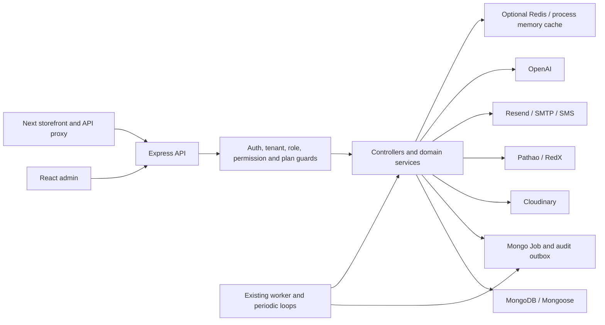
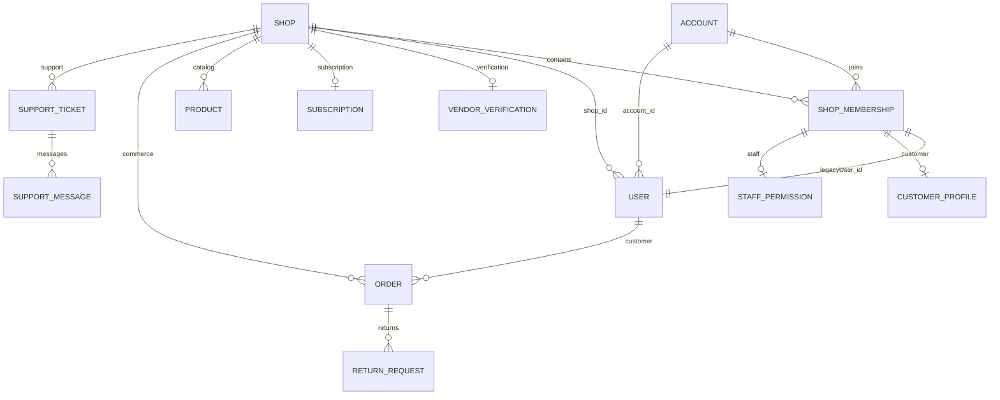

# Architecture, ownership and dependency impact

## Confirmed architecture

Evidence: [app route mounting](/Users/user/Downloads/Shop-for-all/ecommerce-backend/backend/app.js:154), [worker entry](/Users/user/Downloads/Shop-for-all/ecommerce-backend/backend/workers/index.js:69), [cache service](/Users/user/Downloads/Shop-for-all/ecommerce-backend/backend/services/cacheService.js:1), [storefront server fetching](/Users/user/Downloads/Shop-for-all/ecommerce-storefront/src/lib/storefrontServer.js:72). Shared `packages/storefront-theme` and `packages/storefront-renderer` are application code, not tenant-owned resources. The search service queries MongoDB; no external search index implementation was found. [Store search](/Users/user/Downloads/Shop-for-all/ecommerce-backend/backend/services/search/storeSearchService.js:90).

Cardinalities describe intended schema relationships, not verified production completeness. Mongo refs are not foreign-key cascades. `VendorVerification.owner_id` is polymorphic Account/User and is the registration owner evidence; `Shop` has no owner field. Products embed variants/inventory/options; Orders embed commercial/shipping/payment snapshots; Shop embeds theme, branding, SEO, domains and courier credentials. Drafts/revisions repeat theme/media/entity references. [Identity creation](/Users/user/Downloads/Shop-for-all/ecommerce-backend/backend/services/identityService.js:39), [registration owner](/Users/user/Downloads/Shop-for-all/ecommerce-backend/backend/controllers/authController.js:505).

## Ownership questions answered from behavior

| Question | Confirmed answer / limitation |
|---|---|
| Can one person own multiple shops? | The membership schema permits several VendorAdmin memberships for an Account. The public vendor registration flow rejects an email that already has an Account, so that flow does **not** offer another owned shop. Login explicitly handles multiple memberships. Actual legacy/imported multi-owner-shop relationships are unknown. Do not assume one shop when deleting an Account. |
| Can a shop have multiple owners? | More than one VendorAdmin Account is schema-permitted, but normal staff creation is VendorStaff only. Verification records one polymorphic owner per shop. No co-owner agreement or ownership transfer contract was found. Multiple administrators must not be assumed to be interchangeable owners. |
| Can staff belong to multiple shops? | Yes in the data/creation path: staff creation can reuse an existing Account after checking that Account's password and creates a separate tenant membership/User. |
| Can a customer also be a vendor? | Across different shops, yes: customer registration can reuse a verified-password Account, including an existing vendor Account. A shop/account pair is unique and stores one role, so simultaneous customer/vendor membership roles in the **same** shop are not modeled. Guest checkout also creates tenant Users without necessarily creating Accounts. |
| Do vendor/customer accounts share a model? | Yes: global Account credentials plus role-specific tenant Users/memberships. Guest and legacy Users require separate discovery. |
| Can disabled/deleted identities authenticate? | Modern auth rejects missing/inactive Account/User/membership/Shop. Vendor legacy tokens check User/Shop/version. The legacy non-vendor branch does not perform equivalent liveness checks. Login/reset can lazily recreate identity artifacts from legacy Users; some login filtering uses optional populated shop fields and is not a deletion contract. |
| Does authorization check shop status? | Modern auth and `resolveTenant` check `isActive`/suspension, with intentional billing/verification recovery exceptions. Some public handlers independently resolve Shop; workers have entitlement checks and inactive-queue exceptions. There is no deleting/deleted lifecycle check shared by all these paths. |
| Is shop switching a separate session service? | No explicit switch-shop endpoint was found. Login selects a shop/subdomain and returns 409 for ambiguous memberships except its single-vendor-membership preference. Other memberships must remain usable via this existing login selection. |

Evidence: [membership uniqueness](/Users/user/Downloads/Shop-for-all/ecommerce-backend/backend/models/ShopMembership.js:44), [vendor email restriction](/Users/user/Downloads/Shop-for-all/ecommerce-backend/backend/controllers/authController.js:439), [customer reuse](/Users/user/Downloads/Shop-for-all/ecommerce-backend/backend/controllers/authController.js:623), [staff reuse](/Users/user/Downloads/Shop-for-all/ecommerce-backend/backend/controllers/userController.js:168), [login membership selection](/Users/user/Downloads/Shop-for-all/ecommerce-backend/backend/controllers/authController.js:855), [guest creation](/Users/user/Downloads/Shop-for-all/ecommerce-backend/backend/controllers/publicController.js:433), [authentication branches](/Users/user/Downloads/Shop-for-all/ecommerce-backend/backend/middlewares/auth.js:20).

## Impact matrix

**Important interpretation:** `deleting` is a proposed state. Today it is absent, so adding an arbitrary flag alone has no effect. “Shutdown” below means also setting the existing inactive/suspended fields. Missing data effects are code-derived predictions unless a cited existing test exercises that boundary. No shop or resource was deleted to produce this audit.

| Risk / workflow | Deleting/shutdown today | If related data is missing | Late writes / recreation | Customer access and error impact | Required guard or compatibility change |
|---|---|---|---|---|---|
| Critical — login, token verification, logout | Modern auth blocks inactive shops except recovery; logout only clears this cookie. | Modern identities fail 401; an orphaned login path needs explicit rejection. | Legacy migration can recreate Account/membership from remaining Users. | Other memberships can lose access if Account is deleted globally. | Modern owner-only admission, scoped revocation, tombstone-aware login and reset; account finalization only after relationship eligibility. |
| High — password reset / password change | Reset resolves active shop; shared account passwords affect its Users. | Reset target can disappear or remain on a legacy record. | Reset fallback creates identity artifacts; a consumed proof must not authorize deletion. | Unrelated shop credentials must remain intact. | Fence reset/identity migration for deleting targets; remove only scoped reset proofs; full Account proof cleanup only when authorized. |
| Critical — staff / customer profile / shop selection | Existing status controls affect membership and User independently. | Populated membership/user/profile becomes null. | Staff creation or customer registration can add new rows after an early check. | Deleting a shared Account harms independent relationships. | Freeze membership creation and profile changes; drain writes; preserve other Account relationships and global support identities. |
| Critical — both checkout paths and order placement | Tenant routes block unavailable Shop; `/public/orders` has its own active-shop query. | Missing products/variants cause rejection; missing Shop makes store unavailable. | A transaction admitted earlier can create User, Order, ConsentLog, InventoryLog and jobs after a middleware check. | New purchases must stop cleanly; unrelated checkout must remain live. | Fence inside both checkout transactions; reject new checkout OTP/proofs; drain admitted transactions before inventory/catalog removal. |
| Critical — order history and public tracking | Current tenant resolver blocks history/tracking along with commerce; independent public lookup also requires a valid active shop. | Missing Shop/User or deleted orders prevent discovery; missing populated parents can affect serializers. | Access OTP and status work may continue from previously resolved objects. | Customers may lose receipts, delivery evidence and necessary support. | Approve and implement restricted historical reads/support using retained snapshots and existing order-access scope; never simply allow all inactive shops. |
| Critical — cancellation, returns and refund inventory restoration | Tenant-gated public actions stop; vendor operations depend on normal auth. | Restoration loads Product/variant and can fail if catalog is purged. | Accepted cancellation/refund request can write inventory and logs later. | Paid customers may lose refund/return capability. | Block destructive purge until obligations resolved or an approved restricted operator workflow exists; preserve inventory restoration markers/dependencies. |
| High — order/status email and courier synchronization | Normal courier jobs use entitlement checks; receipt queue deliberately allows inactive shops. | Missing Shop/Order can fail and retry/dead-letter; provider shipment already exists. | In-flight provider calls cannot be undone by cancelling a Job. | Lost tracking, duplicate parcel or unwanted post-closure notification. | Drain/reconcile calls; prevent new dispatch; retain shipment truth; allow only specifically approved obligation handling. |
| High — products/variants/media | New state ignored; normal auth/status blocks only later requests. | Variant/image references can become stale; cleanup can lose media identifiers. | A pre-admitted update/upload can persist or leave a provider orphan. | Inconsistent stock/catalog or media leakage. | Shared write fence and upload admission, immutable asset capture, scoped cleanup including archived/soft-deleted records. |
| High — inventory adjustments / reservations / purchase receiving | User permission and stock transactions exist. | Missing variants break movement/receiving/refund paths. | Existing transactions or receiving jobs can update quantities/logs after cutoff. | Fulfillment integrity and audit trail can be lost. | Drain operations and verify reservedStock/PO obligations; no synthetic stock reset as a deletion shortcut. |
| High — categories / collections / promotions / reviews | No deletion lifecycle check of their own. | Slugs, collection arrays, banner/product references and ratings become dangling. | Review rating recalculation and catalog editors can still update Product. | Cached links and public cards can reference missing entities. | Fence writers; retain required snapshots; remove tenant secondary references and invalidate cached content. |
| High — scheduled publishing / sales / banners | Queue gates cover some features; direct periodic scans also execute. | A missing product/shop can fail, skip or leave scheduled state. | Idle worker invokes overdue publishing and sale processing outside Job dispatch. | Deleted storefront may be repopulated or stale promotions shown. | Guard direct scan selection and per-row execution, cancel jobs and block all publication/plan reactivation. |
| Critical — subscription reads / renewal / payment approval | Billing/verification recovery intentionally works for some suspended shops. | Plan access fails if Shop is gone; if Shop remains and Subscription is removed, `ensureSubscriptionExists` recreates it. | Lifecycle, approval, reconciliation and upgrade handlers can update Shop/Users or create records. | False renewal/debt status; unwanted reactivation. | Explicit deletion fence before lazy creation, approval and reconciliation; settle obligations before removing billing dependencies. |
| High — email campaigns / consent / SMS / welcome | Some queues independent of inactive entitlement; sending helpers can run from retained payloads. | Missing recipient/campaign may be ignored or fail; provider-accepted messages remain external. | Reconciliation scans and consent tokens can update records; queued payloads contain PII. | Unwanted sends or lost unsubscribe/suppression evidence. | Cancel producers and consumers, reconcile uncertain sends, stop consent promotion, apply approved suppression retention. |
| High — Resend webhook | Signed webhook bypasses browser CSRF by design. | Missing recipient/delivery is ignored; this is helpful but insufficient before removal. | A matching surviving recipient causes EmailWebhookEvent creation and suppression/count updates. | New PII/metadata can reappear during cleanup. | Deletion-aware event suppression/minimal receipt handling before mutations; do not use ordinary vendor auth for webhook authorization. |
| High — AI requests / accounting / history | AI admission uses plan/operation services, not a deletion fence. | Missing Shop stops plan resolution; deleting receipts early can make settlement unrecoverable. | Running provider calls, recovery and content saves can materialize results or receipts. | Uncertain credit usage, retained prompts/results and orphan artifacts. | Freeze admissions; settle or explicitly quarantine in-flight accounting; fence result/history writes, then remove eligible payloads. |
| High — Store Builder / branding / SEO revisions | Normal admin guards cover entry; optimistic concurrency protects drafts. | Removing assets before revisions loses ownership/reference evidence. | Autosave, publish/restore, compatibility normalization and cleanup workers need lifecycle guards. | Theme restores can bring back media/content; dead links remain. | Drain autosave/publish; fence revisions/restores and asset promotion; inventory all legacy and restricted theme fields. |
| High — domain routing / storefront cache / SEO | Tenant resolution reads DB rather than trusting recovered Redis for availability. | Missing Shop returns unavailable/not found; cached Next/public output can persist independently. | DNS field ensure path can save Shop; domain reassignment or restore can reuse identity. | Old storefront content or customer links may appear under reassigned host. | Revoke public admission, invalidate every tenant/host cache, define domain/subdomain quarantine and retained-history addressing. |
| Medium — analytics / reports / growth | Public events have separate routes; raw events and rollups are tenant-specific. | Missing parent may break plan lookup; existing aggregates can retain old names/IDs. | Rollup script upserts metrics from raw records; event requests can insert after cutoff. | Old reports persist, aggregate totals shift. | Fence ingest/rollup/upserts; purge raw and derived datasets consistently or keep approved anonymous aggregates. |
| High — support / abuse / platform audits | Platform support uses separate role access; support queue allows inactive shops. | Tickets lose parent context; child messages/history have only ticketId. | Notifications and audit outbox can create new records after deleting parent logs. | Evidence or required support can be lost; shared agents must remain. | Resolve ticket IDs before parent deletion; retain/strip evidence under policy; drain/redact outbox; do not remove global agents/issues. |
| Medium — Super Admin reports/governance | Platform controls may still change approval, plan, domain or sessions. | Populated Shop/Account may be null; reports should not invent live shops. | Operator reactivation or job replay can undo ordinary suspension. | Operational confusion or accidental resurrection. | Show deleting/held/completed distinctly; block incompatible governance transitions and replay for deleted tenants. |
| High — backups / logs / restore | No deletion suppression ledger exists. | Backups retain older documents and assets. | Restore or subsequent outbox/worker replay can resurrect data. | “Permanent” promises become inaccurate. | Independent tombstone replay before traffic; finite verified backup/log lifecycle and provider reporting. |

Workflow evidence: [tenant routes](/Users/user/Downloads/Shop-for-all/ecommerce-backend/backend/routes/storefrontRoutes.js:185), [public order transaction](/Users/user/Downloads/Shop-for-all/ecommerce-backend/backend/controllers/publicController.js:274), [authenticated orders](/Users/user/Downloads/Shop-for-all/ecommerce-backend/backend/controllers/orderController.js:241), [return service](/Users/user/Downloads/Shop-for-all/ecommerce-backend/backend/controllers/returnController.js:1), [worker loop](/Users/user/Downloads/Shop-for-all/ecommerce-backend/backend/workers/index.js:161), [webhook mutations](/Users/user/Downloads/Shop-for-all/ecommerce-backend/backend/services/mail/resendWebhookService.js:74), [AI recovery](/Users/user/Downloads/Shop-for-all/ecommerce-backend/backend/services/ai/aiAccountingRecoveryService.js:1), [rollup script](/Users/user/Downloads/Shop-for-all/ecommerce-backend/backend/scripts/runAnalyticsRollup.js:1), [review ratings](/Users/user/Downloads/Shop-for-all/ecommerce-backend/backend/models/Review.js:27).

## Minimal frontend integration blueprint

**Location:** a separate owner-only irreversible-actions section after existing Store Settings sections in [ShopSettings.jsx](/Users/user/Downloads/Shop-for-all/ecommerce-admin/src/pages/dashboard/settings/ShopSettings.jsx:103). Settings currently allows VendorStaff with settings permission through [App.jsx](/Users/user/Downloads/Shop-for-all/ecommerce-admin/src/App.jsx:184); hide the control based on server-resolved owner capability and enforce ownership again in the API. Do not change ordinary Settings permissions.

Use existing Input/Button/AdminState/toast visual patterns. The current generic [Modal.jsx](/Users/user/Downloads/Shop-for-all/ecommerce-admin/src/components/ui/Modal.jsx:3) lacks dialog roles, labelled descriptions, focus trapping/return and accessible close labeling. Reuse its appearance only after implementing these requirements locally or extract the proven sensitive-dialog behavior from [DashboardLayout.jsx](/Users/user/Downloads/Shop-for-all/ecommerce-admin/src/layouts/DashboardLayout.jsx:52). The existing platform step-up API is not vendor-compatible.

Proposed minimal sequence: load preflight; show shop identity, account scope and obligations; confirm exact shop/subdomain plus current password; disable duplicate submit while pending; keep typed values on validation/server error; show 202 as accepted, never completed. A timeout/lost response queries or retries the same operation identity. Do not automatically retry a new irreversible request. Explicitly disclose which account memberships remain, what customer/financial records must stay and why backup/provider completion differs. Avoid nested forms inside the existing Settings form; use a sibling dialog/action boundary.

On acceptance clear current tenant caches/state and use the existing [AuthContext.logout](/Users/user/Downloads/Shop-for-all/ecommerce-admin/src/context/AuthContext.jsx:29), then redirect to a stable platform page without a live-shop dependency. Last-shop status access and account finalization require the contract in SECURITY.md. Keep progress and failure handling understandable at mobile widths; require keyboard/focus/error-announcement browser tests. No UI was implemented in this audit.
