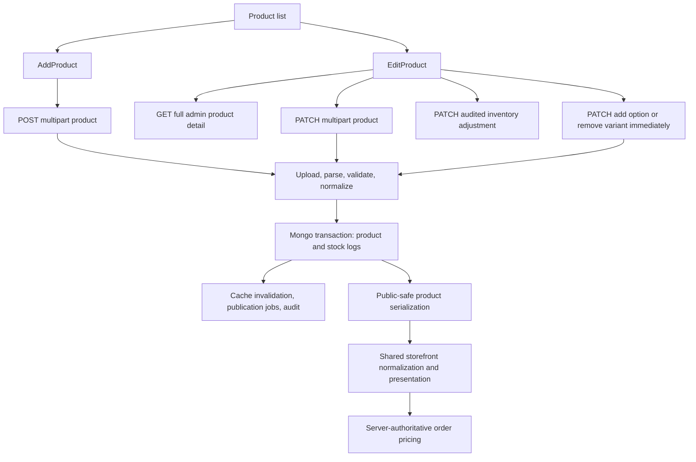
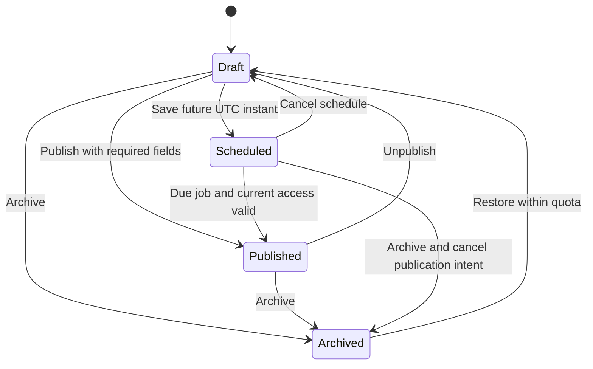

# Product Add / Edit: Review and Implementation Blueprint

**Project:** Scaleup / Shop-for-all  
**Review date:** 20 October 2026  
**Scope:** Vendor Admin product creation and editing, their API contracts, variants, pricing, media, inventory, publication, AI assistance, organization, and the resulting storefront behavior.

## 1. Verdict

The product editor has a substantial feature foundation. It already supports simple products, generated variants, variant metadata, images and videos during creation, draft/published/archived states, scheduled publishing, collections during creation, SEO tools, and image-aware AI content suggestions.

**The first improvement should be correctness and consistency across saving, reloading, and selling the product.** Some visible controls currently disagree with the API or with the storefront. Adding more controls before repairing these contracts would increase merchant confusion.

The most urgent issues are:

1. Existing variant metadata cannot save through the current Edit payload because the API requires a stock field that Edit deliberately omits.
2. Changing a simple product's main selling price can leave its saved variant price unchanged; product details and order pricing prefer the variant price.
3. Adding an option updates variants without updating option definitions; the storefront prefers those stale definitions.
4. Selecting a different cover in Edit can retain the existing cover when saved.
5. Add sends a scheduled date without a timezone offset, while Edit converts the date to UTC.

These are source-based findings supported by isolated runtime checks. They are not claims that a deployed environment was exercised.

### Evidence and limits

- Inspected both product forms, relevant list actions, shared editor components, AI integration, routes, validators, product model, media and variant services, publication service, public serialization, shared storefront normalization, and order pricing.
- Ran **39 focused backend tests: 39 passed**.
- Ran **9 existing admin utility tests: 9 passed**.
- Ran **12 read-only diagnostic probes** against the actual validation and service code. They reproduced contract inconsistencies and one latent stock-reset hazard. These probes assert current problematic behavior; their successful execution does not mean those behaviors are correct.
- Did not run an authenticated browser walkthrough, live Cloudinary uploads, a worker deployment, or Mongo-backed HTTP integration tests. No claim of visual, accessibility, or production certification is made.
- No application code was changed. This deliverable contains the report and reproducible diagnostic evidence.

Evidence: [probe results](/Users/user/Downloads/Shop-for-all/output/product-add-edit-review/contract-probes.json), [diagnostic script](/Users/user/Downloads/Shop-for-all/output/product-add-edit-review/verify-contracts.cjs), [verification record](/Users/user/Downloads/Shop-for-all/output/product-add-edit-review/verification.md).

## 2. Current flow and architecture



**Add:** enter content, choose files, enter pricing, optionally generate a variant matrix, review readiness/SEO and a custom preview card, submit, and return to the list. It defaults to Published.

**Edit:** fetch the full product, normalize the response into local form state, change fields and media, save pending metadata, and return to the list. Existing stock adjustments, adding an option, and removing a saved variant commit immediately through separate requests. Edit includes dirty-state indicators, its own Cancel confirmation, a browser unload warning, section links, mobile variant cards, and top/bottom save actions.

**Backend:** authentication and shop scoping are present. Product writes use Mongo transactions, inventory movement logs, plan checks, cache invalidation, scheduling hooks, and audit logging. Public serialization strips private cost and inventory metadata. Slug history exists; old URL handling should be preserved during changes.

## 3. Feature inventory and Add/Edit parity

| Capability | Add | Edit | Assessment |
|---|---|---|---|
| Title, description, category, tags | Present | Present | Shared validation and category selection need improvement |
| Seller-confirmed brand/model/material/dimensions/package facts | Present | Present | Useful input for factual AI suggestions; private in public serializer |
| Base buying/selling price and discount | Present | Present | Base/variant inheritance is inconsistent |
| Benefits, specifications, public extra notes | Present | Present | Preserve; clarify that extra notes are customer-facing |
| Simple product | Creates a default variant | Loads it | Variant update schema rejects its empty attributes/blank SKU shape |
| Variant matrix generation | Present | Add-option and custom-variant tools | Different workflows and inconsistent limits |
| SKU, barcode, price/cost, weight, dimensions, image, status, taxable | Matrix rows | Existing/new variant rows | Existing metadata save contract is broken |
| Existing stock adjustments | Initial stock only | Audited adjustment dialog | Good separation; permission and retry UX need alignment |
| Image upload/remove/cover | Present | Present | Cover persistence bug; upload rules differ |
| Image ordering | Left/right controls | No ordering controls | Missing parity |
| Videos | Upload, list, remove before create | No video load/edit controls | Missing parity; backend has video fields |
| Collections | Selectable if fetch succeeds | No collection load/edit controls | Missing parity |
| Draft, publish, archive | Present | Present | Default publish and strict draft requirements deserve redesign |
| Scheduled publish | Present | Present | Add timezone handling differs; staff permission UX incomplete |
| SEO title/description, snippet, health | Present | Present | Good foundation; product-local score is a heuristic |
| AI generation, comparison, selective apply, undo/history | Present | Present | Preserve the existing review-before-save behavior |
| Product preview | Custom card | SEO snippet, no equivalent product preview | Missing shared storefront preview |
| Dirty-state protection | No equivalent guard | Cancel + beforeunload | Neither provides a complete in-app navigation guard |
| General product revisions/restore | Not found in reviewed flow | Not found | Audit/AI history are not a product revision system |
| Duplicate product / save and add another | Not found | Not found | Useful later productivity additions |

Primary sources: [Add form](/Users/user/Downloads/Shop-for-all/ecommerce-admin/src/pages/dashboard/products/AddProduct.jsx:46), [Edit form](/Users/user/Downloads/Shop-for-all/ecommerce-admin/src/pages/dashboard/products/EditProduct.jsx:131), [API routes](/Users/user/Downloads/Shop-for-all/ecommerce-backend/backend/routes/adminRoutes.js:933), [product model](/Users/user/Downloads/Shop-for-all/ecommerce-backend/backend/models/Product.js:112).

## 4. Defects and contract gaps

Priority means implementation order: **P1** directly affects a central save, price, or sellable option; **P2** affects important edge cases, reliability, or usability. These are engineering priorities, not security severity scores.

### F01 — P1: Existing variant metadata cannot save

**Trigger:** change an existing variant's SKU, price, status, image, dimensions, or low-stock threshold, then Save changes.

Edit deliberately excludes existing stock from its payload, because stock has an audited endpoint. `updateVariantSchema` nevertheless requires `stock`. The payload is rejected with `"variants[0].stock" is required`.

There are additional failures hidden behind that first error:

- Simple variants are created with `attributes: []` and `sku: ''`, but update validation requires at least one attribute and rejects an empty SKU.
- Edit spreads hydrated inventory into the request. Model-owned `lowStockAlertActive`, `lowStockAlertStatus`, and `lowStockAlertSentAt` fields are not accepted by the Joi inventory schema.
- Merely making stock optional is unsafe: `normalizeIncomingVariant` defaults omitted stock to zero, and `applyVariantOperations` assigns that value to the existing variant. The diagnostic service call reproduced 12 → 0. **Current HTTP validation blocks this first; this is a latent hazard when repairing the validator.**

**Required fix:** separate new-variant creation, existing metadata patches, and inventory adjustments. Whitelist writable fields. Preserve omitted values and allow the legitimate simple-variant shape. Never initialize existing stock through a metadata normalizer.

**Acceptance:** changing every metadata field on both simple and multi-option products saves and reloads; stock, reservations, and alert state remain unchanged. New variants still require valid initial stock.

Evidence: probes P01–P03/P08; [Edit payload](/Users/user/Downloads/Shop-for-all/ecommerce-admin/src/pages/dashboard/products/EditProduct.jsx:823), [update variant schema](/Users/user/Downloads/Shop-for-all/ecommerce-backend/backend/validations/productValidation.js:112), [variant operations](/Users/user/Downloads/Shop-for-all/ecommerce-backend/backend/services/products/productVariantService.js:64).

### F02 — P1: Simple-product prices can remain at the old amount

Simple creation copies the product selling and buying prices into the default variant. Editing the base price changes `product.pricing` without updating those copied values. Storefront product details and server order pricing prefer `variant.pricing.price` over the base selling price.

**Example reproduced:** create at 100, change base selling price to 150, retain default variant price 100 → shared storefront presentation still returns 100. Variant cost can similarly continue using the old copied cost. Catalog cards and the editor's base-price summary can therefore disagree with the product detail/order amount.

**Required fix:** introduce explicit inheritance. For a simple product, use the base price unless an intentional override exists. For multi-variant products, distinguish “inherit product price” from “custom price.” Apply the same rule to private cost and to clearing an override.

**Acceptance:** base edits affect inheriting variants immediately; explicit overrides remain; editor, product card, detail, cart, and server order calculations agree for zero discount, ordinary discounts, and scheduled sales.

Evidence: probe P06; [simple variant creation](/Users/user/Downloads/Shop-for-all/ecommerce-backend/backend/services/products/productVariantService.js:32), [base price update](/Users/user/Downloads/Shop-for-all/ecommerce-backend/backend/controllers/productController.js:938), [shared display price](/Users/user/Downloads/Shop-for-all/packages/storefront-renderer/normalizeProduct.js:92), [order line pricing](/Users/user/Downloads/Shop-for-all/ecommerce-backend/backend/services/orders/orderPricingService.js:6).

### F03 — P1: Option definitions become stale after variant changes

Add-option pushes new variants but does not update `product.options`. Removal and custom-variant changes also do not reconcile that definition. The shared storefront prefers `product.options` when present.

**Example reproduced:** product options contain red; add blue → variants contain red and blue, but the storefront's available options still contain only red. Removal can leave obsolete choices visible.

**Required fix:** choose one canonical option/variant relationship and maintain it atomically for every operation. Preserve labels, swatches, sort order, and stable existing variant IDs while reconciling.

**Acceptance:** adding, removing, renaming, or archiving an option produces correct selectable storefront options without changing unaffected stock or IDs.

Evidence: probe P07; [variant operations](/Users/user/Downloads/Shop-for-all/ecommerce-backend/backend/services/products/productVariantService.js:64), [storefront option precedence](/Users/user/Downloads/Shop-for-all/packages/storefront-renderer/normalizeProduct.js:53).

### F04 — P1: “Make cover” can save the old cover

Edit sends the selected `coverImageIndex`. The controller passes the product's current `coverMediaId` as `requestedCover`; the resolver returns that existing valid cover before considering the newly selected index.

**Example reproduced:** images A/B, existing cover A, select index 1 → resolver returns A.

**Required fix:** explicit submitted cover selection must take precedence over the existing cover. Use a stable media identity rather than relying on positional indexes across removal, deduplication, and upload.

**Acceptance:** choose any retained or new image, save, reload, and verify the same cover in the admin, card, detail, and public metadata. Removing the cover selects a deterministic remaining item.

Evidence: probe P05; [cover resolver](/Users/user/Downloads/Shop-for-all/ecommerce-backend/backend/controllers/productController.js:100), [Edit cover resolution](/Users/user/Downloads/Shop-for-all/ecommerce-backend/backend/controllers/productController.js:784).

### F05 — P1: Add and Edit schedule the same local time differently

Add submits the raw `datetime-local` string, which contains no timezone. Edit converts it with `new Date(...).toISOString()`. Server-local interpretation can shift Add's intended instant.

**Example:** 10:00 in Asia/Dhaka represents 04:00 UTC. A timezone-free 10:00 interpreted on a UTC server represents 10:00 UTC: six hours later.

**Required fix:** use one conversion utility and explicit ISO UTC instants. Show the effective timezone next to the date and display the saved instant back in that zone. Validate that scheduling is in the future on both client and server. Check both feature access and `productsSchedule` permission in the UI.

**Acceptance:** Add/Edit schedule the same instant for the same local input under different server timezones; changing/rescinding a schedule does not publish from an obsolete job. Preserve the existing worker entitlement checks.

Evidence: probe P12; [Add date submission](/Users/user/Downloads/Shop-for-all/ecommerce-admin/src/pages/dashboard/products/AddProduct.jsx:460), [Edit date submission](/Users/user/Downloads/Shop-for-all/ecommerce-admin/src/pages/dashboard/products/EditProduct.jsx:809), [publication service](/Users/user/Downloads/Shop-for-all/ecommerce-backend/backend/services/products/scheduledProductService.js:12).

### F06 — P2: An optional category can block save

Both forms allow category to be blank and submit `category: ''`. The Joi string is optional but does not allow an empty string. Omission is valid; the submitted blank value is rejected. Clearing a category has the same contract problem.

**Required fix:** decide whether category is required for publishing. Normalize optional blank fields deliberately, and use the same rules in Add and Edit. Replace free text with a searchable existing-category picker plus permitted creation.

Evidence: probe P04; [category validation](/Users/user/Downloads/Shop-for-all/ecommerce-backend/backend/validations/productValidation.js:222), [Add category](/Users/user/Downloads/Shop-for-all/ecommerce-admin/src/pages/dashboard/products/AddProduct.jsx:532).

### F07 — P2: Duplicate validation does not cover the resulting product

The validator checks duplicates within the incoming variant array. The service can append a combination already present in the product; the model has an option-key index but no uniqueness validator for the entire resulting array. Custom-variant UI catches some duplicates, but that is not a durable server invariant.

**Required fix:** validate the final variant set after applying the intended operation, with a canonical normalized key. Specify SKU uniqueness scope and blank-SKU behavior separately.

**Acceptance:** duplicates are rejected across existing and incoming variants, case/order normalization is consistent, and nonconflicting additions work.

Evidence: probe P09; [duplicate guard](/Users/user/Downloads/Shop-for-all/ecommerce-backend/backend/validations/productValidation.js:75), [variant append](/Users/user/Downloads/Shop-for-all/ecommerce-backend/backend/services/products/productVariantService.js:64).

### F08 — P2: Variant limits and operations have inconsistent boundaries

Matrix validation allows up to 500 combinations; flat lists allow up to 200. Add eagerly computes Cartesian products without a corresponding client-side count guard. Incremental add-option/custom-variant operations lack a final-product count check in the reviewed service. Update also accepts multiple operation fields while the service applies only the first matching branch.

**Required fix:** define one supported total-variant limit and calculate the projected count before expansion. Enforce it after every operation. Reject conflicting operation types instead of silently ignoring part of a request. Paginate or virtualize larger editors.

**Acceptance:** every creation/update path uses the same boundary; an excessive matrix is blocked before generating a large UI; ambiguous operations receive a structured validation error.

Evidence: probe P10; [matrix/flat validation](/Users/user/Downloads/Shop-for-all/ecommerce-backend/backend/validations/productValidation.js:156), [Add combinations](/Users/user/Downloads/Shop-for-all/ecommerce-admin/src/pages/dashboard/products/AddProduct.jsx:89), [operation branches](/Users/user/Downloads/Shop-for-all/ecommerce-backend/backend/services/products/productVariantService.js:64).

### F09 — P2: A zero low-stock threshold becomes five

Add uses `|| 5` in submission/defaults. The simple-variant builder also converts zero to five. The backend schema permits zero. Product-level threshold edits additionally need a documented inheritance rule because variants already store their own threshold.

**Required fix:** use nullish/default handling that preserves zero and explicitly model inheritance versus overrides.

Evidence: probe P11; [Add threshold payload](/Users/user/Downloads/Shop-for-all/ecommerce-admin/src/pages/dashboard/products/AddProduct.jsx:461), [simple variant threshold](/Users/user/Downloads/Shop-for-all/ecommerce-backend/backend/services/products/productVariantService.js:32).

### F10 — P2: Media support and plan messaging disagree with the backend

- Add accepts broad `image/*` and `video/*`. Edit specifically advertises AVIF/GIF, while the backend's product upload filter accepts JPEG/PNG/WebP and MP4/QuickTime only.
- The backend limits each product upload file to 10 MiB; the forms do not expose the same size validation before submission.
- Edit says existing over-limit images can stay, but update asserts the total image limit even without new uploads. Such products can be blocked from saving an unrelated edit.
- Frontend counts gallery images; the backend also counts unique variant image URLs and cover sources.
- Both forms use `Number(limit) || 5`, which does not represent null/unlimited or zero distinctly if those values occur.

**Required fix:** expose one product-media policy to both forms. Account for all media sources. Decide and implement how existing restricted media behave after a downgrade; the wording and write policy must agree.

Evidence: [backend upload policy](/Users/user/Downloads/Shop-for-all/ecommerce-backend/backend/config/cloudinary.js:209), [Edit accepted types](/Users/user/Downloads/Shop-for-all/ecommerce-admin/src/pages/dashboard/products/EditProduct.jsx:342), [Edit limit message](/Users/user/Downloads/Shop-for-all/ecommerce-admin/src/pages/dashboard/products/EditProduct.jsx:1053), [limit assertion](/Users/user/Downloads/Shop-for-all/ecommerce-backend/backend/controllers/productController.js:145), [unique sources](/Users/user/Downloads/Shop-for-all/ecommerce-backend/backend/services/products/productMediaService.js:81).

### F11 — P2: Add has fragile image selection and preview lifecycles

Selecting another batch replaces `imageFiles` instead of appending. This differs from Edit and can discard a previous selection. In Add, the cleanup effect depends on `coverImageIndex` and revokes all current preview URLs when only the cover changes; the next effect reuses those same revoked URLs.

**Required fix:** use a shared media queue that appends/deduplicates files, owns stable object URLs, and revokes them only when that file leaves the queue or the editor unmounts. Changing cover/order must not invalidate previews.

**Acceptance:** add files in multiple batches, change covers repeatedly, reorder, remove, and restore without losing files or breaking thumbnails. The URL lifecycle issue is code-derived and still needs a browser regression test.

Evidence: [Add file selection](/Users/user/Downloads/Shop-for-all/ecommerce-admin/src/pages/dashboard/products/AddProduct.jsx:298), [Add preview effect](/Users/user/Downloads/Shop-for-all/ecommerce-admin/src/pages/dashboard/products/AddProduct.jsx:158).

## 5. What is missing or incomplete

These items are product and engineering improvements; they should not all be treated as launch-blocking bugs.

| Gap | Recommended behavior | Priority |
|---|---|---|
| Incomplete drafts | Save a minimal draft with a title; show publish blockers separately. Today create still requires description, image and full pricing even for Draft | Next after core repairs |
| Safe creation default | Start in Draft; explicit Publish or Schedule action with readiness review | Next |
| Add/Edit parity | One collections selector, video manager, ordering UI, preview, validation and navigation protection | Next |
| In-app navigation guard | Protect sidebar links, route changes and browser Back, with save/discard/stay choices | Next |
| Recoverable work | Debounced draft recovery with visible saved/failed status; tenant/user-scoped recovery and explicit discard | Next |
| Field-level errors | Map backend paths to inputs, focus the first error, provide an error summary, retain entered content | Next |
| Concurrency | Save with expected revision and return 409 on stale writes; offer reload/compare | Next |
| Retry safety | Idempotent create and stock adjustments; retain the same action key after an uncertain response | Next |
| Consistent commit behavior | Keep product/variant structure staged until Save; label immediate stock adjustments clearly | Next |
| Permissions in controls | Reflect `products`, `productsSchedule`, and `inventoryManage` independently; backend remains authoritative | Next |
| Mobile Add editor | Use the compact cards/drawers approach already started in Edit; avoid a 13-column primary editing surface | Next |
| True storefront preview | Reuse shared storefront rendering and effective pricing with real shop theme/context | Next |
| General revision history | Actor/time/field changes, compare and restore; preserve inventory as separate transactions | Later |
| Faster repeat entry | Duplicate product, save and add another, reusable category-specific field templates | Later |
| Rich description editing | Optional constrained rich text with a safe rendering contract; do not introduce raw arbitrary HTML | Later |
| Advanced merchandising | Related products, variants grouped for bulk edits, price-range display and merchandising rules as actual demand requires | Later |
| Structured shipping/tax | Explicit units, tax-code/rate UI, product-type rules; verify these affect checkout before promising them | Demand-dependent |
| Internationalization | Explicit store currency, units and language; current form price display uses ৳ | Demand-dependent |

**Do not duplicate functionality already present:** AI suggestions already have selective application, comparison, undo, stale-input protection, and history. Inventory and product actions already have logs. Slug redirect infrastructure exists. Improve their integration instead of rebuilding them under new names.

## 6. Target editor blueprint

### Shared page structure

Use one editor shell for both modes. Creation and editing should differ in initial data and allowed actions, while sharing the field components and domain rules.

```text
Back to products     Add product / Product title     Saved / Unsaved
                     Draft / Scheduled / Published / Archived

Section navigation: Basics · Media · Pricing · Inventory · Organization · SEO

Main editor                                      Right panel (desktop)
1. Basics                                        Storefront preview
   Title, description, seller facts               Publication/readiness
2. Media                                         Selected variant price
   Ordered images/videos, cover, alt text         Validation summary
3. Pricing                                       AI content helper
   Base price, optional private cost, discount
4. Inventory and variants
   Simple / Has options; compact rows + drawer
5. Organization
   Existing categories, tags, collections
6. Search and optional details
   Slug, SEO, benefits, specifications, notes

Persistent actions: Cancel | Save draft / Save changes | Publish / Schedule
```

On mobile, use one column, a collapsible preview and readiness panel, variant cards, and a bottom action bar with adequate space above it. Preserve entered values while switching sections. Show advanced variant fields in a drawer, with accessible labels and keyboard behavior.

### Creation journey

1. Start as Draft with a clear Simple / Has options choice.
2. Enter title and basic facts; save a minimal draft without completing every publish field.
3. Add media through the common queue; choose cover and image-specific alt text.
4. Enter base price and optional private cost; show effective price and a clearly labeled gross-margin estimate. Define rounding, discount and loss-sale rules.
5. Add stock or options. Preview projected combinations before generation. Confirm structural changes that would remove existing sellable options.
6. Organize through category/tag/collection controls. Empty and failed-load states must be visible.
7. Optionally improve content and SEO using the existing AI review/apply tools.
8. Review publish blockers and warnings. Publish now or choose an explicit zoned schedule. Confirm the saved outcome and provide View product / Continue editing / Add another.

### Editing journey

1. Load full details with a revision token and all media/organization fields.
2. Compare edited values against the saved baseline. Track fields that actually changed.
3. Stage variant metadata and structural changes for the same Save action. Preserve IDs and inventory.
4. Keep stock adjustment as an explicit immediate transaction. Show the committed result and link to movement history; Cancel product edits does not undo that transaction.
5. If another writer changed the product, show a comparison instead of silently overwriting it.
6. Save, update the baseline from the response, and remain in the editor by default. Provide Save and close when useful.

### Publication/readiness rules

Maintain one canonical lifecycle and derive legacy flags through a compatibility adapter. Avoid separately editable `status`, `publicationStatus`, and `isActive` values.



Separate **blocking errors** from **recommendations**. A valid zero-stock product may be intentionally published as sold out; a completed SEO description should not determine whether product data can be saved. Scheduling must respect both the current subscription feature and staff permission.

Suggested publish blockers: meaningful title/description, at least one valid cover image, a valid effective price, a valid sellable configuration, no duplicate combinations, and a complete future schedule when requested. Category, stock availability, SEO and alt text should have explicitly chosen policies, rather than accidental rules from unrelated schema defaults.

## 7. Field and data contract

| Area | Target fields/rules | Important distinction |
|---|---|---|
| Identity | Stable product ID; title; unique tenant slug; category identity/display name; tags; collection IDs | Changing title should not silently change an established URL |
| Content | Description; benefits; specifications; public notes; private seller-confirmed facts | Public notes and private internal information must be visibly distinct |
| Media | Stable media ID, URL, type, position, alt, upload state; cover ID | Positional indexes are transport details, not durable identities |
| Product pricing | Store currency; base selling price; optional private cost; discount; rounding policy | Decide whether fractional BDT amounts are supported; inputs and checkout must agree |
| Variant pricing | Inherit/custom mode; nullable override price/cost; compare-at amount | Null clears an override; omission preserves it; zero is a real value |
| Variant identity | Stable ID, canonical option key, SKU, barcode, attributes | Labels/case normalization must not create duplicate combinations |
| Variant inventory | On-hand/reserved/available; tracking; oversell policy; threshold inheritance | Product metadata saves must not overwrite stock or server-managed alert state |
| Shipping/tax | Explicit weight unit; dimension unit; taxable/code/rate where operational | Expose only rules actually used by shipping/tax calculations |
| Publication | Canonical lifecycle, future UTC instant, effective display zone, published timestamp | Feature access and staff permission are separate |
| Reliability | Revision token; request/action ID; changed-field set | Detect stale writes and uncertain retries |

Current validation limits worth surfacing consistently: title 3–100 characters, description 10–3,000, SEO title up to 70, SEO description up to 170, image alt text up to 160, at most 30 tags, and at most 20 collection IDs. These are current implementation limits, not universal product-design requirements. Draft rules may intentionally be relaxed.

### API proposal

Preserve existing endpoints where practical. Introduce shared request DTOs and normalize into the current model during migration.

- `GET /admin/products/:id`: full editor data plus revision, capabilities, relevant media policy, and safe computed preview data.
- `POST /admin/products`: explicit Draft/Publish/Schedule intent and idempotency key; server validates the rules for that intent.
- `PATCH /admin/products/:id`: expected revision and only intended field changes. Existing variant patches contain IDs and writable metadata; omit stock.
- `PATCH /admin/inventory/stock`: retain the audited transaction route; server checks `inventoryManage`; reuse an action key across retries.
- Structural variant operations: either one staged operation set in the main save or explicit commands with clear commit semantics. Reject conflicting commands and validate the final result.

Illustrative metadata request, **proposed rather than currently supported**:

```json
{
  "expectedRevision": "opaque-revision",
  "changes": { "title": "Premium Cotton Panjabi" },
  "variantChanges": [
    {
      "id": "variant-id",
      "changes": {
        "sku": "PANJABI-WHITE-M",
        "pricingMode": "inherit",
        "priceOverride": null
      }
    }
  ]
}
```

Return structured errors, for example `fieldErrors: {"variants.<id>.sku": "SKU already exists"}`, a request ID, and an explicit stale-write code. Preserve omission/clear/zero semantics throughout multipart serialization.

### Save pipeline and recoverability

1. Resolve tenant, authorization, feature access and limits.
2. Parse and validate intent and writable field paths.
3. Check expected revision against the current document.
4. Apply changes to a candidate product; validate final options, variants, prices and media references.
5. Persist product changes, necessary inventory records, and durable job/outbox intent transactionally.
6. Return the committed product and revision; process cache refresh and background side effects with retries.

The current controller awaits side effects after committing, including scheduled-job creation. Those calls need clear failure handling so a post-commit failure does not look like a failed save and invite duplicate retries. This is a source-identified failure window, not a reproduced production incident. A transactional outbox or equivalent durable intent is the preferred longer-term design.

## 8. Component and state architecture

The two page files currently contain about **2,928 lines combined**. Duplication is already visible in validation, scheduling, media policy, publication state and variants. Refactor after the critical behavior is covered by tests.

Proposed boundaries:

```text
ProductEditorPage (mode: create/edit)
  useProductEditor: load, draft state, baseline, dirty paths, save
  productEditorContract: hydrate, serialize, validate, clear semantics
  ProductBasicsSection
  ProductMediaManager + useMediaQueue
  ProductPricingSection + shared effective-price calculation
  ProductVariantEditor + shared option/count rules
  ProductOrganizationSection
  ProductContentAndSeoSection
  ProductPublicationPanel
  ProductStorefrontPreview (shared renderer)
  ProductEditorActions
  Existing ProductAiAssistant and audited stock dialog
```

Keep persisted product data separate from upload queue state, temporary variant IDs, open drawers, request state, and AI proposal state. Rename `changedStocks` to describe metadata/variant changes; it currently tracks much more than stock.

Avoid spreading full API subdocuments into mutation requests. DTO serializers should include only writable fields and should be testable without mounting the page. Dirty state should compare actual values, so changing a field and restoring its original value clears the dirty indicator.

## 9. Delivery sequence

| Stage | Work | Completion gate | Relative effort |
|---|---|---|---|
| 1. Repair core contracts | F01–F05; tests for metadata, simple pricing, options, cover and timezones | Save/reload/storefront/order parity across simple and matrix products | Medium–large |
| 2. Unify domain rules | F06–F11; shared DTOs, limits, blank/zero/null handling, media policy, permissions and structured errors | All paths enforce the same rules; no stock changes from metadata saves | Medium |
| 3. Unify editor experience | Shared shell; collections/video/order parity; drafts; navigation guard; mobile Add; shared preview | Equivalent capabilities on Add/Edit and desktop/mobile | Large |
| 4. Improve recovery and operations | Revision conflicts, idempotent create/retries, durable post-commit work, recovery and diagnostics | Lost response, concurrent edits, worker outage and reload scenarios pass | Medium–large |
| 5. Add productivity features | General revisions, duplicate/save-another, templates, optional richer content | Measurable reduction in entry time/errors without contract regressions | Demand-dependent |

These are sizing categories, not calendar estimates. Establish the team's capacity, migration needs and browser test setup before assigning dates. Reliability tests for Stage 4 should start early even if the broader feature work ships later.

## 10. Required verification plan

Existing tests provide useful guards, but some editor tests only assert source strings or regexes. A test can confirm that `coverImageIndex` appears in a request without checking that saving actually changes the cover. The reviewed behavior needs layered tests.

| Layer | Minimum cases |
|---|---|
| DTO/validation | Blank optional category; simple empty attributes; blank/cleared SKU; server-owned fields excluded; zero/null/omission; field error mapping |
| Variant service | Metadata-only stock preservation; options synchronized for add/remove; final-set duplicate check; stable IDs; one total-count limit; mutually exclusive operations |
| Pricing | Simple price/cost inheritance; explicit override and clearing; zero values; discount rounding; card/detail/cart/order agreement |
| Media | Multiple file batches; accepted types/size; object URL lifecycle; existing/new cover persistence; reordering; deletion/restore; variant-image reassignment; downgrade policy |
| Publication | UTC and Asia/Dhaka; invalid/past times; schedule/reschedule/cancel; archive scheduled item; plan/staff denial; obsolete and duplicate jobs |
| Inventory | Permission denial; valid adjustment; negative/fractional rejection; replay after lost response; concurrent checkout; audit/log correctness |
| HTTP integration | Actual form payload → validator → transaction → response → reload → public detail → order price, on a disposable test database |
| Browser | Add simple; add variants; edit metadata; edit price; cover; collections; videos; mobile; keyboard; leave dirty page; failed save retains input |
| Reliability | Two-editor stale write; retry create after committed/lost response; upload failure cleanup; job enqueue failure after commit; recovery after reload |

Representative merchant acceptance scenarios:

1. Save a title-only draft, reload, complete it, and publish.
2. Create a simple product at ৳100, change the base price to ৳150, and observe ৳150 consistently through checkout when there is no additional discount.
3. Edit SKU/image/status on a stocked variant; confirm stock and reservations do not change.
4. Add blue to a red product; blue becomes selectable. Remove an obsolete value; it disappears from public options without breaking historical order snapshots.
5. Select the second image as cover; save/reload retains it everywhere.
6. Schedule 10:00 Asia/Dhaka from Add and Edit; both persist 04:00 UTC on a UTC server.
7. Navigate away with pending changes through the sidebar, browser Back and Cancel; each follows the same policy.
8. Lose the response to a successful stock adjustment, then retry; apply exactly once.
9. Open the same product in two sessions; the second stale save receives a comparison/conflict response.
10. Edit an unrelated field on a product with legacy restricted media; behavior matches the documented downgrade policy.

## 11. Measurement and definition of done

Instrument product actions without logging sensitive field content:

- Create/edit save attempt and success, with error code, field path, mode and request ID.
- Publish/schedule failures and scheduled-job delay.
- Variant operation count and failure cause.
- Upload validation/provider failure rates.
- Stale-write conflicts and retry replays.
- Draft recovery and editor abandonment after a validation error.

Proposed release goals: every core acceptance scenario passes; no unintentional stock changes during metadata edits; one effective-price result across all customer surfaces; correct cover/options after reload; no duplicate domain action from replaying the same request. Set timing and success-rate targets after collecting a real baseline.

**Recommended first implementation slice:** repair the existing-variant request contract and stock-preservation service together, then fix simple-price inheritance, option reconciliation, cover precedence and UTC scheduling. Add browser/HTTP regressions for these behaviors before undertaking the shared-page refactor.

## 12. Reproduce this review's diagnostics

From the repository root:

```sh
node output/product-add-edit-review/verify-contracts.cjs
```

The script uses validation, helper, model and shared presentation code in memory. It does not connect to a database, upload files, or mutate product data. Diagnostic IDs P01–P12 map to the evidence cited above.

See the [verification record](/Users/user/Downloads/Shop-for-all/output/product-add-edit-review/verification.md) for the exact existing test commands and scope limits.
