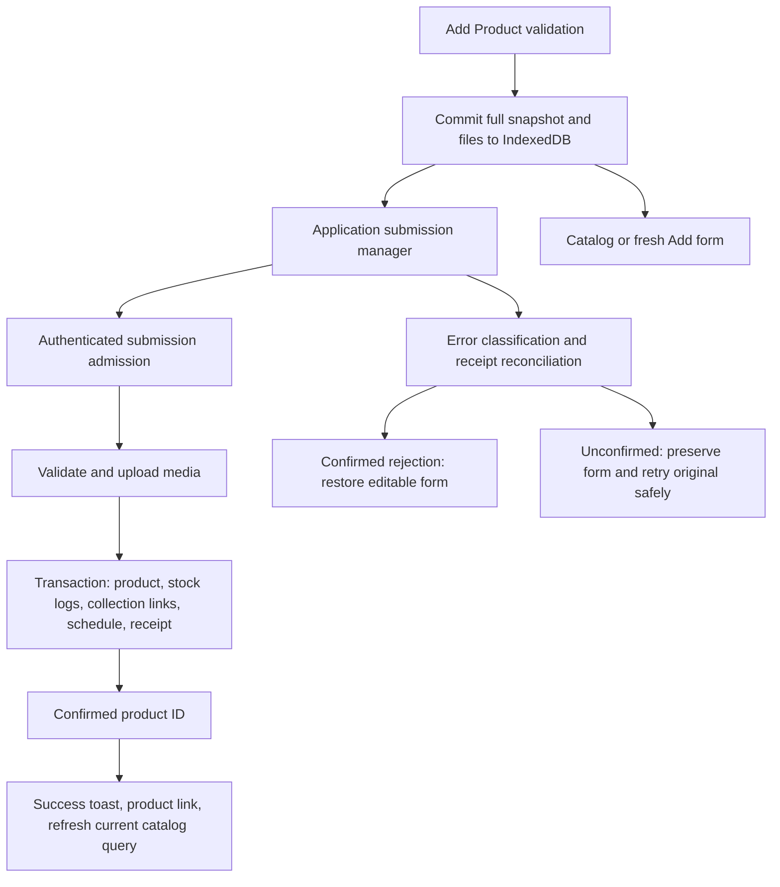

# Smart product publishing — implementation and verification

The subsequent [Product Activity & Recovery Center enhancement](/Users/user/Downloads/Shop-for-all/docs/product-activity-recovery-center.md) documents the current drawer, four user-facing statuses, cross-tab coordination, safe discard, and expanded recovery behavior. This report records the initial publishing implementation and its original verification.

Implemented in the existing admin and backend. No deployment, commit, or push was performed.

## Merchant workflow

1. Complete the existing Add Product form and choose **Save Product** or **Save & Add Another**.
2. Browser constraints and immediate form checks run before submission. These include title/description, prices, discount, stock, thresholds, scheduling, variants, incomplete content rows, and image limits.
3. Capture the complete form, the multipart payload, and image/video `File` objects. Commit them to IndexedDB before starting the request or navigating.
4. **Save Product** opens `/dashboard/products`. **Save & Add Another** opens a fresh Add form with independent state. Repeated clicks share a synchronous submission lock.
5. Product Activity shows Preparing, Uploading images, Saving, Saved successfully, Failed, or Recovery required. Upload percentages measure transfer to the API; subsequent media processing and database saving remain indeterminate.
6. A verified backend product ID triggers **Product added successfully**, a **View product** link, and a catalog refresh using the currently mounted catalog's search, category, status, sort, page, and page size.
7. A rejected save remains in Product Activity with **Review & Retry**. Each product has its own recoverable record.

The form retains its existing fields and layout. Publication intent, including Draft, Archived, and scheduled publication, continues through the existing backend rules. The Edit Product page was not changed.

## Architecture

The application uses a React provider above the dashboard routes, a framework-independent submission manager, IndexedDB, the existing Axios client, and a small MongoDB receipt extension. Upload cleanup uses the existing worker. No dependencies were added.



### Durable browser handoff

Database: `shop-product-submissions`, object store: `submissions`, indexed by account/shop scope. The storage key combines scope and submission ID.

Each pending/failed record contains:

- All scalar form data, publication fields, SEO, seller facts, features, specifications, and extra notes.
- Selected collection IDs, attributes, option input state, default stock, stock overrides, and complete variant details.
- Gallery order, cover index, image files, and video files.
- The exact multipart entries, stable UUID, SHA-256 fingerprint, timestamps, status, and error category.

Authentication tokens and cookies are never copied into these records. Recovery does not use localStorage. Successful records release their form and file payloads; at most ten success summaries remain. Failed records retain their recoverable data.

If storage cannot commit, the form remains open and no product request begins. If storage fails after the backend confirms creation, the manager still reports the confirmed success; a retained older browser record can reconcile again later.

### Server receipts and concurrency

`ProductSubmission` has a unique index over `(shop_id, actor, key)`. Admission ensures the unique index exists before accepting identified submissions.

The existing `POST /api/admin/products` accepts optional headers:

| Header | Purpose |
| --- | --- |
| `X-Product-Submission` | Stable submission UUID |
| `X-Product-Fingerprint` | Digest of the captured multipart values and media bytes |
| `X-Product-Actor` | Expected authenticated actor |
| `X-Product-Shop` | Expected authenticated tenant |

The server compares actor/shop headers with the authenticated session. They cannot assign ownership. Existing API callers can continue using the original request body without these headers.

Admission happens after authentication and product permission checks, before plan mutations and file upload. Concurrent requests for one active submission receive `SUBMISSION_PROCESSING` without uploading duplicate files. A completed receipt replays the existing product ID. A receipt remains after product deletion so late retries cannot recreate a deleted product.

A five-minute admission lease permits recovery after an interrupted server request. Each claim receives a new owner token. Receipt completion checks that owner inside the product transaction, fencing an older request if another request reclaimed the lease. Product creation, initial inventory logs, collection associations, scheduled publication, receipt completion, and asset retention commit together.

Changed fingerprints are rejected while processing or completed. A definitively rejected submission can be corrected and resubmitted under the same UUID. The digest assists replay consistency; backend schemas, ownership checks, authorization, and transactional receipt admission remain authoritative.

MongoDB commit replies with an uncertain outcome retry the same commit up to three times. An unresolved commit does not trigger destructive upload cleanup. Cache/audit failures after a confirmed commit cannot turn creation into a failed response.

### Recovery and retry rules

`GET /api/admin/product-submissions/:key` requires an authenticated vendor with product permission and matching expected actor/shop headers. It queries receipts by both actor and tenant.

| Observed result | Behavior |
| --- | --- |
| Completed receipt with valid product ID | Confirm success, release local form/media payload, refresh catalog |
| Definitively failed receipt | Restore the full editable Add form; preserve its UUID for correction |
| Processing receipt or unavailable status | Keep Recovery required; show the preserved form for review with editing disabled |
| No receipt | Keep the original payload recoverable; retry that payload under the original UUID |
| Invalid data or invalid media | Require user action; no automatic retry |
| Expired authentication or changed account/shop | Pause automatic requests; retry requires the original signed-in scope |
| Network, throttling, temporary upload, or server failure | At most three POST attempts, with one- and two-second backoff and receipt reconciliation |

POST requests have a two-minute browser timeout. Receipt reads have a fifteen-second timeout. An active server request can reject an immediate retry until its admission lease expires; Product Activity retains the original submission for another check. An unconfirmed save is never labeled a confirmed failure or success.

### Refresh, tab closure, and account switching

The manager survives client-side dashboard navigation. Browser refresh or tab closure can interrupt the transport; there is no promise of continued execution after the dashboard closes.

On reopening the same account/shop in the same browser, interrupted records become Recovery required and query the server receipt. Reopening does not automatically POST preserved products. A merchant can check and safely retry the original submission. Editing waits for a definitive rejection to avoid creating a second product after a lost response.

Scope changes dispose the old manager and abort its browser requests. Stale responses cannot publish notifications or refresh the new scope's catalog. Backend expected-scope checks also protect requests sent after a cookie/account change.

If a recovered file is unavailable, the UI explicitly identifies missing media and requires it to be added again after reconciliation.

### Upload cleanup

Identified submissions persist an upload intent before contacting Cloudinary, including its deterministic provider target, owner, resource type, and cleanup time. Uploaded media is checked against the current claim before continuing. Rejected requests retain the existing immediate cleanup path.

Committed assets are marked retained in the product transaction. Unretained assets mature for cleanup after one hour. The existing worker checks a bounded batch each minute, fences expired submissions before destroying their assets, retries unsuccessful cleanup on later sweeps, and preserves media belonging to active or committed submissions. Production cleanup therefore depends on the existing worker running and provider availability; it is not necessarily immediate after a server crash.

## Changed files

| File | Change |
| --- | --- |
| [App.jsx](/Users/user/Downloads/Shop-for-all/ecommerce-admin/src/App.jsx) | Install the provider above dashboard routes |
| [DashboardLayout.jsx](/Users/user/Downloads/Shop-for-all/ecommerce-admin/src/layouts/DashboardLayout.jsx) | Mount Product Activity |
| [AddProduct.jsx](/Users/user/Downloads/Shop-for-all/ecommerce-admin/src/pages/dashboard/products/AddProduct.jsx) | Validation, durable handoff, second save action, recovery form |
| [useProducts.js](/Users/user/Downloads/Shop-for-all/ecommerce-admin/src/hooks/useProducts.js) | Refetch current query after confirmed creation |
| [ProductSubmissionContext.jsx](/Users/user/Downloads/Shop-for-all/ecommerce-admin/src/context/ProductSubmissionContext.jsx) | Scope lifecycle, notifications, catalog revision, unload protection |
| [ProductActivity.jsx](/Users/user/Downloads/Shop-for-all/ecommerce-admin/src/components/products/ProductActivity.jsx) | Accessible activity states, recovery actions, verified product links |
| [productSubmissionStore.js](/Users/user/Downloads/Shop-for-all/ecommerce-admin/src/services/productSubmissionStore.js) | Scoped IndexedDB records and file persistence |
| [productSubmissionManager.js](/Users/user/Downloads/Shop-for-all/ecommerce-admin/src/services/productSubmissionManager.js) | Background requests, bounded retry, reconciliation, isolation |
| [product-editor.browser.cjs](/Users/user/Downloads/Shop-for-all/ecommerce-admin/tests/product-editor.browser.cjs) | Adapt Add failure recovery assertions to the new navigation contract; retain Edit/media/inventory assertions |
| [product-publishing.browser.cjs](/Users/user/Downloads/Shop-for-all/ecommerce-admin/tests/product-publishing.browser.cjs) | Actual browser, API, IndexedDB, and database workflows |
| [product-submission-manager.test.mjs](/Users/user/Downloads/Shop-for-all/ecommerce-admin/tests/product-submission-manager.test.mjs) | Fifteen manager behavior tests |
| [ProductSubmission.js](/Users/user/Downloads/Shop-for-all/ecommerce-backend/backend/models/ProductSubmission.js) | Unique receipts, admission ownership, upload cleanup intents |
| [productSubmissionService.js](/Users/user/Downloads/Shop-for-all/ecommerce-backend/backend/services/products/productSubmissionService.js) | Admission, replay, scoped status, transaction completion, cleanup |
| [productController.js](/Users/user/Downloads/Shop-for-all/ecommerce-backend/backend/controllers/productController.js) | Atomic receipt completion and safe post-commit handling |
| [adminRoutes.js](/Users/user/Downloads/Shop-for-all/ecommerce-backend/backend/routes/adminRoutes.js) | Admit before upload, scoped status endpoint, temporary upload error classification |
| [cloudinary.js](/Users/user/Downloads/Shop-for-all/ecommerce-backend/backend/config/cloudinary.js) | Record upload intents and check claim ownership around uploads |
| [workers/index.js](/Users/user/Downloads/Shop-for-all/ecommerce-backend/backend/workers/index.js) | Sweep unretained submission assets using existing worker infrastructure |
| [product-publishing.integration.test.js](/Users/user/Downloads/Shop-for-all/ecommerce-backend/backend/tests/integration/product-publishing.integration.test.js) | Five HTTP/database/cleanup scenarios |
| [This report](/Users/user/Downloads/Shop-for-all/docs/smart-product-publishing.md) | Architecture, behavior, file inventory, verification, limitations |

The pre-existing account/shop deletion audit documents were preserved. Future deletion implementation should include the new receipt model in its retention inventory.

## Verification

All database tests used a disposable local replica set on port 27131 with separate test databases for HTTP and browser runs. Production data was not used. Browser tests used real Chrome, the admin UI, authenticated HTTP endpoints, IndexedDB, and MongoDB. Cloudinary upload/destroy calls were stubbed; file decoding and application upload handling remained real.

| Check | Result |
| --- | --- |
| Admin unit tests, including fifteen new manager tests | **30 passed** |
| Product, media, inventory, scheduling, category/content backend unit regressions | **68 passed** |
| Publishing, Add/Edit, variant/media limits, stock reliability, tenant isolation, and auth HTTP regressions | **24 passed** |
| Existing Add/Edit browser regression and new publishing browser workflow | **2 passed** |
| Admin production build | **Passed** |
| ESLint across every changed frontend runtime file | **Passed** |
| Syntax checks across all six changed backend runtime files | **Passed** |
| `git diff --check` | **Passed** |
| Repository-wide admin lint | **18 errors and 4 warnings in unchanged files** |

The full admin lint failures are in existing Topbar, GrowthCenter, StoreBuilder code, and theme test fixtures. They were not suppressed or changed for this task. The backend has no build or lint script; syntax checks and the relevant executable tests were used.

Behavior coverage includes navigation before completion, immediate invalid input, invalid media and temporary provider failure, storage quota failure, full file/variant/content recovery after refresh, independent simultaneous and failed products, repeated clicks, stable retries, lost-response reconciliation, query-preserving refresh, interrupted navigation, expired sessions, account switching, stale completions, initial inventory logs, unchanged Edit behavior, keyboard operation, and a 390-pixel mobile viewport. Late upload progress and storage failures after success cannot undo a confirmed result.

Representative commands:

```sh
# ecommerce-admin
node --test tests/*.test.mjs
npm run build
npm run lint
npx eslint src/services/productSubmission*.js src/context/ProductSubmissionContext.jsx src/components/products/ProductActivity.jsx src/pages/dashboard/products/AddProduct.jsx src/hooks/useProducts.js src/App.jsx src/layouts/DashboardLayout.jsx

# Requires disposable MONGO_URI_TEST; bundled Playwright can use PLAYWRIGHT_MODULE.
node --test --test-concurrency=1 tests/product-editor.browser.cjs tests/product-publishing.browser.cjs

# ecommerce-backend/backend, with disposable MONGO_URI_TEST
node --test --test-concurrency=1 tests/integration/product-publishing.integration.test.js tests/integration/product-editor.integration.test.js tests/integration/product-f06-f11.integration.test.js tests/integration/product-stock-reliability.integration.test.js tests/integration/tenant-isolation.integration.test.js tests/integration/auth-rbac-privacy.integration.test.js
```

## Practical limits

- Pending form/file recovery belongs to this browser profile and origin. Clearing browser data, browser eviction, private-session closure, or device loss can remove it. Server receipts preserve duplicate prevention, but do not contain a backup of the full form.
- New submissions require IndexedDB capacity and a modern secure browser context. Storage failure keeps the form open.
- Unconfirmed submissions require status reconciliation before correction. A live or interrupted claim may take up to its five-minute lease before it can be reclaimed.
- The browser manager does not execute after tab closure. Returning to the dashboard checks status and offers recovery without automatically publishing.
- Media cleanup after a server interruption is eventual and uses the existing worker/provider. Provider production credentials and real network behavior were not exercised by the stubbed browser/integration upload tests.
