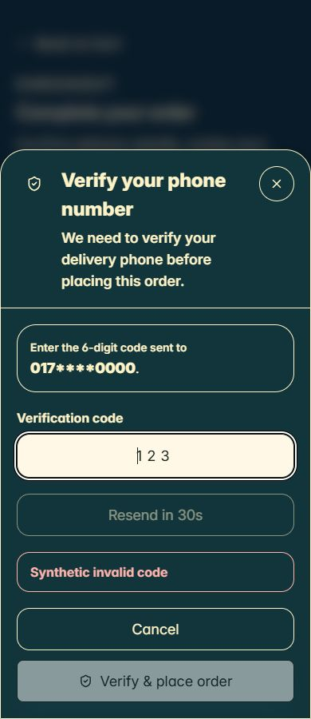

# Adaptive Store Builder — Phase 3 blocker remediation

Date: 20 October 2026. Start revision: `54a04b6d34939dab3b9cc6f0139a753116edbd32`. Existing dirty work preserved.

**Final readiness: BLOCKED.** The implementation and tested compatibility gates pass. Actual **200% browser zoom** remains unverified: the available browser exposes viewport dimensions, and the tested zoom shortcut left `innerWidth=1440`, `devicePixelRatio=1`, `visualViewport.scale=1` unchanged. A 320×450 viewport is useful short-screen evidence, not a substitute for real zoom. Phase 4 has not started.

## 1. Original blockers, causes and resolution

| Blocker | Source-grounded cause | Resolution |
|---|---|---|
| Content before protected cores | Version-1 manifest, factory, graph validator and commands already agreed on root index 0. Earlier Phase 3 expectations requested product content before it; this was a scope conflict, not a renderer ordering defect. | Retain required, singleton, nonremovable root-0 product/checkout cores. Declare `beforeCore:false, afterCore:true`; expose the same capability to future inspectors. Tests reject remove/copy/move/displacement without mutating input. Supporting content above a core requires a separately reviewed blueprint. |
| Accepted style values did not reliably reach visible elements | Trusted views contain inline colours, nested backgrounds and size utilities. Wrapper declarations alone did not style actual fields, headings, summaries, grids or media. | Add opt-in semantic/surface/layout markers, scoped typed compilation and per-context typography variables. Catalog gaps/card typography/outer backgrounds, media fit/radius and safe page width now have concrete targets. Surface box settings target one wrapper. Border, padding, width and radius are not copied to children. Font-size overrides use a safe line-height fallback so legacy size utilities cannot retain a smaller fixed line box. |
| General core paint was rejected | The renderer returned `CORE_PALETTE_ADAPTER` because it could not validate actual nested code-owned surface contexts. A paired button guard did not prove contextual safety. | Pure `corePalette.js` resolves semantic paint at all three tiers, validates text at 4.5:1 and required control border/fill at 3:1, then compiles only fixed scoped selectors. Controls with zero-width or indistinguishable borders fail unless their fill provides contrast. Border-only outer edits do not activate unrelated paint. |
| Responsive overflow inside wide viewports | Legacy desktop grids used fixed/minimum columns based on viewport width even inside a narrow configured page. | Scoped container queries retain a single column until the actual commerce core is at least 1000px wide; desktop columns use `minmax(0,1fr)`. A 520px page inside a 1440px viewport is browser-tested. Existing legacy breakpoints remain unchanged. |
| Accessibility gaps | Tiny icon buttons/policy disclosures, short-height OTP content and low-contrast default muted/error copy were insufficiently protected. | Adaptive-only 44px button/disclosure targets, two-tone focus ring, scrollable bounded OTP form, existing dialog focus hook for every explicitly adaptive presentation, named field/error seams and darker default muted/error ink. Explicit validated palettes take precedence. A trusted missing product state no longer reveals stale purchase controls. |

No commerce controller, route, API, pricing, inventory, totals, consent, OTP rate limit or tenant policy was changed. The protected adapter still forwards trusted data and callbacks to existing views.

## 2. Supported styles and explicit limits

`ADAPTIVE_RENDER_CAPABILITIES` is frozen and derived from the shared registry. Only **home, product and checkout** have adapters. Category, collection, cart, account, track, policiesIndex, policy, header and footer contracts exist but resolution fails with `PAGE_ADAPTER`; future UI must not advertise them as rendered.

| Property group | Actual renderer support |
|---|---|
| `color, background, borderColor` | Typed token/solid colour resolution. Protected semantic context palettes; outer borders remain local. Optional cards retain their commerce button colour pair rather than copying the card foreground into actions. |
| `fontFamily, fontSize, fontWeight, lineHeight, letterSpacing, textAlign` | Approved values compile; core and part typography uses nearest semantic variables to beat legacy inline/utility styles. Explicit part values win over node/page settings. Safe line-height fallback preserves readable enlarged fields. |
| `width, maxWidth` | Optional block dimensions clamped to containing width. Page supports only outer maxWidth: 320–1920px or exactly 100%. No functional fixed width/height. |
| `height, aspectRatio, objectFit` | Media only; objectFit is contain/cover. Radius reaches the actual image. No clipping of functional controls. |
| `minHeight` | Optional content.section only, 0–600px. |
| Four logical paddings / four logical margins | Existing bounded values on registered targets; page/part boxes are not inherited. Functional bounds unchanged. |
| `borderWidth, borderRadius` | Local boundaries and approved semantic parts; required control visibility checked for palette/border edits. |
| `gap, columns, alignItems, justifyContent, stackOnMobile` | Registered stack/section/column semantics. Catalog gap has a real opt-in grid seam. Mobile stacking false survives resolution. |
| `visible` | Optional content only; required cores/controls cannot be hidden. |

The regression test iterates every advertised block/part property with a valid typed sample and compilation. Real browser assertions cover representative actual targets, not every possible combination of all bounds. No arbitrary selectors/classes/HTML/CSS/JS/URLs, position, z-index, clipping or programmable bindings were added. Limits and whole-theme budgets remain intact. Preset references cannot bypass validation. Ownership remains the existing backend's responsibility; the pure palette resolver does not claim to prove it.

## 3. Browser and accessibility evidence

Actual SSR + hydration fixture, actual shared views and installed production stylesheet; synthetic data only. GET-only loopback server, blocked live dependencies, no real notifications/orders. [Matrix](remediation/browser/matrix.json), [read-only probe](remediation/browser/probe.js), [interaction evidence](remediation/browser/interaction-evidence.json), [native accessibility names](remediation/browser/otp-ax.txt).

- **48/48** cases hydrate without errors/fallback/horizontal document overflow, measured text/field contrast failures or enabled button/field/disclosure targets below 44px.
- 21 cases: all three families at 320, 360, 390, 430, 768, 1024 and 1440 CSS px; English/Bengali long product/home copy and checkout errors.
- 16 cases: product variants/checkout OTP using default, light, custom and inverted edge palettes at 320 and 1440px. Dark palettes are also exercised across the seven widths. Text contrast uses browser-computed RGB/OKLCH/OKLab colours with alpha composition against actual ancestor backgrounds; disabled controls are excluded.
- Three cases: a 520px configured page inside a 1440px viewport. Media is 180px high, cover-fit, 12px radius; section minHeight 120px; products grid gap 24px and card title 18px. Checkout label 16px remains distinct from summary 20px.
- Eight cases: product zero-price/sold-out/loading/missing and checkout busy/empty/success/no-consent at 320px. Missing images have accessible names/fallbacks.
- Keyboard: Back to Cart → Full Name → Email → Phone Number → Full Address → Delivery area; names verified in native AX. Policy consent toggles order-button eligibility using the existing callback seam. OTP autofocus, Tab/Shift+Tab cycle and Escape cancellation verified; cooldown and invalid six-digit submission remain guarded. No provider/verification request executed.
- Short-screen OTP at 320×450: form height 448px, scroll height 801px, overflow auto, top 0/bottom 450. Contents remain reachable without unlocking the page behind it. [Screenshot](remediation/browser/otp-320x450.png).
- Two-tone focus outline checked in the actual browser. CSS transitions mean an immediate computed shadow sample can be between its endpoints; visible outline and screenshots are retained.
- **Unverified:** real 200% browser zoom; physical touchscreen/virtual-keyboard behavior; spoken NVDA/JAWS/VoiceOver sessions and a complete WCAG conformance audit. Native AX names and keyboard tests are not a claim of those checks. Contrast against arbitrary future media is outside these fixtures.



## 4. Commands and results

Backend commands below run from `ecommerce-backend/backend`; set `THEME_PARITY_REPORT` to this remediation directory before parity/unit runs. Logs and exit files are retained in `remediation/`.

| Check | Result |
|---|---|
| Pre-edit compatibility | 644/644 passed; original blockers reproduced before source changes. |
| Final Phase 0–3 + remediation | **671/671 passed**; 27 new tests, 107 total renderer tests. All 370 frozen cases, 144 older hashes and 20 Gallery/Builder/live-home comparisons preserved. |
| Package unit script equivalent | **1123/1128**; same five historical failures listed below. No introduced failure remains. |
| Isolated adaptive/Store Builder MongoDB | **45/47**; 35 adaptive persistence checks pass; same two historical Store Builder failures. |
| Isolated Atelier release hardening | **8/8**. Combined isolated result **53/55**. |
| Focused lint | **24 JS/JSX/CJS/MJS files, 0 errors, 0 warnings**. |
| Admin full lint | Existing **18 errors, 4 warnings** in unchanged files. |
| Storefront full lint | Passed. |
| Admin / storefront production builds | Both passed on final source. |
| Explicit browser entry / Node CJS + ESM | Passed; **11** page/palette plan+CSS parity cases and capability parity. No new dependency. |
| `git diff --check` | Passed; Git emits existing LF/CRLF advisories, not whitespace failures. |

`node --test tests/adaptive-builder-baseline.test.js tests/storefront-preview-parity.test.js tests/storefront-atelier-contract.test.js tests/storefront-atelier-routes.test.js tests/storefront-atelier-commerce.test.js tests/storefront-atelier-builder.test.js tests/storefront-atelier-presentation.test.js tests/storefront-release-hardening.test.js tests/storefront-effective-theme.test.js tests/store-builder-prebuilt-themes.test.js tests/adaptive-page-contract.test.js tests/adaptive-persistence.test.js tests/adaptive-renderer.test.js tests/adaptive-renderer-remediation.test.js`

`node --test 'tests/*.test.js'` (the package test script's suite selection).

MongoDB: cached official mongo:7 image, task label `adaptive-remediation-fc0f7ec2`, loopback port 27028, tmpfs, rs0 primary verified; existing isolated preload blocks real credentials/external transports and mocks notifications. Commands:

`node --require ./tests/helpers/isolatedAcceptance.cjs --test --test-concurrency=1 tests/integration/adaptive-persistence.integration.test.js tests/integration/store-builder-safety.integration.test.js`

`node --require ./tests/helpers/isolatedAcceptance.cjs --test --test-concurrency=1 tests/integration/atelier-release-hardening.integration.test.js`

Exact test-only env guard: `NODE_ENV=test`, `SFA_ISOLATED_ACCEPTANCE=c085454b`, `MONGO_URI_TEST=mongodb://127.0.0.1:27028/atelier_acceptance_c085454b_test?directConnection=true&replicaSet=rs0`. The first recorded Mongo command also named a nonmatching atelier-release path; Node selected only the two existing suites (47 tests). The correct hardening file was then run explicitly (8 tests). Container label/isolation was checked before stop/removal; cached image retained. No shared database was targeted.

Builds: Admin `node node_modules/vite/bin/vite.js build --outDir ../output/adaptive-builder/phase3/remediation/admin-dist --emptyOutDir=false`; storefront `node node_modules/next/dist/bin/next build`. Lints: installed ESLint on each app; focused lint/bundle/parity in `node output/adaptive-builder/phase3/remediation/verify-tooling.cjs`. Browser server: `node tests/helpers/adaptive-browser.cjs`; it is stopped after evidence collection and viewport override reset.

An exploratory bare `node --test` also selected integration suites without the disposable environment: **1121/1221**, with **95 environment/setup failures plus the same five unit failures**. That log is retained as `backend-full.log`; it is not presented as an integration verification result. Package unit selection and isolated integration commands above provide the applicable evidence.

### Historical failures retained

1. `ai-acceptance-provenance.test.js:11`: empty product output / requested SEO fallback expectation.
2. `ai-preferences.test.js:27`: prompt version expectation 5 vs 4.
3. `security-hardening.test.js:339`: low-stock source regex expectation.
4. `security-hardening.test.js:377`: promotion warning copy/source regex expectation.
5. `security-hardening.test.js:883`: courier confirmation/Retry Courier source regex expectation.
6. `integration/store-builder-safety.integration.test.js:295`: spreading a Mongoose value into the pure normalizer reaches its depth guard; JSON boundary passes.
7. `integration/store-builder-safety.integration.test.js:438`: limited-plan partial normalization inserts a featured-products section rejected by the existing capability gate (403 vs expected 200).

These match the retained pre-remediation Phase 3 logs. Their test and responsible source files were not modified in this task. They remain release risks; assertions and plan/tenant guards were not weakened to clear them.

### Performance observations

`node tests/helpers/benchmark-adaptive-renderer.cjs`: 20 warmups + 100 samples. small: resolve median 3.77ms, p95 27.11ms; SSR median 0.51ms; representative: resolve median 2.43ms, p95 46.28ms; SSR median 7.09ms; near-node-limit: resolve median 11.62ms, p95 107.63ms; SSR median 5.19ms. Near-limit document has 200 total nodes / 50 active nodes. This Windows run overlapped verification processes; measurements are observations, not an isolated performance SLO or retained-memory guarantee. The legacy entry does not import the adaptive resolver/compiler.

## 5. Exact files changed in this remediation

Repository root: `C:/Users/user/WebstormProjects/Shop-for-all`. SHA-256 and absolute paths are in [source-manifest.json](remediation/source-manifest.json). Existing work from Phases 1–3 was not reverted.

- `packages/storefront-theme/responsiveStyles.cjs`
- `packages/storefront-theme/pageTemplates.cjs`
- `packages/storefront-theme/pageTemplateValidation.cjs`
- `packages/storefront-theme/ADAPTIVE_CONTRACT.md`
- `packages/storefront-renderer/adaptive/index.jsx`
- `packages/storefront-renderer/adaptive/pagePlan.js`
- `packages/storefront-renderer/adaptive/corePalette.js`
- `packages/storefront-renderer/adaptive/styleCompiler.js`
- `packages/storefront-renderer/adaptive/ProtectedCore.jsx`
- `packages/storefront-renderer/adaptive/PageTemplateRenderer.jsx`
- `packages/storefront-renderer/presentation/ProductDetailsView.jsx`
- `packages/storefront-renderer/presentation/ProductInfo.jsx`
- `packages/storefront-renderer/presentation/ProductImageGallery.jsx`
- `packages/storefront-renderer/presentation/VariantSelector.jsx`
- `packages/storefront-renderer/presentation/ActionButtons.jsx`
- `packages/storefront-renderer/presentation/ProductExtras.jsx`
- `packages/storefront-renderer/presentation/CheckoutSections.jsx`
- `packages/storefront-renderer/reference/StorefrontSectionRenderer.jsx`
- `packages/storefront-renderer/reference/StorefrontProductCard.jsx`
- `packages/storefront-renderer/reference/StorefrontSectionVariants.jsx`
- `ecommerce-backend/backend/tests/adaptive-renderer.test.js`
- `ecommerce-backend/backend/tests/adaptive-renderer-remediation.test.js`
- `ecommerce-backend/backend/tests/fixtures/adaptive-builder/browser-fixture.jsx`
- `ecommerce-backend/backend/tests/fixtures/adaptive-builder/remediation-fixtures.cjs`
- `ecommerce-backend/backend/tests/helpers/adaptive-browser.cjs`
- `output/adaptive-builder/phase3/README.md`
- `track.md`

Generated logs, bundles, screenshots, manifests, fixture assets, helper scripts and retained app builds live only under `output/adaptive-builder/phase3/remediation/`. Prior evidence is preserved except this explicitly updated Phase 3 README. Frozen baseline SHA-256: `06f9c824214c10ec907fcb5e5de12e269f3ba334749d98294ca381153452b841`.

## 6. Compatibility, limitations and next step

All ten definitions, v4 normalization/effective resolution and frozen expected output are unchanged. No existing assertion/snapshot was regenerated. Six earlier renderer assertions were updated to test implemented palette support and semantic selectors; the singleton assertion now counts markup after removing its stylesheet, so a fixed CSS selector is not mistaken for an extra DOM core. No security or commerce assertion was removed.

No Store Builder UI, adaptive adoption, persistence/write-fence policy, merchant data, deployment, publication, dependency installation, commit or push was changed. The inactive contract's additive controls are not merchant capabilities. V5 ownership/transaction/recovery restrictions remain the existing Phase 2 implementation, verified with synthetic isolated fixtures.

**Next safe task:** verify actual 200% browser zoom in a browser with a real supported zoom control, record the zoom setting plus viewport/DPR and recheck product, checkout/OTP and long-content reflow. Review historical release failures separately. Revisit this readiness verdict before authorizing Phase 4; do not auto-enable adoption or start the editor.

## Retained original Phase 3 report (historical)

The following evidence predates remediation; current status and superseding decisions are above.

<!-- ORIGINAL_PHASE3_REPORT -->
# Adaptive Store Builder — Phase 3 inactive renderer evidence

Date: 20 October 2026. Starting Git revision: `54a04b6d34939dab3b9cc6f0139a753116edbd32`.

**Implemented foundation: regression tests pass. Phase 4 readiness: BLOCKED.** The approved contract and this task disagree about product content before the core and several design controls. General protected-core paint also needs a verified presentation seam. Those affected features fail closed or remain unsupported, rather than weakening Phase 1 validation. Real 200% browser zoom and complete accessibility acceptance remain unverified. Review these limits before starting Phase 4.

No adaptive route, merchant UI, adoption, publication, production data change, deployment, dependency installation, commit or push was performed. The existing ten theme definitions and every immutable expected result are unchanged.

## 1. Implementation and entry contract

Explicit opt-in import: `@scaleup/storefront-renderer/adaptive`. The legacy renderer root does not import this entry. Its barrel exports pure `resolveAdaptivePage` and `compileAdaptiveStyles`, plus the client-boundary `PageTemplateRenderer`.

```jsx
const result = resolveAdaptivePage({ siteBuilder: publicProjection.siteBuilder,
  pageKind: 'product', colorTokens: trustedEffectiveFlatColors });
// If !result.valid: show actionable editor errors and retain the legacy route.
// Do not save a truncated/repaired graph or mount an unsupported page family.
const view = <PageTemplateRenderer plan={result.value} pageKind="product"
  data={trustedPageData} actions={trustedActions} runtime={codeOwnedLinkImageAdapters} />;
```

This example belongs in a trusted presentation owner, not merchant JSON. It is not production route wiring. Plan provenance is local to the module/runtime: plans are detached, deeply frozen and held in a `WeakSet`; a fabricated, JSON-rehydrated or foreign-bundle plan cannot reach the compiler. Resolve again in the owning runtime after transport. A future Next.js integration must transport validated projection/data, create action and Link/Image adapters inside the appropriate client boundary, and resolve the plan there for SSR and hydration. Do not pass function props or assume a server-created branded plan survives a React Server Component boundary. Standalone SSR/hydration is verified; actual Next.js route integration remains deferred.

The resolver:

- Reuses the Phase 1 manifest, complete graph validator and responsive resolver, with mandatory complete trusted effective colors.
- Accepts the complete document or Phase 2 public projection. For a projection, attaches only an empty private library through descriptors before inspection; does not spread/evaluate getters or strip unknown keys.
- Validates every supplied template/preset/library, then resolves only the assigned active page. No per-section full-site resolution or I/O.
- Returns structured failures for missing assignments, unsupported adapters or unsupported core paint. Returns no partial plan.
- Emits only active-page nodes, typed resolved tiers/parts, IDs and colors; no merchant library/private customer lookup data.

Invalid runtime plans produce a visible error and reuse the trusted product/checkout core without merchant decoration or compiled overrides. Missing assignments/unsupported families must retain their existing route at the caller. The fallback is not a substitute for future caller error handling or a second legacy page renderer.

## 2. Exact changed source/test/document files

Paths below are relative to `C:/Users/user/WebstormProjects/Shop-for-all`. `source-manifest.json` contains absolute paths, initial status and final SHA-256 for the same list. Generated evidence, this report, tooling scripts and retained builds are enumerated by `artifact-sha256.json`.

| File | Change |
|---|---|
| `packages/storefront-renderer/package.json` | One additive inactive subpath export; existing entries/peer dependencies retained. |
| `packages/storefront-renderer/adaptive/index.jsx` | New explicit shared entry; pure APIs remain outside the component client boundary. |
| `packages/storefront-renderer/adaptive/pagePlan.js` | New strict validation, projection boundary, immutable active-page resolution and supported-paint guard. |
| `packages/storefront-renderer/adaptive/styleCompiler.js` | New bounded scoped CSS, three tiers, fixed part selectors and safe value conversion. |
| `packages/storefront-renderer/adaptive/PageTemplateRenderer.jsx` | New registered block tree, trusted media/catalog/runtime composition and defensive core fallback. |
| `packages/storefront-renderer/adaptive/ProtectedCore.jsx` | New thin product/checkout view adapter; no API/controller hooks. |
| `packages/storefront-renderer/presentation/ProductDetailsView.jsx` | Opt-in part flag/markers forwarded to existing primitives; no commerce changes. |
| `packages/storefront-renderer/presentation/ProductInfo.jsx` | Opt-in title and price markers; default output unchanged. |
| `packages/storefront-renderer/presentation/ProductImageGallery.jsx` | Opt-in frame marker for the adaptive-only narrow-width fix. |
| `packages/storefront-renderer/presentation/VariantSelector.jsx` | Opt-in options marker; selection/availability logic unchanged. |
| `packages/storefront-renderer/presentation/ActionButtons.jsx` | Opt-in primary-action markers; callbacks/conditions unchanged. |
| `ecommerce-backend/backend/tests/adaptive-renderer.test.js` | 80 new boundary, SSR, style, core, source, parity and compatibility tests. |
| `ecommerce-backend/backend/tests/fixtures/adaptive-builder/render-fixtures.cjs` | Synthetic three-family graphs, public catalog/media and inert state/action fixtures. |
| `ecommerce-backend/backend/tests/fixtures/adaptive-builder/browser-fixture.jsx` | Test-only hydration/state owner; all submissions/OTP/cart callbacks are synthetic. |
| `ecommerce-backend/backend/tests/helpers/adaptive-renderer.cjs` | Existing installed React/Rolldown SSR approach, CJS/ESM loading and live-dependency rejection. |
| `ecommerce-backend/backend/tests/helpers/adaptive-browser.cjs` | Opt-in loopback-only static/SSR fixture server, fixed assets, GET only, restrictive CSP. |
| `ecommerce-backend/backend/tests/helpers/benchmark-adaptive-renderer.cjs` | Opt-in bounded local resolution/SSR/CSS/heap observations. |
| `track.md` | Add this phase's commands/results/limits; previous contents retained byte-for-byte as the tail. |

No theme-package, backend persistence/model/service/controller, storefront route, Admin application component, shared legacy stylesheet, environment file or lockfile was changed in this phase. Earlier Phase 0–2 edits remain present and are preserved.

## 3. Supported rendering and remaining contract conflicts

| Area | Implemented | Deliberate limitation / blocker |
|---|---|---|
| Home | All eight optional types: section, stack, columns, text, image, link, products, categories. Ordered stable IDs; plain headings/paragraphs; existing `HomepageSection` catalog primitives. | Not a replacement for the legacy home composition engine. No automatic conversion of legacy sections. |
| Product | Existing `ProductDetailsView`, gallery/info/variant/actions/tabs; current price, stock, quantity and actions passed unchanged. Long English/Bengali, missing media, zero price, variants, unavailable/loading/missing states. | Core must stay first. Content before it is rejected by the approved Phase 1 blueprint; only following optional content is supported. Existing related/review regions need separately approved trusted data adapters before claiming full live-page equivalence. |
| Checkout | Existing shell/details/delivery/payment/marketing consent/summary/mobile submit/OTP/empty/success presentations. Required fields, controller totals, separate consents, busy/error/OTP conditions and handlers retained. | Presentation only. No submit/OTP state machine, server totals, authentication or business validation implemented here. Future trusted controller owner must supply these. Existing delivery notice remains the original fixed 80/120 presentation; dynamic shipping correctness is not newly implemented or claimed. |
| Other nine families | Existing contracts remain valid in storage. | Resolution returns `PAGE_ADAPTER`; no fake cart/account/tracking/global/policy core. Keep their current routes. |
| Functional parts | Product surface/title/price/options/quantity/primaryButton/error; checkout surface/heading/label/input/summary/primaryButton/error, within approved non-paint properties. | Surface/group paint and inherited core/page palettes return `CORE_PALETTE_ADAPTER`. Opaque legacy interiors can otherwise make required text unreadable. Broadening colors requires verified part-aware surface ownership, not an arbitrary CSS reset. |
| Primary-button paint | Explicit resolved foreground **and** background pair; contract contrast checks; same scoped styling reaches desktop/mobile purchase and submit controls. | A single paint property without its paired value returns `CORE_PALETTE_PAIR`. Reset operations must keep the pair valid or remove both. |
| Minimum height / image fitting | Compiler-owned 44 px control minimum; registered image height/aspect ratio; fixed approved `contain` fitting. | No merchant `minHeight` or `objectFit` property exists in Phase 1. They remain rejected; no new persisted field was invented. |
| Core content width | Existing protected view width/layout and bounded spacing retained. | Width/maxWidth are forbidden for functional cores/pages in Phase 1. Decorative width/maxWidth work. A constrained core outer-width control needs explicit contract review. |

The palette guard is a renderer support boundary in addition to generic graph validity. A graph may be valid for storage and still need an adapter before rendering. It is never silently normalized to remove unsupported settings. No new block/property/blueprint rule was added to the shared theme contract.

### Trusted data/action boundary

`data.assets` maps tenant-verified asset IDs to public `{url,width,height}`. Rendering accepts approved existing local/Cloudinary image handling; missing/unapproved media becomes an accessible fallback. No merchant URL is read from a node and no image URL is fetched by the renderer on the server. Product/checkout data retain their existing view prop contracts; callbacks are supplied separately through `actions.core`. Catalog node data arrive batched in `data.sources[nodeId]`, capped by the binding; manual product identity/order/public eligibility and tenant ownership must be checked by the trusted source resolver. This renderer neither proves ownership nor implements that future fetch adapter.

Product data require the existing product fields and trusted `displayStock`, prices/discount, selected/available attributes and quantity. Product callbacks: `setQuantity`, `selectVariant`, `addToCart`, `buyNow`. Checkout form data require the existing branding, cart/product details, form fields, totals, policies, consent/busy/phone state and explicit `otp` state. Actions: `submit`, `input`, consent/promotion/cart updates and OTP send/resend/verify/cancel/value callbacks. Empty/success/loading/missing states use the existing corresponding views. Callers must preserve existing controller validation, authoritative data and security checks; a successful rendering is not order authorization.

## 4. Responsive compiler and accessibility

- Base below 768; tablet from 768; desktop from 1024. No legacy breakpoint changes. One deterministic stylesheet per page; no viewport-dependent initial React tree.
- Tiers resolve within each layer before specificity. Page/parent text inherits; node base beats less-specific page desktop. Preset/explicit part resolution follows the Phase 1 semantics. Zero/false remain explicit; resets remove overrides through existing commands.
- Node box/background/spacing values are not copied to child nodes or parts. The adaptive outer core shell is transparent so its page surface can show through; opaque card/field/dialog interiors retain trusted presentation and are the reason general core paint is blocked.
- Static scope from React `useId`; compiler ordinal style IDs; registered semantic selectors only. Merchant IDs/text are never CSS selectors/classes. Values map to fixed properties, token-to-hex values, approved font stacks, bounded dimensions and layout enums.
- Font sizes/letter spacing compile to rem; dimensions clamp to containing width. Mobile columns stack unless explicitly false. Optional visibility changes CSS, never tree order or protected nodes.
- Typed part rules use compiler-owned `!important` only within the page/node scope to handle existing inline declarations. No merchant priority/selector/property is accepted. Button pairing prevents unsafe inherited button surfaces.
- Core controls retain visible errors/fields, focus outline, minimum viable 44 px targets and reduced-motion CSS. No arbitrary positioning, clipping, z-index, executable CSS, raw HTML, dynamic import, component lookup or data expression is introduced.
- The browser exposed a 320 px gallery overflow from its existing aspect-ratio/min-height behavior. Fixed with a code-owned adaptive-only width rule and opt-in gallery marker. All frozen legacy markup remains unchanged.

These checks do not establish every computed contrast combination, screen-reader behavior, 200% zoom, every protected state/layout or cross-browser accessibility. Do not enable broader core palettes until their actual surfaces/labels are verified.

## 5. Verification and evidence

Commands use Node `v24.12.0` on Windows x64. No dependencies were installed. Test counts overlap; do not add them as independent coverage.

| Gate / artifact | Result |
|---|---|
| Pre-edit Phase 0–2 compatibility command → `compatibility-before.log` | **564/564 pass**. |
| Final compatibility command below → `compatibility-final.log` | **644/644 pass**, including **80 new renderer tests**. |
| Full backend `node --test tests/*.test.js` → `backend-final.log` | **1096/1101 pass**; same five historical failures. |
| Isolated three integration suites → `mongo-integration.log` | **53/55 pass**; all **35 adaptive persistence** tests pass; same two historical Builder failures. |
| `node output/adaptive-builder/phase3/verify-tooling.cjs` → `tooling-results.json` | **16 changed JS/JSX files: zero focused lint errors/warnings**. CJS load, ESM syntax/import, exact CJS/ESM three-family plan/CSS parity pass. |
| Admin full ESLint → `admin-lint.log` | Existing **18 errors / 4 warnings**; unchanged Admin application source. |
| Storefront full ESLint → `storefront-lint.log` | **PASS**. |
| Admin Vite production build → `admin-build-final.log` | **PASS**. Retained local artifacts, not published. |
| Storefront Next production build → `storefront-build-final.log` | **PASS**. Adaptive routes remain unconnected. |
| Git whitespace → `diff-check.log` | **PASS**. New files also inspected for trailing whitespace. |
| Source/artifact hashes → `integrity.json` | Original files/previous evidence preserved, except the seven intentional existing-file changes listed above. |
| Actual in-app browser → `browser/acceptance.json` | **27/27 layout/hydration cases**, three pages × nine required widths; no horizontal document overflow, hydration recovery errors or recorded console warnings/errors in the final matrix. |

Run from `ecommerce-backend/backend`:

```powershell
$env:THEME_PARITY_REPORT='C:/Users/user/WebstormProjects/Shop-for-all/output/adaptive-builder/phase3/home-parity-final.json'
node --test tests/adaptive-builder-baseline.test.js tests/storefront-preview-parity.test.js tests/storefront-atelier-contract.test.js tests/storefront-atelier-routes.test.js tests/storefront-atelier-commerce.test.js tests/storefront-atelier-builder.test.js tests/storefront-atelier-presentation.test.js tests/storefront-release-hardening.test.js tests/storefront-effective-theme.test.js tests/store-builder-prebuilt-themes.test.js tests/adaptive-page-contract.test.js tests/adaptive-persistence.test.js tests/adaptive-renderer.test.js
node --test tests/*.test.js
node tests/helpers/benchmark-adaptive-renderer.cjs
```

Build/lint commands from their respective frontend directories:

```powershell
node node_modules/eslint/bin/eslint.js .
# Storefront uses: node node_modules/eslint/bin/eslint.js
node node_modules/vite/bin/vite.js build --outDir ../output/adaptive-builder/phase3/admin-dist --emptyOutDir=false
# Storefront uses: node node_modules/next/dist/bin/next build
```

### Preserved compatibility

All ten preset definitions, IDs and versions; v4 normalization/effective resolution; **370 Phase 0 exact rendering cases**, **144 earlier protected hashes**, and **20 Gallery/Builder/live-home comparisons** pass unchanged. Existing callbacks/commerce assertions are retained. No snapshot was regenerated or old assertion edited. Existing production callers pass no `adaptiveParts` flag; the added attributes remain absent.

The synthetic preview and storefront-like harnesses use distinct code-owned Link/Image adapters with the same renderer, comparing exact structure, nodes, parts, styles and repeated SSR output. This establishes **synthetic presentation parity**, not production route parity. Final full-backend, compatibility and module checks cover the final code.

### Actual browser checks

Widths: 320, 360, 390, 430, 767, 768, 1023, 1024 and 1440, height 900. Browser client widths were 15 px narrower because of the vertical scrollbar; scroll width equaled client width in every final case. Tested long English/Bengali product text, missing product media and home image/catalog content. Computed home columns change at 768; optional decorative content changes at 1024; core headings change 24 → 32 px at 1024. Explicit button colors compute to `#111111` / `#ffffff` and radius 8 px despite the legacy inline radius.

Also exercised required-field count (5), keyboard tab from name to email with a solid focus outline, initially disabled submit without consent, synthetic consent/submission, OTP resend cooldown and short-code disabling, six-digit inert verify, zero price, quantity increase and unavailable stock. Inter font readiness was observed. All callbacks remain fixture-only; the server accepts no write endpoints and CSP blocks connections/form navigation. No OTP/email/SMS/order was sent. One mobile OTP screenshot was visually inspected inline; no pixel-baseline assertion is claimed.

**200% real browser zoom: BLOCKED.** The available viewport API has no zoom control; `Control+Equal` left `innerWidth=1440` and `devicePixelRatio=1` unchanged. Resizing or CSS scaling was not presented as real browser zoom. Complete accessibility, full keyboard/focus traversal, all modal edge states, screen readers, reduced-motion emulation and other browser engines remain open. Task tabs were closed and viewport override reset.

### Mongo isolation and historical failures

Used the cached approved official `mongo:7` image, loopback `127.0.0.1:27028`, task label `adaptive-phase3-20261020`, tmpfs `/data/db` and `/data/configdb`, replica set `rs0`, writable-primary verification. Evidence: `mongo-isolation.json`, `mongo-hello.log`. Only the disposable server's transaction lifetime was set to 5 seconds for crash recovery. Exact harness URI:

`mongodb://127.0.0.1:27028/atelier_acceptance_c085454b_test?directConnection=true&replicaSet=rs0`

Environment: `NODE_ENV=test`, `SFA_ISOLATED_ACCEPTANCE=c085454b`, `MONGO_URI_TEST` equal to that URI. The existing isolated preload prevents .env loading, non-test Mongo targets, external transports and worker startup. Command:

```powershell
node --require ./tests/helpers/isolatedAcceptance.cjs --test --test-concurrency=1 tests/integration/adaptive-persistence.integration.test.js tests/integration/store-builder-safety.integration.test.js tests/integration/atelier-release-hardening.integration.test.js
```

Verified owned container stopped/removed; cached image and earlier artifacts retained. The loopback browser fixture server was also stopped.

Historical backend failures still concern AI provenance, AI prompt version, low-stock enqueue source text, promotion scheduling warning source text and confirmed-order/courier source text. Their tests and implicated source are unchanged in this phase. Integration failures remain the live-Mongoose-object normalization depth case and the limited-plan partial-theme fallback-section 403 case; no normalizer/plan rule was weakened. See Phase 2's `legacy-boundary-diagnosis.json` for the established explanation. Existing Admin lint errors also remain. Intermediate task-owned fixture setup/test failures were repaired; their logs remain, including wrong relative evidence-read paths and a fixture-server port collision. They are not final verification passes.

## 6. Performance observations

`benchmark-final.json`: 20 warmups, 100 plan samples and 100 SSR-with-CSS samples per fixture, Node v24.12.0 Windows x64. These local samples overlapped other checks and show scheduling variance; no production performance score or peak-memory claim.

| Fixture | Whole-document / active-page nodes | Plan median / p95 ms | SSR+CSS median / p95 ms | Markup / CSS bytes |
|---|---:|---:|---:|---:|
| Small | 14 / 3 | 3.87 / 6.50 | 0.44 / 1.07 | 3198 / 2279 |
| Representative | 15 / 11 | 2.46 / 14.87 | 6.17 / 19.74 | 15933 / 6162 |
| Near node limit | 200 / 50 | 10.38 / 21.81 | 4.72 / 9.76 | 25580 / 16358 |

CSS is included in markup bytes, not additional to it. The small fixture validates twelve families, whereas the representative fixture has three, so node count alone does not order validation cost. Unforced-GC heap deltas were approximately +1.09 MB, −1.67 MB and +9.45 MB; these are observational deltas, not retained allocations or peak memory. SSR performance sampling covers home; product/checkout are functionally tested but not separately benchmarked.

The browser-target **explicit inactive entry is 356243 uncompressed bytes**, with React, JSX runtime and lucide external. It includes the existing presentation primitives and pure theme contract. Browser fixture bundles are larger test artifacts and are not shipped. No runtime dependency was added. No adaptive planner/compiler is imported into legacy routes; the opt-in product marker code is present in their existing shared components, so a claim of exactly zero legacy JavaScript byte impact would be inaccurate.

## 7. Security and integration boundary

- Required cores/positions/singletons, permitted slots, IDs, finite sources, graph limits and content/style checks come from the existing shared contract.
- Unknown/unsafe objects, keys, handlers, markup, URLs, sources, CSS, dimensions and oversized payloads fail before cloning/rendering. No string-to-code/HTML or dynamic component/import dispatch.
- Styling cannot introduce protected visibility, clipping, absolute positioning or stacking overrides. General functional palette inheritance is explicitly rejected until actual part surfaces are safe. Paired primary-button colors retain known contrast validation.
- Only trusted code receives callbacks or runtime components. No API-owning controller is imported. Source/asset ownership, user authorization, actual inventory/totals/OTP proof and private-state access remain backend/controller responsibilities, not claims made by this renderer.
- Real user/account/order state must never enter public plan caches or generic preview data. The renderer consumes a deliberate core prop allowlist and public node sources; it does not serialize the entire trusted data object into HTML.
- The existing `PresentationRuntime` is reused; no new provider, theme engine, cache service or database collection exists.

## 8. Phase 4/5 handoff and stop decision

**Phase 4 readiness: BLOCKED. No Phase 4 UI or Phase 5 route integration started.**

Required decisions/gates before claiming this entire requested Phase 3 surface complete:

1. Resolve product-before-core versus immutable root-zero placement. Keep the existing blueprint unless a separately reviewed versioned blueprint is approved.
2. Decide whether to defer `minHeight`, editable fitting and protected outer content width, or approve narrowly bounded changes to the inactive contract with backward-compatibility tests. Do not invent stored properties in the renderer.
3. Approve and verify a small part-aware paint seam for opaque product/checkout interiors; retain the current fail-closed palette guard until then. Do not clear arbitrary descendants' styles or weaken contrast checks.
4. Complete actual 200% zoom and the missing accessibility/functional-state acceptance. Keep the existing historical release failures visible.

**Exact first safe next implementation task:** after reviewing these results, add isolated tests for the selected contract/paint decision and implement only that inactive contract/presentation seam. Re-run the frozen ten-theme baselines. Do this before starting Builder controls. If product explicitly defers those controls, record that reduced scope and acceptance first.

Subsequent authorized Phase 4 seams: reuse Builder page selection, a node-ID structure tree and contextual inspector; expose only manifest **and renderer-supported** properties; display inherited/explicit/reset tiers; preserve required-core restrictions and current queue/undo/history; use the existing `data-ab-template`, `data-ab-node`, `data-ab-type`, `data-ab-part` selection markers without merchant event attributes. Preview callbacks/state owners must remain synthetic. No selection event handler is implemented here.

Phase 5 still needs approved adapters for remaining families, safe batched tenant/public source resolution, per-route/default/global selection, unassigned/unsupported legacy fallback, Next.js boundary/hydration integration, entitlement/rollout decisions, revision-aware public cache keys and actual controller data/actions. Preserve real checkout/auth/OTP/tracking/order access and after-sale workflows. A new renderer import, hidden gallery entry or environment flag is not adoption authorization.

Stop after this Phase 3 implementation/report. Do not enable adaptive adoption, start Builder UI, deploy or publish.
